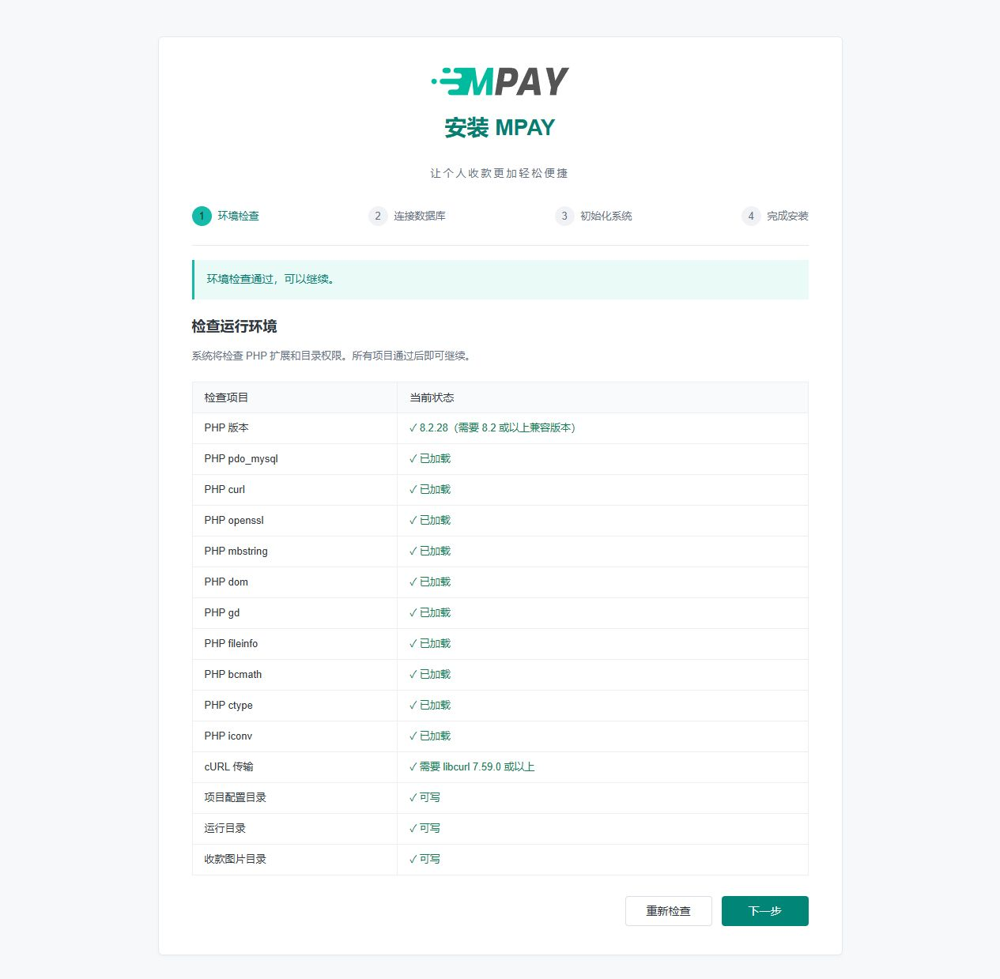
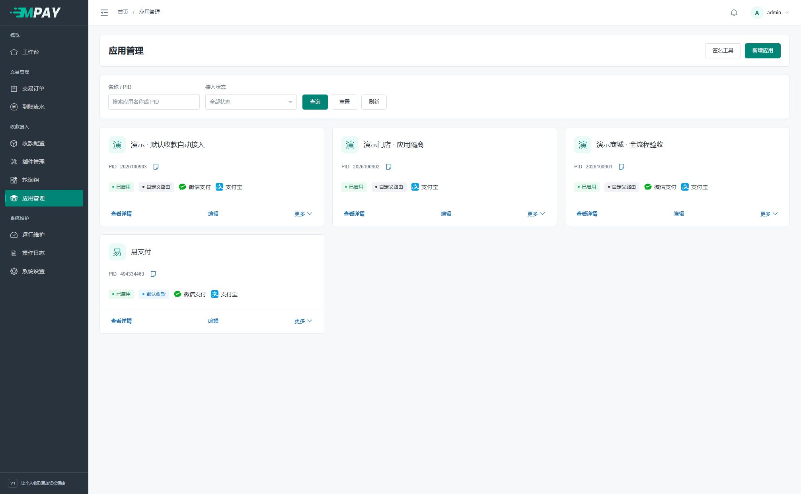
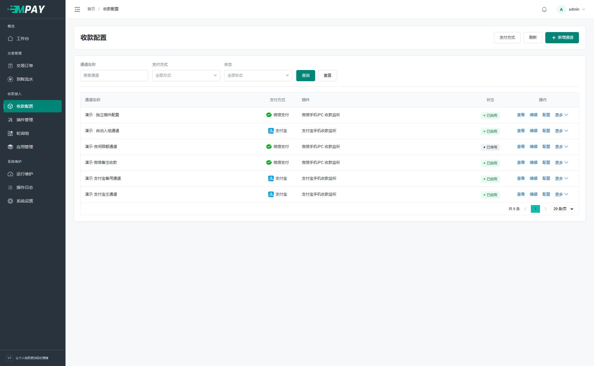
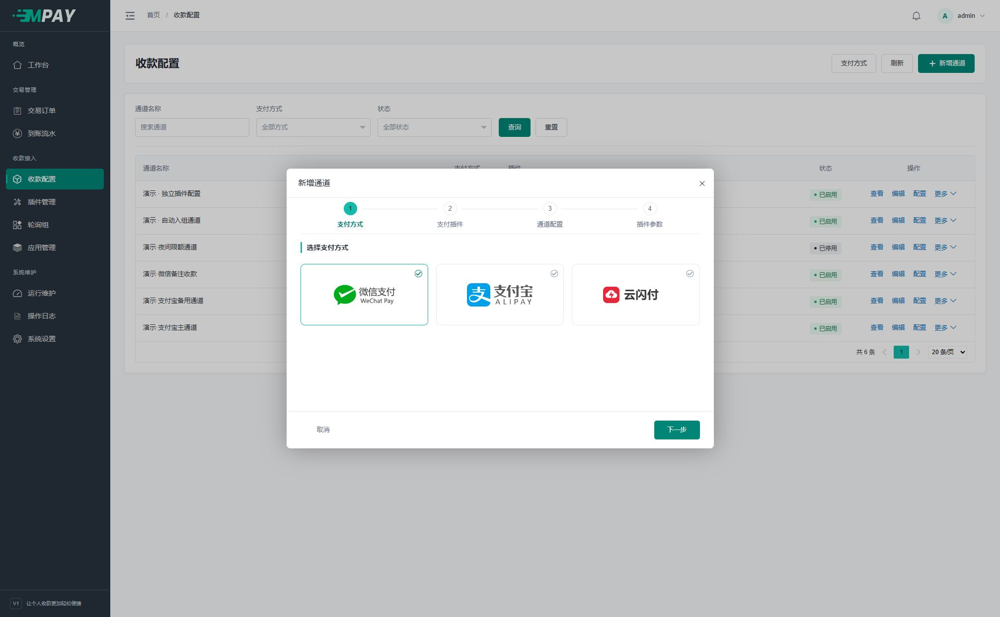
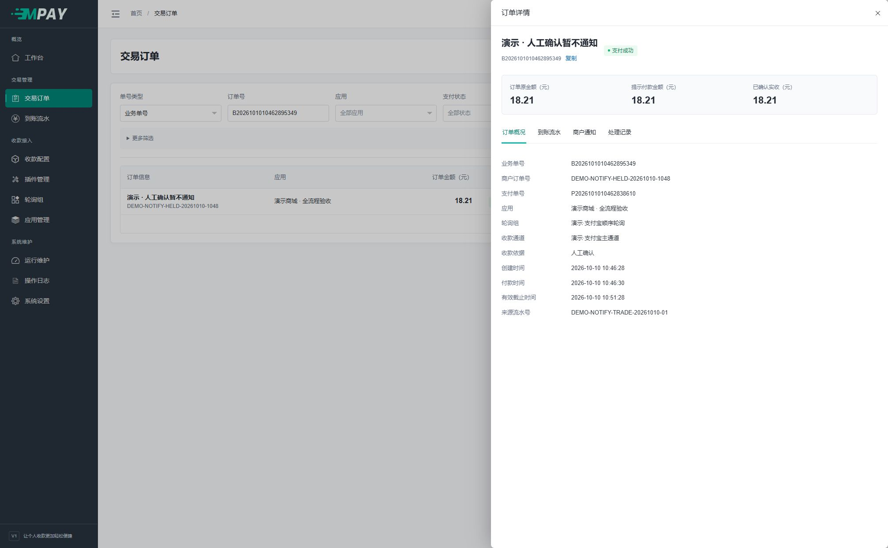
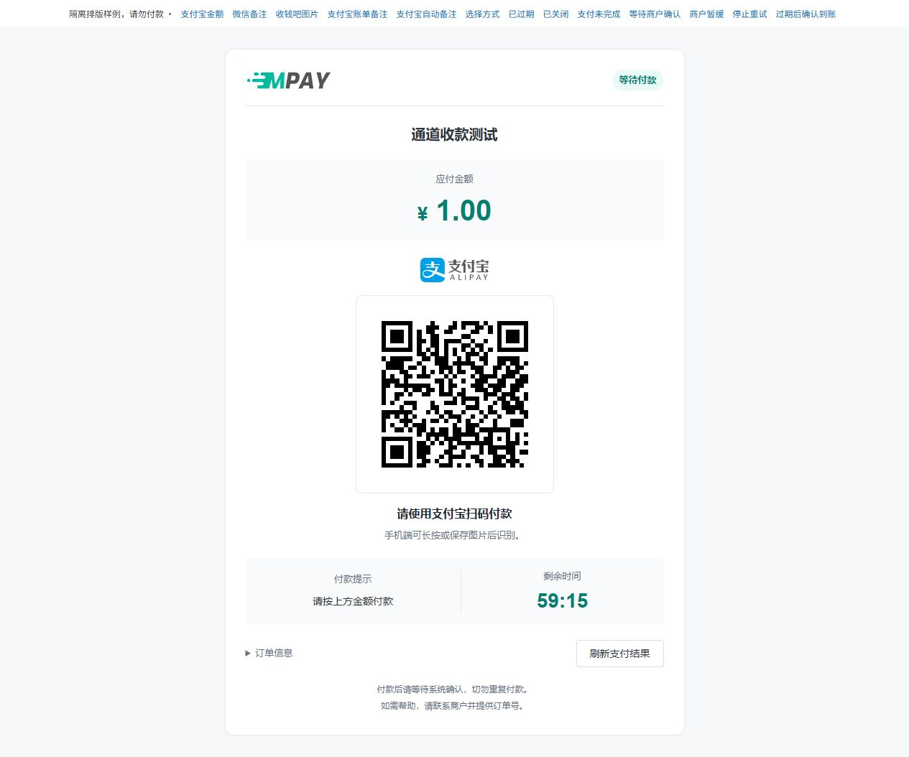
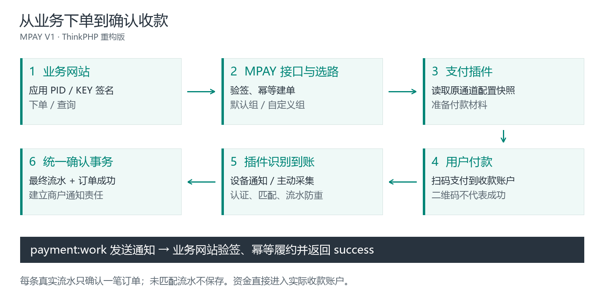

<p align="center">
  
</p>

<h1 align="center">MPAY · 码支付 V1</h1>
<p align="center"><strong>让个人收款更加轻松便捷</strong></p>
<p align="center">收款码接入 · 多应用管理 · 通道路由 · 订单核对 · 商户通知</p>
<p align="center">
  
</p>
<p align="center">
  <a href="docs/wiki/V1-01-开始阅读.md"><strong>新手上手路线</strong></a> ·
  <a href="#online-demo"><strong>在线演示</strong></a> ·
  <a href="#web-install"><strong>网页安装</strong></a> ·
  <a href="#screenshots">界面预览</a> ·
  <a href="https://gitee.com/technical-laohu/mpay/wikis/Home">Gitee 文档</a> ·
  <a href="https://github.com/techhaha/mpay/wiki">GitHub 文档</a>
</p>

---

## ✨ 项目介绍

**MPAY 是面向个人或单一收款主体的收款管理系统。** 它把收款码、到账识别、订单查询和网站付款通知串联起来，让支持易支付 V1 的商城、发卡站或其他业务网站使用统一的收款入口。

资金直接进入实际微信、支付宝或收款服务商账户。MPAY 负责记录、核对和通知，不托管余额、不进行资金清算。你可以为多个业务网站分别创建应用，每个应用拥有独立 PID/KEY、订单记录和收款路由。

| 🧭 更容易开始 | 🧩 按需扩展 | 🔎 过程可查询 |
| --- | --- | --- |
| 网页安装，默认应用与轮询组自动创建；配置一个通道即可开始接入 | 四个内置监听插件，通道参数独立；后续再配置限额、时段和轮询策略 | 从原订单查看到账依据、通知响应与人工处理记录，方便定位问题 |

> **版本说明**：本文对应 `v1` 分支的 ThinkPHP 重构版，目前为开发版本。旧版发行包、MPAY V2 与本版的安装和数据结构不同，请先核对版本。真实设备及平台接入仍需按自己的账号、权限和客户端完成联调。

<a id="online-demo"></a>

## 🌐 在线演示

无需安装，可先登录演示站点体验管理后台。

| 项目 | 内容 |
| --- | --- |
| 演示地址 | [https://mpay-v1.qcjy.cc](https://mpay-v1.qcjy.cc) |
| 登录账号 | `admin` |
| 登录密码 | `Aa12345678910` |

以上账号仅用于演示站点；自行安装时，在网页安装向导中设置自己的管理员账号和密码。

## 📍 从哪里开始

| 你现在要做什么 | 直接阅读 |
| --- | --- |
| 第一次使用，想按步骤配置 | [新手上手路线](docs/wiki/V1-01-开始阅读.md) → [准备资料与名词](docs/wiki/新手-准备资料与名词.md) |
| 已经有服务器，准备安装 | [宝塔建站准备](docs/wiki/新手-宝塔建站准备.md) → [网页安装图文](docs/wiki/V1-03-安装与环境要求.md) |
| 已安装，要配置收款 | [新增通道](docs/wiki/V1-06-收款通道与支付方式.md) → [应用与凭证](docs/wiki/V1-05-应用与接入凭证.md) → [第一笔收款](docs/wiki/V1-04-完成第一笔收款.md) |
| 商城需要填写支付接口 | [业务网站接入](docs/wiki/V1-15-业务网站接入.md) · [易支付 V1 接口参考](docs/wiki/V1-16-易支付V1接口参考.md) |
| 买家已付款，订单或商城没更新 | [订单与到账流水](docs/wiki/V1-09-订单与到账流水.md) · [商户通知排查](docs/wiki/V1-10-商户通知与人工处理.md) |

## ⚙️ 功能概览

| 模块 | 主要功能 |
| --- | --- |
| **网页安装** | 环境检查、数据库连接、自动建表、管理员初始化、默认应用与默认组、中断续装 |
| **工作台** | 按日期和应用查看订单金额、确认实收、创建数量、成功率及待处理事项 |
| **应用管理** | 每个网站独立 PID/KEY；允许域名、凭证查看与重置、默认或自定义收款路由 |
| **收款配置** | 四步新增通道，通用配置与插件参数分别编辑；在“更多 → 测试”选择应用和金额即可核对通道收款 |
| **通道路由** | 顺序轮询、权重随机、默认优先；单笔范围、每日额度、每日笔数和可用时段 |
| **收银台** | 可用支付方式选择、二维码展示、准确付款金额、付款备注和支付状态查询 |
| **订单与流水** | 按应用、日期、单号等筛选，订单导出，最终到账证据，人工确认及本地关闭 |
| **商户通知** | 自动重试、暂缓与放行、立即发送及单次补发；保存每次响应片段和首次确认记录 |
| **插件管理** | 扫描本地插件、刷新定义、启用/停用，按插件声明自动生成配置表单 |
| **运行维护** | 两个原生后台任务、运行诊断、采集状态、管理员操作日志及账户安全 |

首次使用保留默认收款路由即可。系统会自动为新应用绑定默认组，并把新通道加入对应默认组；多网站独立通道池和权重策略可以在熟悉系统后再配置。

<a id="web-install"></a>

## 📦 纯净安装包

客户安装包包含生产 `vendor/`，解压后按包内 README 配置 `public/` 运行目录并访问 `/install`，服务器无需执行 Composer。包内不含 `docs/`、开发工具、测试、站点配置、上传图片或演示数据；使用手册通过在线 Wiki 阅读。[安装包文件说明](docs/wiki/examples/install-README.md)。

当前新装只有 `database/migrations/202610140100_install.php` 一份最终基线，保留逐表进度与中断续装。仅用于空库全新安装，不是旧开发库的覆盖升级包；恢复站点应使用与备份一致的程序版本。

## 🚀 网页安装

**推荐通过浏览器完成安装。** 网站准备好以后，在自己的 MPAY 网站地址后加 `/install`，按四步向导操作。

### 1. 准备程序、网站和数据库

1. 使用明确对应本版的纯净安装包，或从 [Gitee v1 分支](https://gitee.com/technical-laohu/mpay/tree/v1/) / [GitHub v1 分支](https://github.com/techhaha/mpay/tree/v1)取得源码，上传并解压到独立网站目录。纯净安装包已含生产依赖，源码包需按第 3 步准备依赖。
2. 创建 MPAY 专用空数据库，保存地址、端口、库名、用户名和密码。
3. 确认 PHP、扩展和依赖满足[环境要求](#requirements)。源码没有 `vendor` 时，先按[依赖准备](docs/wiki/V1-03-安装与环境要求.md#源码部署的依赖准备)安装锁定依赖。
4. 将网站运行目录设置为程序下的 `public`，配置本站路由和实际 HTTP 或 HTTPS 地址；正式访问建议配置 HTTPS。使用宝塔可跟随[建站图文教程](docs/wiki/新手-宝塔建站准备.md)。

**包含 `think`、`app`、`public` 的那一级是程序目录，`public` 是网站运行目录。** 当前源码分支不等于已经打包好依赖的正式发行包，勿使用旧版下载包套用本教程。

**使用宝塔时，可按下面的页面顺序配置；完整配图、可复制规则和故障定位见[宝塔部署教程](docs/wiki/新手-宝塔建站准备.md)：**

| 宝塔入口 | 设置内容 |
| --- | --- |
| 网站 → PHP 项目 → 添加站点 | 选择传统 PHP 项目、PHP 8.2+，同时创建 MySQL 专用空库 |
| 网站根目录 → 文件管理 | 上传解压，确认 think、app、public、vendor 位于同一级 |
| 站点设置 → 网站目录 | 网站目录指向程序所在层，运行目录选择 **`/public`** 并保存 |
| 站点设置 → 伪静态 | 用[本版 Nginx 规则](docs/wiki/新手-宝塔建站准备.md#5-配置伪静态)整体替换编辑框内容并保存；不要包裹 `location /` |
| 浏览器 | 打开自己的 `域名/install`，网址中不加 `/public` |

### 2. 打开安装页面，完成四步向导

例如你的 MPAY 域名是 `pay.example.com`，在浏览器打开：

```text
https://pay.example.com/install
```

| 步骤 | 页面操作 | 完成结果 |
| --- | --- | --- |
| **① 环境检查** | 核对检查项，通过后点击“下一步” | 进入数据库设置 |
| **② 连接数据库** | 填写空库连接资料，点击“检查连接并继续” | 数据库检查通过 |
| **③ 初始化系统** | 设置管理员账号和密码，点击“立即安装” | 程序建表并保存初始化配置 |
| **④ 完成安装** | 点击“进入管理后台”，使用刚设置的账号登录 | 工作台可打开，默认应用与默认组已创建 |

<p align="center">
  <a href="docs/wiki/assets/tutorial/install-environment.jpg"></a>
</p>
<p align="center">网页安装向导 · 点击图片查看原图</p>

**无需手动导入 SQL、填写 `.env` 或执行数据库初始化命令。** 每个输入框的来源、四步截图及失败处理见[网页安装详细教程](docs/wiki/V1-03-安装与环境要求.md)。

### 3. 配置通道、后台任务和业务网站

1. 在“收款配置”新增并启用通道，完成对应手机转发或账单查询设置。
2. 按[后台任务指南](docs/wiki/V1-18-部署与后台任务.md)添加两个守护任务，分别负责流水采集、通知与维护。
3. 在“应用管理”使用默认应用，填写业务网站允许域名，将地址、PID、KEY 填入业务网站。
4. 从业务网站创建一笔订单，按[第一笔收款教程](docs/wiki/V1-04-完成第一笔收款.md)核对三个结果：**实际账户到账、MPAY 支付成功、业务网站处理成功**。

配置完成后，可先在通道列表点击“更多 → 测试”，选择应用并输入金额进入收银台。发起后就是普通订单，商品名为“通道收款测试”；业务网站接入仍需按[第一笔收款](docs/wiki/V1-04-完成第一笔收款.md)核对完整流程。

<a id="screenshots"></a>

## 🖼️ 界面预览

以下均为实际界面与隔离演示数据。点击图片可查看原图；图中的二维码、地址和凭证示例不能用于真实收款。

| 工作台 · 统计与待办 | 应用管理 · 每个网站独立接入 |
| --- | --- |
| [](docs/wiki/assets/dashboard.jpg) | [](docs/wiki/assets/applications.jpg) |

| 收款配置 · 通道与插件 | 通道向导 · 分步填写 |
| --- | --- |
| [](docs/wiki/assets/channels.jpg) | [](docs/wiki/assets/channel-wizard.jpg) |

| 订单详情 · 到账与通知 | 收银台 · 金额与付款提示 |
| --- | --- |
| [](docs/wiki/assets/order-detail.jpg) | [](docs/wiki/assets/tutorial/cashier-alipay.jpg) |

## 🧩 选择收款方案

**收款码用于展示，手机通知或账单查询用于识别到账。** 先选择与你现有资料相符的一种方案，不需要一次配置全部插件。

| 内置插件 | 支持方式 | 需要准备 | 逐步教程 |
| --- | --- | --- | --- |
| **微信手机/PC 收款监听** | 微信支付 | 本人收款码、兼容通知工具及通知密钥；PC 需适配消息格式 | [微信配置](docs/wiki/V1-11-微信手机与PC监听.md) |
| **支付宝手机收款监听** | 支付宝 | 本人收款码、接收到账通知的安卓手机及通知密钥 | [手机配置](docs/wiki/V1-12-支付宝手机监听.md) |
| **支付宝账单收款** | 支付宝 | 可查询账单的应用、账单账号与 RSA2 凭证 | [账单配置](docs/wiki/V1-13-支付宝账单收款.md) |
| **收钱吧码牌收款** | 微信支付、支付宝 | 能查询流水的账号、商户/门店资料及对应码牌 | [码牌配置](docs/wiki/V1-14-收钱吧码牌收款.md) |

云闪付使用 `unionpay` 编码，当前没有内置适配插件，启用支付方式并不会自动获得收款能力。当前四个监听插件均不支持接口原路退款；退款请求是否支持，由原订单插件决定。

四个插件均提供金额和手动备注识别，实际备注须由设备或平台流水返回。支付宝账单另有“自动填写金额和备注”入口；查看[匹配方式说明](docs/wiki/V1-13-支付宝账单收款.md#选择匹配方式)。识别值按通道分配，同账号多通道只合并登录/查单，流水归属不明确时不强行确认。

## 🔗 业务网站接入

MPAY 对外使用 **易支付 V1**。已有兼容模块的业务网站，通常只需填写下面三项；无需自行编写签名程序。

| 业务网站中的字段 | 从 MPAY 哪里取得 |
| --- | --- |
| 接口地址 / 网关地址 | 应用详情“接入信息”；按模块要求填写根地址或完整下单地址 |
| 商户 ID / PID | 当前应用卡片或详情中的 PID |
| 商户密钥 / KEY | 同一应用的“凭证管理”，经管理员密码复核后复制 |

应用中的允许域名填写**业务网站的通知及返回域名**。应用 KEY、手机通知密钥和管理员密码分别用于不同场景，不能混用。

| 接口入口 | 用途 |
| --- | --- |
| `/submit.php` | 页面下单并跳转收银台 |
| `/mapi.php` | API 下单并获得付款信息 |
| `/api.php` | 应用/订单查询及原插件支持的动作 |

业务网站收到通知后，需要验签、核对原订单和金额、避免重复处理，再返回小写纯文本 `success`。二维码展示、HTTP 成功和浏览器回跳都不能单独证明付款成功。

继续阅读：[业务网站接入](docs/wiki/V1-15-业务网站接入.md) · [完整接口参数](docs/wiki/V1-16-易支付V1接口参考.md) · [通知验签与排障](docs/wiki/V1-17-通知验签与联调排障.md)。

<a id="requirements"></a>

## 🛠️ 运行环境与后台任务

### 最低环境要求

| 项目 | 要求 |
| --- | --- |
| **PHP** | 64 位 PHP **8.2 及以上**，并满足锁定依赖，不限定补丁版本 |
| **MySQL** | **5.7.9 及以上**，InnoDB / utf8mb4；5.7.44 可以使用 |
| **PHP 扩展** | pdo_mysql、curl、openssl、mbstring、dom、gd、fileinfo、bcmath、ctype、iconv |
| **libcurl** | 7.59.0 及以上 |
| **Web 服务** | Nginx 或 Apache，运行目录指向 `public`；支持 HTTP / HTTPS，正式访问建议使用 HTTPS |
| **后台运行** | Supervisor 或 systemd，分别守护采集与通知两个原生 PHP 命令 |

页面由 ThinkPHP 渲染，Layui 及品牌素材随程序本地交付。部署无需 Node 前端构建服务，也不需要 Redis、消息队列或 Workerman。Web PHP 与命令行 PHP 都需要满足依赖。

### 两个常驻入口

```sh
/path/to/php /path/to/mpay/think payment:watch
/path/to/php /path/to/mpay/think payment:work
```

`/path/to/` 是路径占位符。按[路径填写与守护配置](docs/wiki/V1-18-部署与后台任务.md#准备命令中的路径)复制实际路径，每个任务只填写一条完整命令。

| 任务 | 负责什么 |
| --- | --- |
| `payment:watch` | 按待核对订单采集支付宝账单、收钱吧流水；由插件协调账号及低频登录保活 |
| `payment:work` | 商户通知发送与重试、订单过期及例行维护 |

两个命令默认持续运行，不需要添加时长参数；更新程序或环境配置后应重启任务。进程守护负责退出后重启，不再增加每分钟重复启动的计划任务。网页安装完成后无需重新执行数据库初始化。

使用宝塔可直接跟随[常驻进程配置图文](docs/wiki/V1-18-部署与后台任务.md#用进程守护工具添加任务)：安装进程守护管理器，分别添加 `payment_work`、`payment_watch`，两个任务的启动用户均选 `www`，与网站 PHP 运行用户保持一致，每个进程数量设为 1，再核对 RUNNING 状态和日志。

## 📚 文档导航

完整手册：[Gitee Wiki](https://gitee.com/technical-laohu/mpay/wikis/Home) · [GitHub Wiki](https://github.com/techhaha/mpay/wiki) · [仓库内文档](docs/wiki/Home.md)。

| 阅读目标 | 推荐资料 |
| --- | --- |
| **安装与上手** | [资料准备](docs/wiki/新手-准备资料与名词.md) · [宝塔建站](docs/wiki/新手-宝塔建站准备.md) · [网页安装](docs/wiki/V1-03-安装与环境要求.md) · [第一笔收款](docs/wiki/V1-04-完成第一笔收款.md) |
| **应用与收款配置** | [应用和凭证](docs/wiki/V1-05-应用与接入凭证.md) · [通道](docs/wiki/V1-06-收款通道与支付方式.md) · [插件](docs/wiki/V1-07-插件管理与配置约定.md) · [默认路由](docs/wiki/V1-08-默认路由与轮询策略.md) |
| **日常运营** | [订单与流水](docs/wiki/V1-09-订单与到账流水.md) · [商户通知和人工处理](docs/wiki/V1-10-商户通知与人工处理.md) · [系统设置与账户安全](docs/wiki/V1-29-后台设置与日常检查.md) |
| **部署维护** | [后台任务](docs/wiki/V1-18-部署与后台任务.md) · [备份恢复和域名迁移](docs/wiki/V1-19-备份恢复与域名迁移.md) · [常见问题](docs/wiki/V1-20-常见问题与运行排查.md) · [版本更新](docs/wiki/V1-28-版本更新与文档维护.md) |
| **接口与二次开发** | [接口参考](docs/wiki/V1-16-易支付V1接口参考.md) · [目录结构](docs/wiki/V1-21-开发环境与目录结构.md) · [插件开发](docs/wiki/V1-23-支付插件开发.md) · [config_schema](docs/wiki/V1-24-config-schema字段规则.md) |

## 💬 常见问题

**只有一张收款码就能自动确认付款吗？**

还需要手机通知转发或账单查询提供到账信息。二维码和通道启用状态只表示配置与展示条件，不代表已验证真实收款。

**为什么收银台提示金额可能比商城订单略高？**

金额识别模式可能分配不同提示金额来区分同金额订单。付款者按收银台显示值付款，通知业务网站仍使用原订单金额；具体说明见[插件配置约定](docs/wiki/V1-07-插件管理与配置约定.md)。

**MPAY 已成功，商城为什么还没有更新？**

从原订单“商户通知”查看是否暂缓、发送记录和对方响应。先修复通知目标或商城处理问题，再按状态执行通知操作，不要让买家重复付款。

**多个业务网站一定要分别配置通道和轮询组吗？**

不需要。各应用可以使用默认组中的同一批通道，订单和 PID/KEY 分开管理；需要独立通道池时再切换自定义路由。

**能直接把旧版或 V2 数据库导入本版吗？**

不能直接套用。程序和数据结构不同，应使用本版的新装流程；已有站点的版本更新与恢复按对应版本说明执行。

## 🧱 开发与扩展

支付链路由接入、选路、插件执行、到账核对和通知几部分组成：



Controller 处理入口，Validator 校验输入，Service 编排业务，Repository/Model 负责持久化。插件声明配置并解释平台协议，SDK 封装平台请求。订单成功、最终流水和商户通知由服务层统一确认。

```text
app/
  http/                    控制器、入口验证器与中间件
  service/payment/         下单、路由、插件调用、采集、通知与生命周期
  repository/              查询、锁及持久化
  model/                   表映射与关联
  common/payment/          四个独立支付插件
  common/interface/        支付动作、HTTP 通知与主动采集三个接口
  common/sdk/              平台 SDK
  command/                 安装、诊断与两个后台任务
config/                    应用配置
database/migrations/       最终新装基线及建表定义
public/                    网站入口、Layui、主题与品牌素材
view/                      安装、后台和收银台模板
docs/wiki/                 使用手册、接口及开发文档
```

扩展前阅读[支付链路与数据约定](docs/wiki/V1-22-支付链路与数据约定.md)、[插件开发](docs/wiki/V1-23-支付插件开发.md)、[收银台页面与扩展](docs/wiki/V1-30-收银台页面与扩展.md)和[数据字典](docs/wiki/V1-27-数据库表与字段字典.md)。修改接口、配置或页面操作时，同步 `docs/wiki`；文档维护流程见[Wiki 同步说明](docs/wiki/tools/README.md)。

## 🌐 项目地址与反馈

| 平台 | 源码 | 使用文档 | 问题反馈 |
| --- | --- | --- | --- |
| **Gitee** | [technical-laohu/mpay · v1](https://gitee.com/technical-laohu/mpay/tree/v1/) | [Gitee Wiki](https://gitee.com/technical-laohu/mpay/wikis/Home) | [提交问题](https://gitee.com/technical-laohu/mpay/issues) |
| **GitHub** | [techhaha/mpay · v1](https://github.com/techhaha/mpay/tree/v1) | [GitHub Wiki](https://github.com/techhaha/mpay/wiki) | [提交问题](https://github.com/techhaha/mpay/issues) |

反馈时提供版本、操作步骤、发生时间、请求编号及脱敏提示。可复制[问题反馈模板](docs/wiki/V1-20-常见问题与运行排查.md#发起问题反馈)，不要公开应用 KEY、平台密码、`.env` 或完整数据库。

## ❤️ 开源致谢与许可

| 项目 | 在 MPAY 中的用途 |
| --- | --- |
| [ThinkPHP](https://www.thinkphp.cn/) | Web 框架、路由、容器、ORM 与输入验证 |
| [Layui](https://layui.dev/) | 后台表格、表单、弹层、日期及基础 UI 组件 |
| [Guzzle](https://docs.guzzlephp.org/) | 平台请求与商户通知的 HTTP 客户端基础 |

感谢上游项目作者、维护者和贡献者。框架原有许可说明见 [LICENSE.txt](LICENSE.txt)，第三方组件的原有版权及许可证随源码保留。

<p align="center"><strong>MPAY · 从一笔收款开始</strong><br><a href="docs/wiki/V1-01-开始阅读.md">开始配置</a> · <a href="docs/wiki/Home.md">查阅完整文档</a></p>
