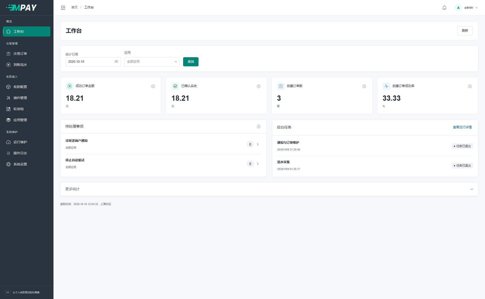

# MPAY V1 文档

**让个人收款更加轻松便捷。**

这里是 MPAY V1 **ThinkPHP 重构版**的使用与开发文档，对应代码分支 `v1`。本版目前处于开发阶段；旧版发行包及 MPAY V2 请使用各自文档。

## 你现在要做什么？

**第一次使用，先打开[新手上手路线](V1-01-开始阅读.md)。** 每一步都有操作入口和完成检查；先配置一个网站、一种收款方式，后面的接口和开发章节按需要阅读。

| 你的情况 | 从这里开始 |
| --- | --- |
| 第一次使用，不知道先做什么 | [新手上手路线](V1-01-开始阅读.md) |
| 网站和空数据库已准备好 | [网页安装四步](V1-03-安装与环境要求.md) |
| 已安装，想接入自己的商城 | [应用与凭证](V1-05-应用与接入凭证.md) → [业务网站接入](V1-15-业务网站接入.md) |
| 已配置通道，想先试一笔付款 | [收款配置 → 更多 → 测试](V1-06-收款通道与支付方式.md#快速测试当前通道) |
| 已经收款，商城没有更新 | [查看商户通知](V1-10-商户通知与人工处理.md) → [按现象排查](V1-20-常见问题与运行排查.md) |
| 配置后台任务，不知道路径怎么填 | [路径与命令填写](V1-18-部署与后台任务.md#准备命令中的路径) |
| 修改系统设置、账户密码或查看统计 | [后台设置与日常检查](V1-29-后台设置与日常检查.md) |
| 想开发接口或插件 | [开发入口](V1-21-开发环境与目录结构.md) |

安装会创建默认应用和默认轮询组。新增并启用通道后，即可使用默认收款路由，不需要先配置复杂的通道分组。

## 开始使用

- [01 · 新手上手路线](V1-01-开始阅读.md)
- [准备资料与名词](新手-准备资料与名词.md)
- [宝塔建站准备](新手-宝塔建站准备.md)
- [02 · 项目介绍与能力清单](V1-02-项目介绍与能力清单.md)
- [03 · 网页安装与环境要求](V1-03-安装与环境要求.md)
- [04 · 完成第一笔收款](V1-04-完成第一笔收款.md)

## 日常管理

- [05 · 应用与接入凭证](V1-05-应用与接入凭证.md)
- [06 · 收款通道与支付方式](V1-06-收款通道与支付方式.md)
- [07 · 插件管理与配置约定](V1-07-插件管理与配置约定.md)
- [08 · 默认路由与轮询策略](V1-08-默认路由与轮询策略.md)
- [09 · 订单与到账流水](V1-09-订单与到账流水.md)
- [10 · 商户通知与人工处理](V1-10-商户通知与人工处理.md)
- [29 · 后台设置与日常检查](V1-29-后台设置与日常检查.md)

## 配置收款插件

- [11 · 微信手机与PC监听](V1-11-微信手机与PC监听.md)
- [12 · 支付宝手机监听](V1-12-支付宝手机监听.md)
- [13 · 支付宝账单收款](V1-13-支付宝账单收款.md)
- [14 · 收钱吧码牌收款](V1-14-收钱吧码牌收款.md)

## 业务网站接入

- [15 · 业务网站接入](V1-15-业务网站接入.md)
- [16 · 易支付V1接口参考](V1-16-易支付V1接口参考.md)
- [17 · 通知验签与联调排障](V1-17-通知验签与联调排障.md)

## 部署与维护

- [18 · 部署与后台任务](V1-18-部署与后台任务.md)
- [19 · 备份恢复与域名迁移](V1-19-备份恢复与域名迁移.md)
- [20 · 常见问题与运行排查](V1-20-常见问题与运行排查.md)

## 开发与扩展

以下面向接入或插件开发者，日常使用无需先阅读。

- [21 · 开发环境与目录结构](V1-21-开发环境与目录结构.md)
- [22 · 支付链路与数据约定](V1-22-支付链路与数据约定.md)
- [23 · 支付插件开发](V1-23-支付插件开发.md)
- [24 · config-schema字段规则](V1-24-config-schema字段规则.md)
- [25 · 主动采集与会话协作](V1-25-主动采集与会话协作.md)
- [26 · 前端组件与主题](V1-26-前端组件与主题.md)
- [27 · 数据库表与字段字典](V1-27-数据库表与字段字典.md)
- [28 · 版本更新与文档维护](V1-28-版本更新与文档维护.md)

## 版本与反馈

- [Gitee V1 源码](https://gitee.com/technical-laohu/mpay/tree/v1/) · [GitHub V1 源码](https://github.com/techhaha/mpay/tree/v1)
- [Gitee 问题反馈](https://gitee.com/technical-laohu/mpay/issues) · [GitHub 问题反馈](https://github.com/techhaha/mpay/issues)
- [旧版使用百问百答](旧版-使用百问百答.md)：原文归档，仅供旧版安装查阅。

反馈问题时请提供程序版本、操作步骤、请求编号和脱敏错误信息；不要上传 KEY、平台密码、完整数据库或未脱敏日志。截图均为演示数据，不代表真实平台验收结果。
