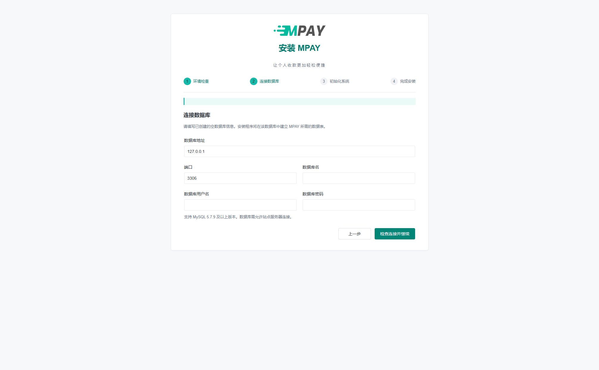
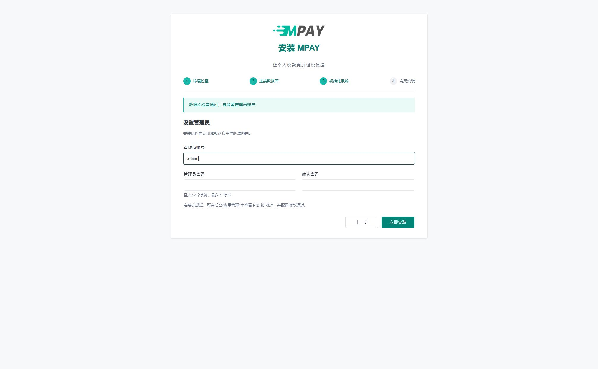
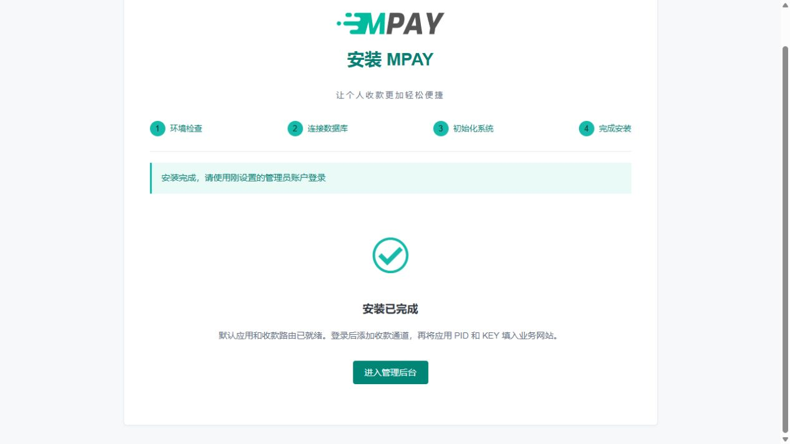
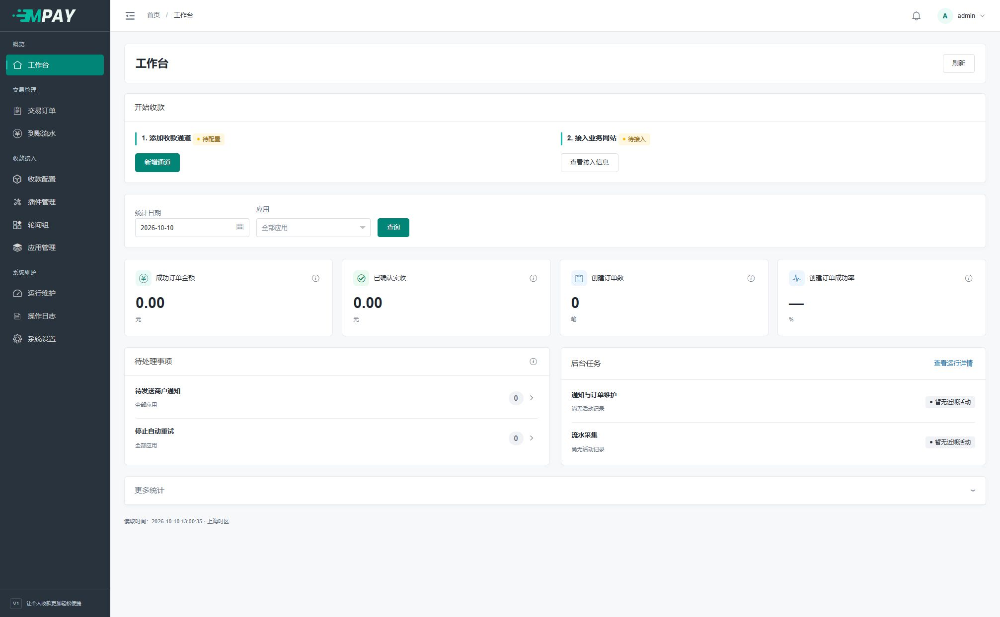

# 安装指南

本文适用于 ThinkPHP 重构版。默认分支和旧发行包可能对应旧程序，请先核对程序版本。MPAY 提供网页安装向导。准备网站和数据库后，访问站点的 `/install` 即可开始。

还没有创建网站和数据库时，先按[宝塔建站准备](新手-宝塔建站准备.md)逐步完成；不使用宝塔的部署者可直接看[Web 服务器配置](V1-18-部署与后台任务.md#web-服务器)。

## 环境要求

| 项目 | 要求 |
| --- | --- |
| PHP | 64 位 PHP 8.2 及以上，并满足 composer.lock 中的依赖要求 |
| MySQL | 5.7.9 及以上，使用 InnoDB 和 utf8mb4；不以 MariaDB 替代 |
| PHP 扩展 | pdo_mysql、curl、openssl、mbstring、dom、gd、fileinfo、bcmath、ctype、iconv |
| libcurl | 7.59.0 及以上 |
| 网站运行目录 | 程序根目录下的 public |
| 可写目录 | runtime、public/storage；安装时还需允许保存站点配置 |

版本要求为最低版本，不绑定某个补丁版本。MySQL 5.7.44 满足要求。安装前应使用站点实际运行的 PHP 检查依赖；Web 与命令行 PHP 可能使用不同配置。

从源码部署时，在项目根目录运行：

```sh
composer install --no-dev --prefer-dist --no-interaction
composer check-platform-reqs --no-dev
```

使用项目附带的 composer.lock 安装依赖。网站重写、HTTPS 和进程守护配置见[部署指南](V1-18-部署与后台任务.md)。

## 第一步：打开安装页面

先完成网站、PHP 和空数据库准备；不理解这些名字时，先看[准备资料](新手-准备资料与名词.md)。网站运行目录必须是程序下面的 public。

在浏览器地址栏输入你的 MPAY 网站地址，末尾加 `/install`。例如你的 MPAY 域名为 pay.example.com，地址是：

```text
https://pay.example.com/install
```

这里是 MPAY 网站，不是商城网站，也不是服务器面板地址。需要按自己的路径生成命令时，可使用[复制命令助手](新手-复制命令助手.md)。

## 第二步：环境检查


打开页面后会自动检查，不需要点击每一行：

1. 查看“当前状态”一列。PHP 扩展应显示“已加载”，目录应显示“可写”。
2. 页面顶部出现“环境检查通过，可以继续”后，点击右下角“下一步”。
3. 若有红色失败项，先按该项目处理，再点击“重新检查”。例如缺少 pdo_mysql，应在网站实际使用的 PHP 中启用该扩展。

**完成结果：** 页面切换到“连接数据库”。仅在终端执行 php -v 成功，不代表网站使用的 PHP 扩展也已齐全，应以这个页面为准。

## 第三步：连接数据库



从你创建数据库时保存的资料中复制以下内容，不需要自己写 SQL：

| 输入框 | 填入什么 | 容易填错的地方 |
| --- | --- | --- |
| 数据库地址 | 数据库所在服务器的地址 | 数据库与网站同机时常用 127.0.0.1；在另一台服务器时填那台服务器的地址 |
| 端口 | 数据库实际监听端口 | 常见为 3306；以创建时的配置为准，不抄教程演示端口 |
| 数据库名 | 为 MPAY 创建的空数据库名称 | 不是网站域名，也不是管理员账号 |
| 数据库用户名 | 该数据库的登录用户名 | 即使与库名相同，也要分别复制到各自输入框 |
| 数据库密码 | 创建数据库时设置的密码 | 不是宝塔密码，也不是接下来设置的 MPAY 管理员密码 |

填写完成，点击“检查连接并继续”。此时只检查连接和库内情况，还没有创建管理员。

**完成结果：** 显示“数据库检查通过，请设置管理员账户”，并进入“初始化系统”。失败时先核对地址、端口、账号和数据库是否为空，不要反复换库名试错。

## 第四步：设置管理员



1. 在“管理员账号”填写以后登录 MPAY 后台的用户名。
2. 在“管理员密码”填写你自己保存的密码，至少 12 个字符、最多 72 字节。
3. 在“确认密码”再填写一次相同的密码。复制粘贴时注意不要带上首尾空格。
4. 点击“立即安装”，保持页面打开，等待结果。

不需要在这一页填写 PID、KEY 或轮询组。系统会自动创建默认应用和默认收款路由，稍后在后台配置。

**正在安装时：** 按钮会暂时不可用，这是为避免重复提交。页面超时或网络断开时，保留原数据库，使用“检查安装结果”，不要清空已经建立的表。

## 第五步：确认完成并登录



看到“安装已完成”后，点击“进入管理后台”。


填写刚才设置的管理员账号和密码，点击“登录”。第一次进入工作台还没有交易记录，这是正常情况。



**完成检查：** 能进入工作台；“应用管理”中已有默认应用；“轮询组”中已有按支付方式建立的默认组。此时还没有可用收款通道，也没有完成真实收款。

**下一步：** 按[新增收款通道](V1-06-收款通道与支付方式.md)配置一种收款方式，随后完成[第一笔收款](V1-04-完成第一笔收款.md)。

## 安装中断与常见提示

| 情况 | 处理方式 |
| --- | --- |
| 环境检查未通过 | 按提示启用扩展或调整目录权限，再重新检查 |
| 数据库检查失败 | 核对数据库是否存在、连接账号、授权来源和建表权限，并查看安装日志 |
| 数据库包含业务数据 | 核对数据库名称；新装应使用空库，恢复已有站点请按备份恢复流程操作 |
| 页面超时或安装结果不明 | 保留原数据库和配置，点击“检查安装结果”；确认结果后再继续 |
| 提示已安装 | 直接访问 `/admin/login` |

安装中断后应使用同一数据库继续，避免丢失已经写入的数据和配置。程序不会自动清空已有业务数据。技术日志位于 `runtime/log`，可按错误提示中的请求编号查询。

程序按迁移文件逐张建表并记录进度。继续安装时会核对原 SQL 摘要和已建表，完成的步骤直接保留；不需要清库或删除进度文件。安装期间请勿手动修改表结构或迁移记录。

程序会先检查待建 SQL 的语法。若某步因语法错误尚未建表，更新修正版程序后可继续安装，该步进度由安装程序处理。

## 安装后配置

安装完成后安装入口自动关闭。请备份数据库、`.env`、`runtime/install.lock` 和上传图片，详见[备份与恢复](V1-19-备份恢复与域名迁移.md)。

生产站点使用 HTTPS，并确认 `APP_DEBUG=false`、`MPAY_ENV=production` 和 `COOKIE_SECURE=true`。安装向导默认使用 production，按访问协议保存 Cookie 设置；从 HTTP 切换至 HTTPS 后，应同步核对这些配置。

## 可选：命令行安装

网页安装完成后无需再执行本节。以下步骤适用于通过命令行部署的新站点，路径均需替换为实际值。

```sh
MPAY_APP=/path/to/mpay
MPAY_PHP=/path/to/php
MPAY_PRIVATE=/path/to/mpay-private
cd "$MPAY_APP"
umask 0077
install -d -m 700 "$MPAY_PRIVATE"
```

仅在 `.env` 不存在时从 `.example.env` 复制，填写数据库连接信息和必要部署选项。配置文件位于 public 之外。

```sh
chmod 600 .env
"$MPAY_PHP" think system:migrate
"$MPAY_PHP" think system:initialize --status
```

恢复已有系统时应完整恢复数据库中的应用凭证与历史版本。迁移命令会记录建表进度，中断后可重新执行；已有业务数据的数据库不适用于新装。

在 public 之外创建仅部署账户可读的 `initialize.json`：

```json
{
  "username": "管理员账号",
  "password": "替换为至少12字符的密码",
  "password_confirmation": "替换为相同密码",
  "app_name": "我的业务网站",
  "pid": "1001"
}
```

`pid` 可省略；用户名最多 64 个字符，应用名称最多 128 个字符。执行：

```sh
"$MPAY_PHP" think system:initialize --input="$MPAY_PRIVATE/initialize.json"
```

初始化完成后，妥善移除包含密码的临时输入文件。通过后台完成收款配置，并按[部署指南](V1-18-部署与后台任务.md)启动任务。

## 宝塔或类似面板的操作顺序

1. 创建独立站点和 MySQL 空数据库，记下数据库地址与账号；数据库在另一服务器时，允许来自网站服务器的连接。
2. 上传本版程序，选择满足依赖的 PHP，安装所需扩展。源码不含 vendor 时按本文 Composer 命令安装。
3. 将运行目录设置为程序的 `public`，根据[部署指南](V1-18-部署与后台任务.md)配置 Nginx/Apache 路由；不要套用 V2 Webman 反向代理模板。
4. 配置 HTTPS，浏览 `/install`，按四步向导完成安装。
5. 用进程守护配置 watch、work 两个前台命令，最后按[第一笔收款](V1-04-完成第一笔收款.md)配置业务接入。

面板的 PHP 选择只代表 Web PHP；命令行应使用该版本的完整可执行文件路径。不要因版本名称相同就假设两个环境加载了相同扩展。
