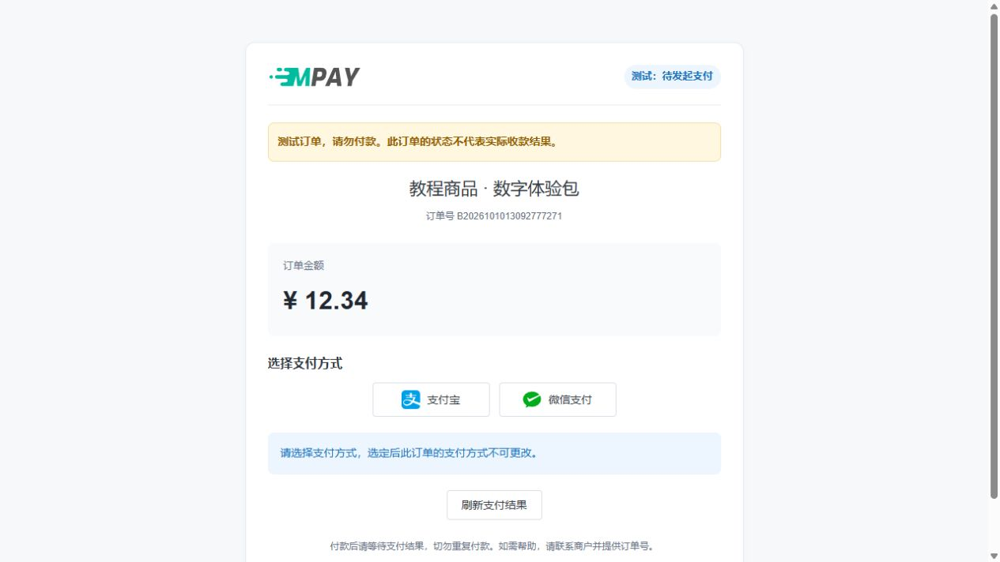
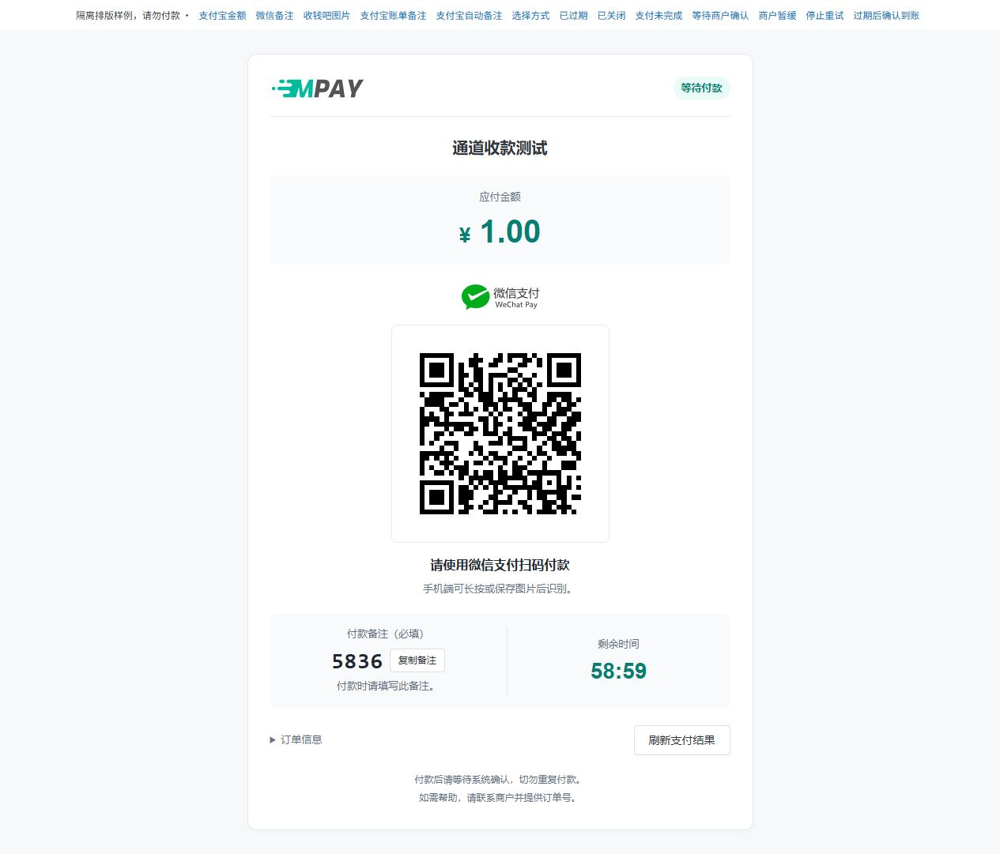
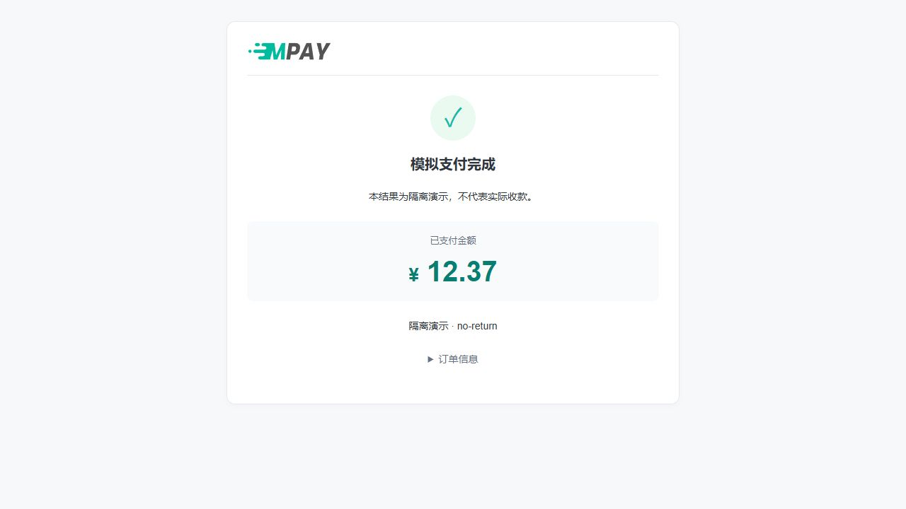

# 完成第一笔收款

刚配置通道、尚未接入业务网站时，可以先在[通道列表点击“更多 → 测试”](V1-06-收款通道与支付方式.md#快速测试当前通道)，选择应用并填写金额后进入收银台。它创建普通订单，直接使用当前通道，不经过应用路由；本篇继续核对业务网站的接入及异步通知。

目标是从你的业务网站下单，经过 MPAY 收银台付款，最后让业务网站收到正确的付款结果。第一次使用默认应用与默认轮询组即可。

**从零开始请先按[新手上手路线](V1-01-开始阅读.md)完成准备。** 本页用于把已经准备好的各环节串起来核对，后台不会自动生成教程里的演示商品和订单。

## 1. 准备收款方案

完成[网页安装](V1-03-安装与环境要求.md)及[两个后台任务](V1-18-部署与后台任务.md)的配置。选择与你实际资料相符的一种方案：

| 已有资料 | 教程 |
| --- | --- |
| 微信收款码和安卓手机，或兼容的 PC 通知工具 | [微信监听](V1-11-微信手机与PC监听.md) |
| 支付宝收款码和安卓手机 | [支付宝手机监听](V1-12-支付宝手机监听.md) |
| 可查询支付宝账单的应用与授权 | [支付宝账单](V1-13-支付宝账单收款.md) |
| 收钱吧账号及对应码牌 | [收钱吧码牌](V1-14-收钱吧码牌收款.md) |

## 2. 新增并启用通道

打开“收款配置 → 新增通道”，依次选择支付方式、支付插件，填写通道名称和插件参数。首次可保留通用策略默认值，收款码必须属于你要核对到账的账号。

点击“保存并启用”。列表应显示“已启用”，通道自动加入对应默认组，不需要先去创建轮询组。保存不成功时按表单提示修正，不要重复点击提交。

手机方案还要完成转发工具的 Server、Secret 和应用通知规则；账单/码牌方案要完成平台资料及查询配置。**仅上传收款码并启用通道，不会自动获得到账通知。** 四步表单的逐项填写见[新增通道图文](V1-06-收款通道与支付方式.md)。

## 3. 配置默认应用

打开“应用管理”，找到“默认应用”卡片：

1. 从应用卡片点击“编辑”，填写业务网站的通知/返回域名，例如 `shop.example.com`；不要填写 MPAY 自己的域名。
2. 点击“查看详情 → 收款路由”，确认仍使用默认收款，所需支付方式已有可用成员。
3. 在“接入信息”取得地址；在“凭证管理”经管理员密码复核查看 KEY。
4. 将 MPAY 地址、PID、KEY 填入你的业务网站易支付配置，详见[接入教程](V1-15-业务网站接入.md)。

## 4. 先预览选路

在应用详情的收款路由中输入准备使用的订单金额并预览。预览只检查选路，不创建订单、不推进顺序轮询游标，也不证明账号当前能收款。

无可用通道时，按[轮询策略](V1-08-默认路由与轮询策略.md)核对通道启用状态、插件、金额范围、日限额和时段。

## 5. 从业务网站发起订单

从自己的业务网站创建一笔订单，金额须满足平台和通道要求。打开收银台后核对收款方，按页面显示的金额和备注完成付款。金额识别模式下，提示金额可能比订单原金额略高；备注模式需完整填写指定备注。

若网站没有预先指定支付方式，会先出现方式选择页。点击你准备使用的支付方式进入对应收银台。

支付宝金额模式示例：重点核对“请准确支付”的金额，再扫码。下图是合成演示，图中的二维码不能用于真实收款。

微信备注模式示例：除了金额，还要点击“复制备注”，在微信实际付款页完整填写这四位备注。这里的备注每单生成，不能复制教程中的数字用于另一笔订单。

这一步会发生真实付款。先选择你能核对的一笔小额测试订单，金额要符合通道和平台的最小要求；确认收款账号后再支付。没有业务网站时先完成[业务网站接入](V1-15-业务网站接入.md)，不要直接给静态码转一笔钱代替下单。开发者可使用自己的接入测试程序，但仍需有可核对的通知接收端。

## 6. 核对三个结果

| 位置 | 应看到什么 |
| --- | --- |
| 实际收款账户 | 找到对应付款记录及金额 |
| MPAY 订单详情 | 支付成功；自动识别的订单有对应最终到账流水 |
| 业务网站 | 原订单完成业务处理；重复通知不会重复发货或记账 |

若 MPAY 成功而业务网站未更新，到订单详情“商户通知”查看发送记录和商户响应。若只有通知接收日志而订单未成功，说明消息还没有完成到账识别，按[排障指南](V1-20-常见问题与运行排查.md)检查原单。

上图中的“测试”标记表示隔离演示。正式收款必须以真实账户到账记录核对，不能用模拟消息或教程截图证明付款。

自动到账验证不要用后台“确认到账”替代；人工操作有自己的审计和通知控制，见[人工处理](V1-10-商户通知与人工处理.md)。
