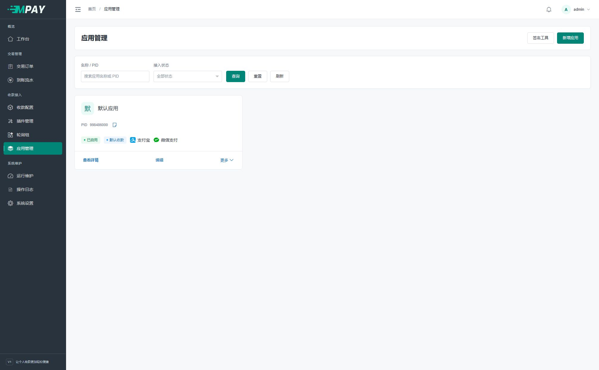
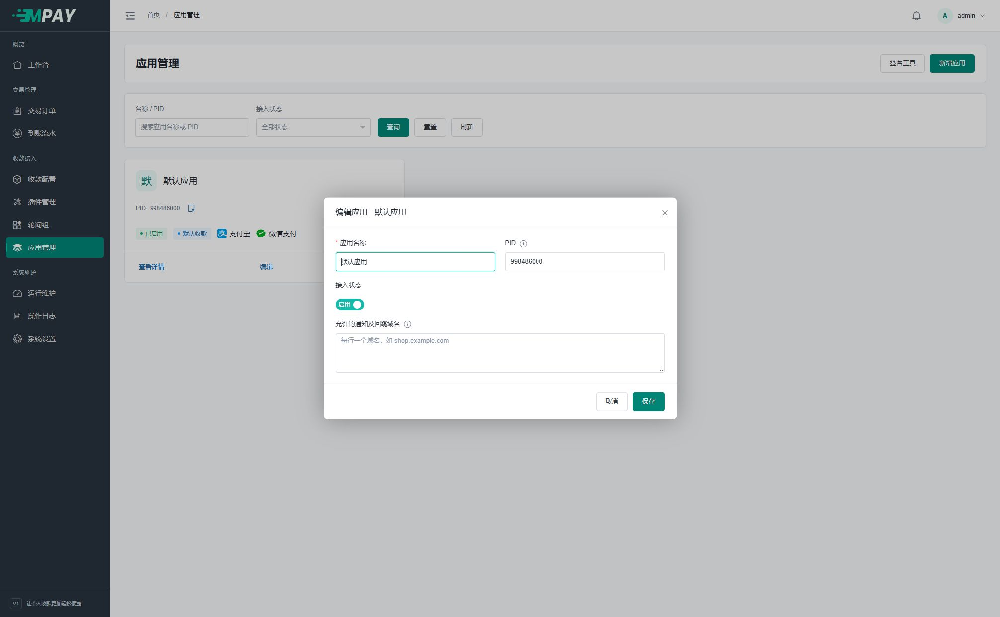
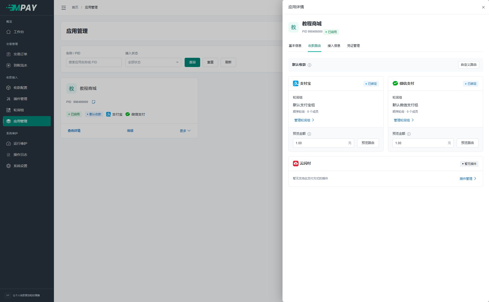
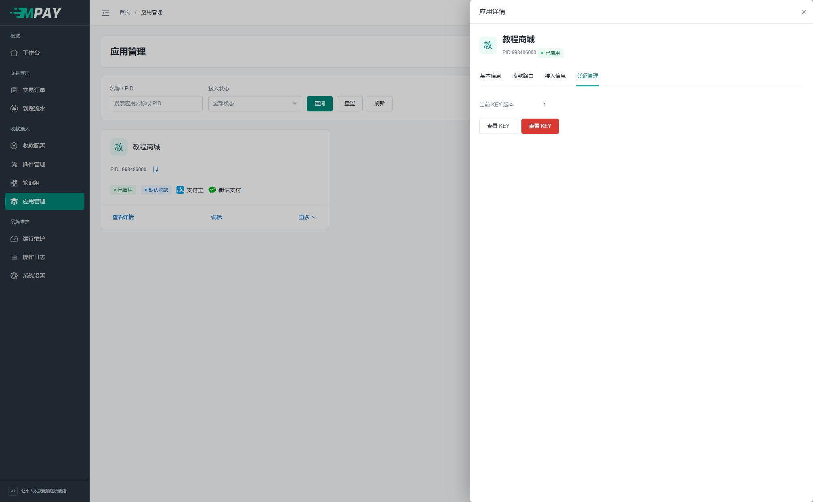
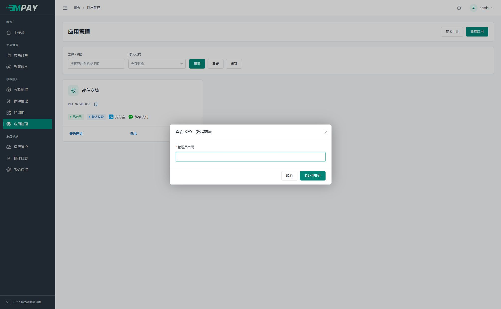
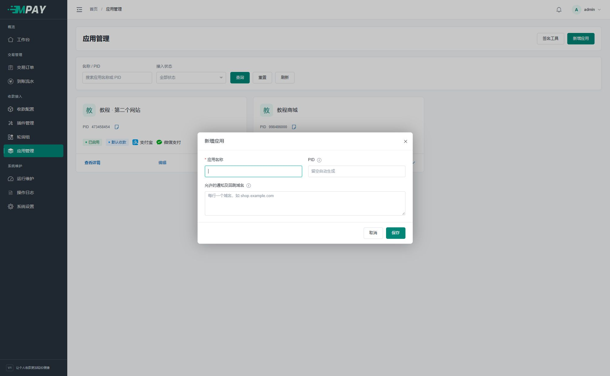

# 把业务网站接入 MPAY：应用、PID 与 KEY

“应用”是 MPAY 为你的一个业务网站保存的接入资料。比如你有一个商城，就使用一份应用资料；以后再增加另一个网站，可以为它新建另一份。

第一次安装已经有“默认应用”，先使用它即可，不必重复创建。

## 1. 找到默认应用

点击左侧“应用管理”，找到“默认应用”卡片。卡片上能看到 PID、是否启用，以及“默认收款”标记。



PID 是接入编号，不是管理员账号，也不是支付平台的账号。后面填写商城配置时，直接点击卡片上的复制按钮，不要手抄编号。

## 2. 修改应用名称和允许域名

1. 点击卡片下方“编辑”。
2. 把应用名称改为你容易识别的名字，例如“我的商城”。
3. PID 首次保持原值，接入状态保持启用。
4. “允许的通知及回跳域名”为可选项：留空或填写 `*` 表示不限域名；需要限制时，每行填写一个业务网站域名。
5. 点击右下角“保存”。



例如，商城地址是：

```text
https://shop.example.com
```

在允许域名中填写：

```text
shop.example.com
```

限定域名时，不要填写 https://、端口或页面路径，也不要填写 MPAY 自己的域名。这个字段限制 MPAY 可以把付款结果发给哪些业务网站。多个域名每行填写一个；商城实际使用 `www.shop.example.com` 时，应填写这个完整域名，不能只填 `shop.example.com` 代替，不支持 `*.example.com` 这样的子域通配。

留空或填写单独的 `*` 均不限制域名；如果同时填写 `*` 和具体域名，保存后统一为 `*`。通知和回跳地址都须符合 HTTP(S) 地址格式。通知由服务器发送，另须通过允许端口和网络目标检查；回跳由浏览器打开，不套用服务器的端口/IP 限制。

**完成检查：** 打开“查看详情 → 基本信息”，应显示保存的域名列表或“不限域名”。

## 3. 保持默认收款

打开应用详情，点击“收款路由”。第一次应看到“默认收款”，每种支付方式有独立卡片。



刚安装还没有通道，显示 0 个成员是正常现象。按[新增通道](V1-06-收款通道与支付方式.md)保存并启用后，通道会自动进入对应默认组。

不需要先点击“自定义路由”。有多个网站需要分别使用不同通道时，再阅读[轮询策略](V1-08-默认路由与轮询策略.md)。

## 4. 取得接口地址、PID 和 KEY

1. 在应用详情点击“接入信息”，取得你的网站应使用的接口地址。
2. 在应用卡片或详情复制 PID。
3. 切换“凭证管理”，点击“查看 KEY”。



4. 输入 MPAY 管理员密码，点击“验证并查看”。这里输入的是登录 MPAY 的密码，不是数据库密码。



5. 在显示的 KEY 文本框中复制完整内容，粘贴到业务网站的易支付密钥字段。
6. 完成后点击“关闭并隐藏”。页面也会在两分钟后或切换页面时隐藏 KEY。

不要为了“查看”而点击“重置 KEY”。重置会产生新的凭证，已经接入的网站也需要同步处理。

## 5. 三种密码不要混用

| 信息 | 用途 |
| --- | --- |
| 管理员账号和密码 | 登录 MPAY、确认查看 KEY 等操作 |
| 当前应用的 PID 和 KEY | 填入业务网站的易支付设置 |
| 手机通知密钥、支付宝私钥、收钱吧密码 | 填入对应通道的插件参数 |

**下一步：** 按[业务网站接入](V1-15-业务网站接入.md)把地址、PID、KEY 分别粘贴到商城对应字段。

## 添加第二个业务网站

点击“应用管理 → 新增应用”，填写新网站名称，按需设置允许域名后保存。系统生成新的 PID/KEY 并自动绑定默认组。分别向两个网站填写各自凭证，不要混用。



## 修改 PID 或重置 KEY

新请求立即使用修改后的凭证。已经创建的订单冻结原 PID、KEY 版本和通知地址，后续通知仍按旧凭证签名；业务网站需保留核验未处理旧单的密钥。

重置 KEY 需要密码复核和原因。停用应用阻止其新的接入请求，不会把既有成功订单改成未支付。处理历史订单应继续使用订单详情里的原始信息。
