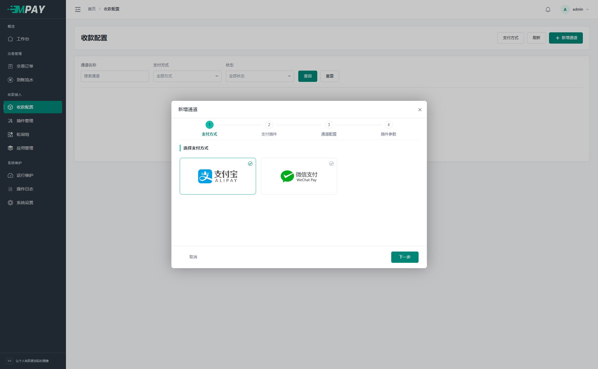
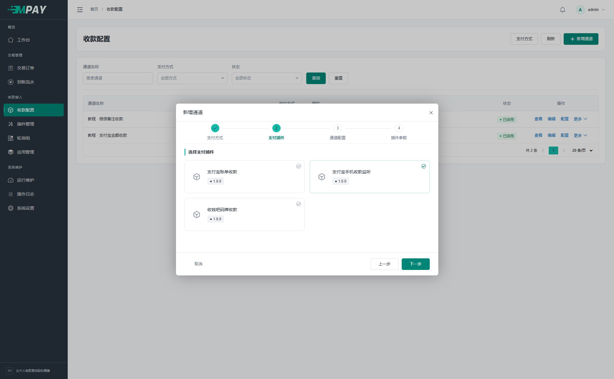
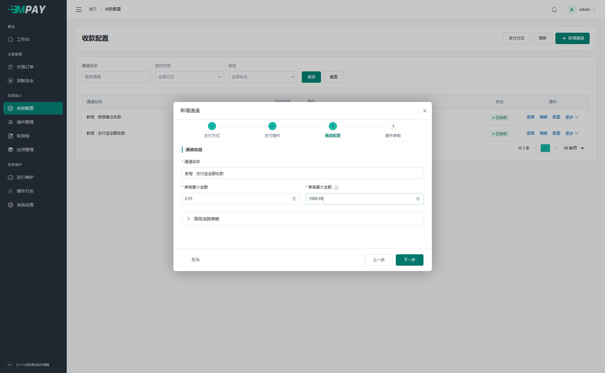
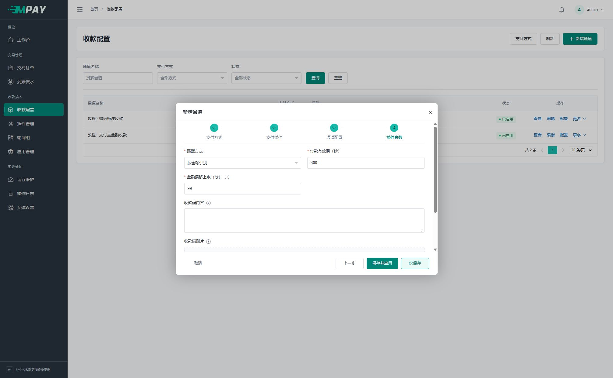
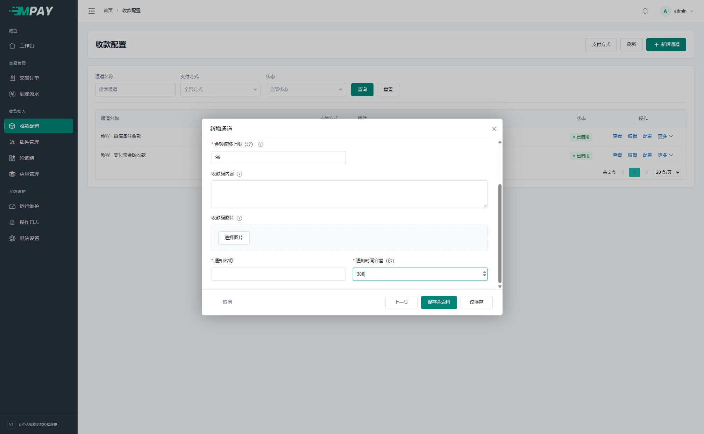
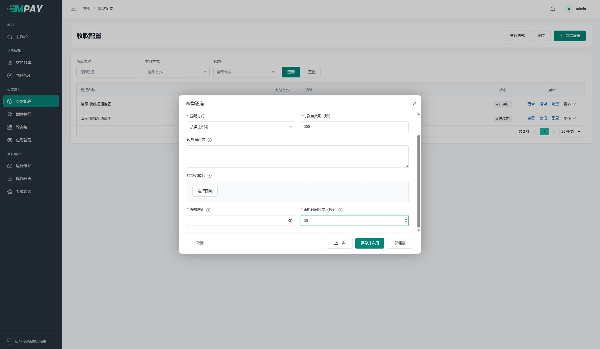
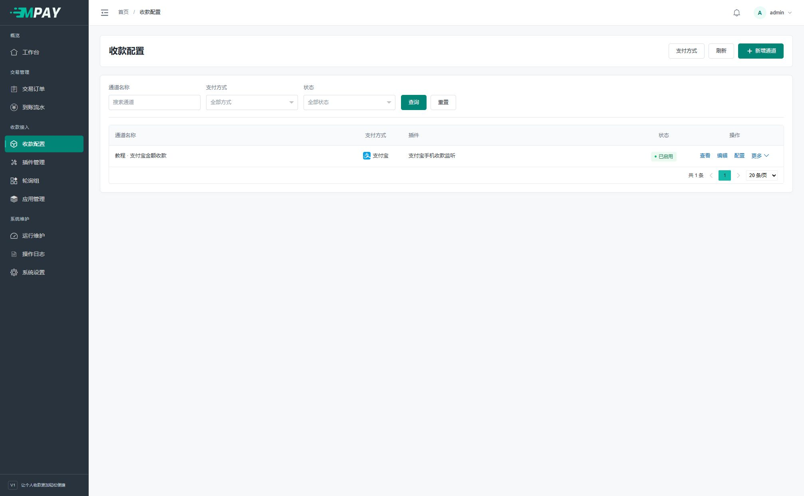
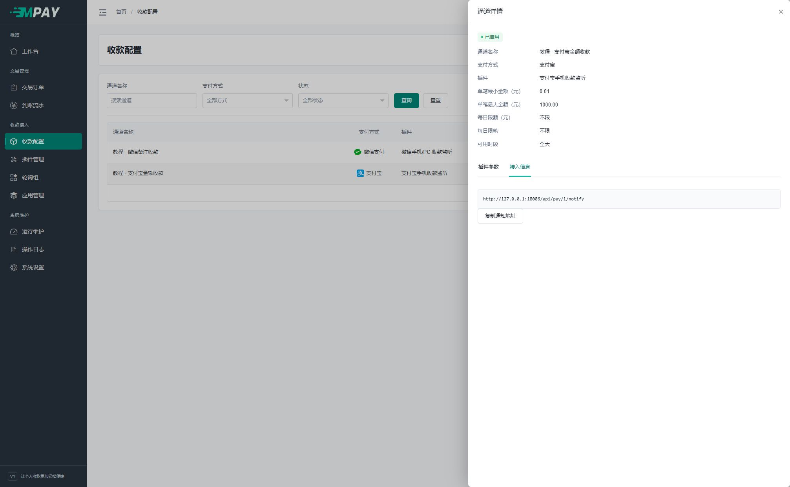
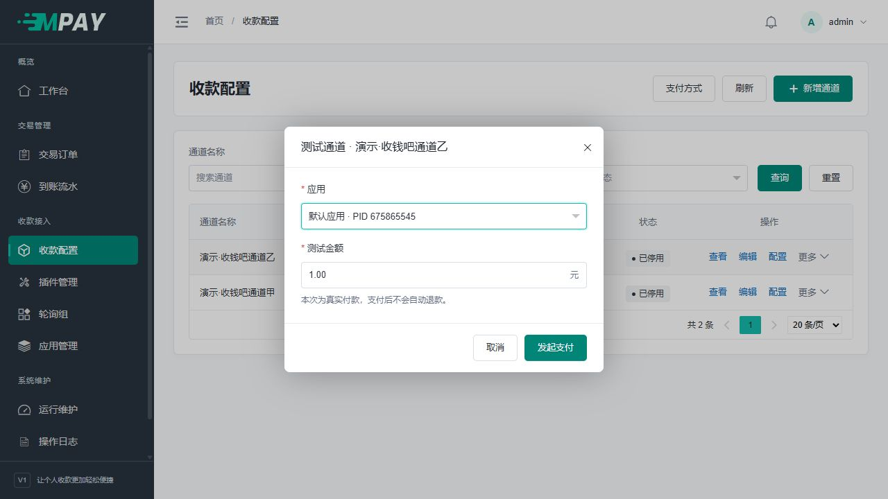

# 收款通道与支付方式

“收款配置”以通道列表为入口。支付方式是分类，插件是实现，通道是实际可用的参数组合。

## 新增通道前

先准备实际收款账号的收款码或银行卡资料，以及对应插件需要的通知密钥或平台资料。“支付方式”只是分类；“插件”决定怎么识别到账；“通道”才是你保存的一套收款设置。

银行卡转账使用独立编码 `bank`，已有安装缺少该支付方式时可在“插件管理 → 支付方式”新增；默认轮询组及默认模式应用按原规则自动绑定。三家银行的插件、监听要求和配置步骤见[银行卡公众号收款](V1-33-银行卡公众号收款.md)。

下面以“支付宝手机收款监听”为例。截图中的“教程”通道和 example.invalid 地址仅供隔离演示，正式使用时需要自己的收款码，不能照抄演示地址。

## 第一步：选择支付方式

1. 登录 MPAY 后台，点击左侧“收款配置”。
2. 点击右上角“新增通道”。没有通道时，也可以点击页面中间的同名按钮。
3. 点击“支付宝”卡片，再点击右下角“下一步”。

**完成结果：** 顶部第二步“支付插件”被选中。只会显示支持刚才支付方式的插件。

## 第二步：选择支付插件

如果你准备通过安卓手机的支付宝到账通知识别付款，选择“支付宝手机收款监听”，点击“下一步”。

不要因为都写着“支付宝”就选择“支付宝账单收款”：账单插件需要平台接口权限和对应密钥，手机监听需要通知转发工具，两种配置方法不同。

**找不到插件：** 先关闭向导，去“插件管理”检查对应插件是否存在并已启用，再回到这里新增。刷新插件列表不会自动从网络安装插件。

## 第三步：填写通道配置

| 输入框 | 第一次可以怎么填 | 含义 |
| --- | --- | --- |
| 通道名称 | 我的支付宝收款 | 给管理员看的名字，用来区分通道 |
| 单笔最小金额 | 保留 0.01 | 低于这个金额的订单不会选中该通道 |
| 单笔最大金额 | 按自己的收款范围填写 | 超过这个金额的订单不会选中该通道 |
| 高级选路策略 | 首次保持收起和默认值 | 有明确需求后再设置每日额度、笔数及时间段 |

填写完点击“下一步”。这里的金额单位是元，不需要换算成分。通道名称可以相似，但建议体现支付方式和用途，便于之后查单。

“高级选路策略”中的“默认收款”使用“启用 / 关闭”开关。关闭后，此通道不参与默认收款，仍可用于自定义轮询组；它与对应默认组内该通道的“成员状态”是同一个设置，不是通道自身的启停开关。具体规则见[默认路由与轮询策略](V1-08-默认路由与轮询策略.md)。

## 第四步：填写插件参数

| 字段 | 第一次配置建议 |
| --- | --- |
| 匹配方式 | 手机消息未确认包含付款备注时，先用“按金额识别” |
| 付款有效期（秒） | 保留 300，即 5 分钟 |
| 金额偏移上限（分） | 按插件说明填写；默认 99，即最多 0.99 元，不是 99 元 |
| 收款码内容 | 有实际解码后的收款内容才填写；它不是图片文件路径 |
| 收款码图片 | 有图片时点击“选择图片”，上传本人的收款码；与内容至少提供一种 |
| 通知密钥 | 按[通知密钥说明](V1-07-插件管理与配置约定.md#生成手机通知密钥)生成并复制，稍后将同一个值粘贴到通知工具 |
| 通知时间容差（秒） | 默认 30，可设 5～30；设备与服务器开启自动校时 |

在弹窗内向下滚动，可找到“收款码图片”“通知密钥”和“通知时间容差”；底部的保存按钮始终保留。

若选择按备注识别，金额偏移字段会隐藏，付款者需要填写收银台给出的备注。下面是微信插件向导向下滚动后的实际表单，收款材料与密钥故意留空用于展示位置，使用时需自行填写：

不确定某个字段怎么填时，点击它旁边的 ⓘ 查看插件说明。具体转发工具配置分别见[支付宝手机监听](V1-12-支付宝手机监听.md)和[微信监听](V1-11-微信手机与PC监听.md)。

## 完成向导：保存并检查

1. 核对收款材料与通知密钥后，点击“保存并启用”。
2. 弹窗关闭后，在列表中找到刚才的通道。
3. 确认状态为“已启用”。新通道会自动加入对应默认组，不必先创建轮询组。

如果只是先录入资料，选择“仅保存”；它还不能用于新订单。之后从通道“更多”中启用。保存失败时按提示修正当前字段，不需要从第一步全部重来。

**注意：** 已启用代表 MPAY 可以选择这个通道，不代表手机已在线或平台认证已通过，还需要完成对应监听工具配置和一笔实际核对。

如果两项收款材料都填，需确保图片和文本指向同一真实收款账户。普通用户只有收款码图片时，直接上传图片即可，收款码内容留空，不用自己找工具解码。

## 保存后：复制通道通知地址

手机监听在保存通道后继续本节。账单和收钱吧主动查询方案直接按各自教程继续，无需给平台填写此地址。

手机监听需要把到账消息发到当前通道：

1. 在通道列表点击“查看”。
2. 切换“接入信息”。
3. 点击“复制通知地址”，将完整地址粘贴到通知工具的 Server/Webhook 地址框。

截图中是隔离演示地址。手机正式使用时，应从你自己的站点复制完整通知地址，HTTP 或 HTTPS 均可；不能填 localhost、127.0.0.1 或照抄截图端口。地址末尾的数字是通道 ID，不要自行改为 PID 或插件编号。

支付宝、微信监听工具如需设置成功响应关键字，填写 `200`。成功及业务拒绝的 HTTP 状态均为 200，正文分别是 `200` 与 `400：错误原因`，可直接在转发日志中查看；不要只凭 HTTP 状态判断收款成功。

**下一步：** 配置对应通知工具，再按[第一笔收款](V1-04-完成第一笔收款.md)检查三个结果。

## 编辑、配置和更多操作

- **查看**：核对通道信息、策略和设备通知地址。
- **编辑**：修改通用属性、支付方式或支付插件；切换插件需填写新插件参数。
- **配置**：仅修改当前通道的插件参数，保存后核对并重新启用当前通道。
- **更多**：测试、启用/停用和删除。菜单项保留简短文字，启用绿色、停用橙色、删除红色。

切换接入前须处理待付款订单；切换方式前处理自定义组引用，默认组由系统自动移组。删除保留历史订单，不是删除已经发生的收款事实。

## 快速测试当前通道

收款配置页只管理通道名称、支付方式、插件、启停及收款参数；“已启用”表示允许新收款，不代表平台认证正常。采集状态、最近错误及恢复信息统一在左侧“运行维护”中查看，可按收款通道筛选。错误恢复后仍保留最近一次错误并标注“已恢复”。

1. 在通道列表点击该行的“更多 → 测试”。
2. 选择接入应用，填写金额后点击“发起支付”。应用默认选中最早创建的启用应用，金额默认 1.00 元。
3. 新页面打开正常收银台，按页面显示的准确金额和备注付款；后台通道列表保留。
4. 收到有效到账消息后，系统更新订单并自动进入支付成功页面。
5. 返回“交易订单”，按应用、时间或订单号查看订单及到账流水，商品名为“通道收款测试”。

通道测试复用当前已保存的配置快照，不会生成新的通道版本或使正在编辑的表单过期。若快照缺失或与当前配置不一致，先重新保存配置后再测试。

测试单创建后，后台直接打开接口返回的站内收银台地址，沿用浏览器当前站点。浏览器不能打开新窗口时在当前页进入收银台。请求中断时先在“交易订单”中按应用和时间核对，实际支付状态以订单记录为准。

这是实际付款，支付后不会自动退款。金额识别可能产生小额偏移，以收银台“请准确支付”为准。手机监听仍需要设备实际转发通知；账单/码牌需要 `payment:watch` 正常运行。仅生成二维码或收到设备请求不能表示收款测试成功。

测试始终使用当前通道，PID 和凭证版本从所选应用读取，不需要手填 KEY 或配置轮询组。指定通道时不检查通道/插件/支付方式的运营启停、权重、单笔/每日限额、限笔和可用时段，不会自动启用通道；所选应用必须处于启用状态。已保存的插件参数必须有效，插件及平台自身限制仍然适用。可以先测试尚未启用的通道，通过后再用于正常业务收款。

发起后就是普通订单，应用归属、状态、到账处理、操作、统计和导出都与其他订单一致，不设独立用途、徽章或筛选。后台快捷付款没有提供外部通知地址；所有订单统一按 notify_url 是否有值决定是否建立异步通知，不通过名称或测试标记判断。关闭页面不会撤销付款，结果仍可在订单中查看。人工确认同样保留，但人工操作不能证明设备或平台自动到账识别已验证。

如果请求结果暂时无法确定，弹层保留原应用和金额，使用原请求重试会返回同一订单，不会重复创建。若需要换应用或金额，请关闭后重新发起。通道测试通过后，再按[第一笔收款](V1-04-完成第一笔收款.md)验证业务网站接入及商户通知。

## 通用策略

保存插件参数及启用通道时会检查已绑定图片是否存在、可读取且属于允许的存储目录；执行付款准备时仍会再次检查。图片在保存后丢失会在下单或收银台准备请求中得到明确提示；管理员恢复后可在付款有效期内重试。后台任务不自动准备付款，也不读取该图片。历史订单固定引用原图片资产，不会自动换用后来上传的新图。

| 设置 | 含义 |
| --- | --- |
| 单笔最小/最大金额 | 按原订单金额判断可否选用，单位元 |
| 每日限额 | 0 表示不限；按上海自然日发起的支付单原金额统计 |
| 每日限笔 | 0 表示不限；计入成功及仍有效待付款单，失败/关闭/超时不占用 |
| 可用时段 | 同时留空为全天；支持 22:00～06:00 跨午夜，包含开始、不包含结束 |

这些策略只限制新单选择，不中断原订单到账核对。排序、权重、默认优先属于[轮询组](V1-08-默认路由与轮询策略.md)，不在通道重复维护。

## 支付方式管理

点击列表上方“支付方式”，可管理名称、编码、排序、启用状态与品牌图片。列表用小图标，收银台品牌区用完整标识；支付方式的图片统一使用 PNG，通用兜底也使用 PNG。未被引用的方式可删除；已有引用时停用并保留历史，不能直接换编码。

新安装会建立 `alipay`、`wxpay`、`unionpay`、`bank` 四种支付方式，并将随程序交付的小图标和完整标识登记为图片资产，保存到各自的配置。银行卡图形为蓝色圆角卡片，完整标识附“银行卡”文字。编辑时可分别上传替换，或点击“使用通用图标”清除该项图片引用；未配置图片的方式统一显示通用收款图标，不按编码猜测品牌。已有安装新增支付方式时同样需要自行选择品牌图片。云闪付可使用[收钱吧码牌插件](V1-14-收钱吧码牌收款.md)，仍需平台账号及码牌已开通对应能力，并配置启用通道；仅启用字典并不会自动获得收款能力。
