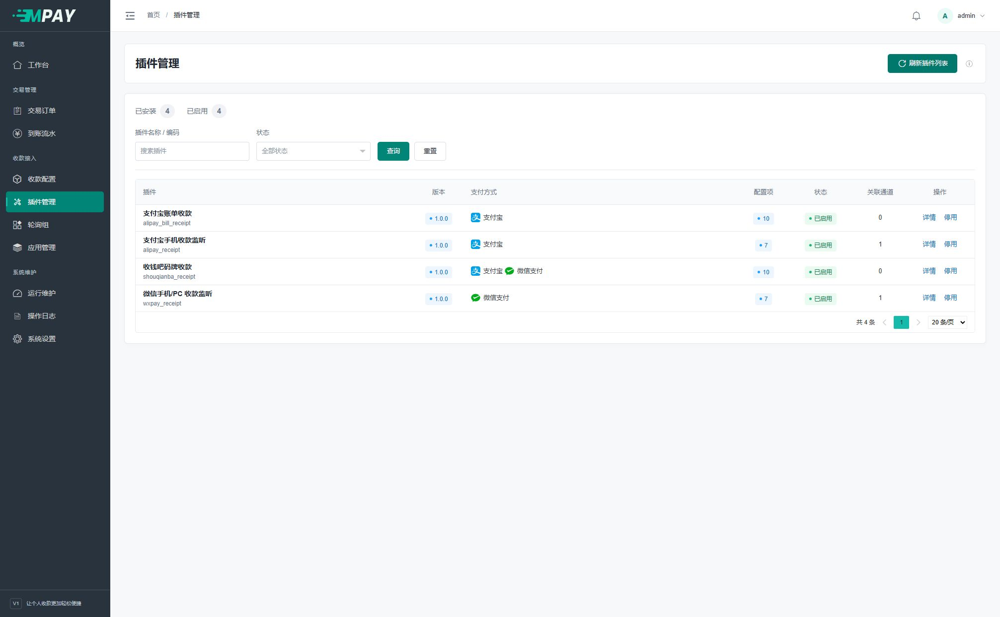

# 插件管理与配置约定

进入“插件管理”查看本地插件及状态。刷新会读取服务器上已放置的插件，更新名称、版本、支持方式和配置表单；不会从网络下载新插件。第一次使用只需确认准备使用的内置插件已经启用。

## 先看已安装的插件

点击左侧“插件管理”。顶部的“已安装”“已启用”是两个数量；表格中的“支付方式”决定新增通道时它在哪些方式下面出现。



| 你想做什么 | 点击哪里 | 如何确认 |
| --- | --- | --- |
| 查看本地最新插件定义 | 右上角“刷新插件列表” | 出现同步数量，名称/版本/配置项更新 |
| 了解某插件 | 该行“详情” | 查看插件声明的说明及字段 |
| 暂停新订单使用 | 该行“停用”并核对提示 | 状态变为停用；原订单仍按创建时的配置核对 |
| 恢复新订单使用 | 对应行“启用” | 状态变为已启用；通道本身也须启用 |
| 填账号和收款参数 | “收款配置”中新增通道或点击该通道“配置” | 参数属于当前通道，不在插件列表中统一填写 |

## 可选：增加或更新插件

使用内置插件可跳过本节。新增插件需要上传代码，由有服务器文件权限的维护人员操作，开发目录及接口要求见[插件开发](V1-23-支付插件开发.md)。

1. 取得与当前程序接口相符的可信插件代码及所需 SDK。
2. 按开发说明放入插件和 SDK 目录；不要把任意类名直接写进数据库当执行入口。
3. 刷新插件列表，检查同步状态和字段说明，启用需要的插件。
4. 新建对应通道；更新插件代码后重启 `payment:watch`、`payment:work`，让常驻进程加载新实现。

新发现的插件默认停用；刷新保留原有启停状态。停用阻止新单使用，已有订单仍要按原配置完成核对。移除代码前先处理未完成订单与采集责任。

## 插件参数的共通规则

当前四个监听插件都声明了以下字段。它们属于插件，未来插件可以选择不提供。

| 字段 | 当前默认值/范围 | 填写说明 |
| --- | --- | --- |
| 匹配方式 | 金额或手动备注；默认金额 | 支付宝账单另有自动填写金额和备注模式；来源必须能返回真实备注 |
| 付款有效期 | 300 秒；1～86400 秒 | 不超过业务订单截止时间；刷新收银台不会续期 |
| 金额偏移上限 | 99 分；0～99 分 | 仅金额模式显示；0 表示不增加金额 |
| 收款码内容 | 可空 | 二维码解码后的原始文本，不是图片文件路径 |
| 收款码图片 | 普通扫码/手动备注时可空 | PNG/JPEG/WebP，最多 2 MiB；这两种模式与文本至少填写一种 |

金额识别以当前通道为范围。同一通道的多个 10.00 元待付款订单，可能分别提示 10.00、10.01 元；不同通道各自分配，不保证它们的提示金额互不重复。最终通知业务网站仍使用原订单金额。

备注识别在当前通道内分配不同的四位备注，同时核对实际金额。切换识别方式后，尚未完成的订单继续使用原规则；若提示原金额仍被待付款订单占用，先处理原订单或等它到期，不删除订单来强行释放。

支付宝账单的“自动填写金额和备注”使用插件生成的付款入口，因此收款码内容和图片字段会隐藏；隐藏不清除已保存的值。选择方法见[支付宝账单收款](V1-13-支付宝账单收款.md#选择匹配方式)。

## 生成手机通知密钥

手机监听通道需要一份独立的随机密钥，MPAY 通道和手机工具的 Secret 填同一个值。它与应用 KEY、管理员密码无关。

两个手机监听插件接受 6～32 个字符，建议使用 16～32 位随机字母和数字。可以用密码管理器生成，或在服务器 PHP 终端执行下面一行，生成 32 位随机文本：

```sh
php -r 'echo bin2hex(random_bytes(16)), PHP_EOL;'
```

若终端找不到 `php`，将命令开头换成[实际 PHP 完整路径](V1-18-部署与后台任务.md#准备命令中的路径)。复制输出到当前通道与手机工具，只生成一次，不要给两端分别生成不同值，也不要把密钥贴到公开截图或日志。

通知时间容差接受 5～30 秒，默认 30 秒，用于比较通知请求时间与服务器接收时间的双向偏差。它与付款有效期、账单采集间隔和预登录保活间隔分别配置。调整插件声明后刷新插件列表；已有通道的参数不会被新默认值覆盖，需核对当前值是否满足新规则，通知密钥不能自动截断或只修改接收端。

## 说明与秘密字段

插件定义使用说明才显示说明区域，字段定义 `help` 才有对应帮助入口。系统不向插件表单插入额外的账号推测或共享配置说明。

密码、私钥等在配置表单中正常回填，默认隐藏，点击眼睛图标可显示或重新隐藏；可以直接修改，不需要额外勾选。保存使用当前填写的值，清空是否允许取决于插件校验规则。数据库备份包含这些凭证，需要妥善保管；字段的开发规则见[secret 说明](V1-24-config-schema字段规则.md#秘密字段)。

每通道独立保存配置，也可以填写同一平台账号。同一账号的登录和查询由插件协调；若“运行维护”提示凭证冲突，请核对相关通道是否填了不同密码，并修正错误项。内部处理方式供开发者查阅[采集协作](V1-25-主动采集与会话协作.md)。

同一真实账号关联多个通道时，合并登录和查单不会合并各通道的识别范围。如果一条流水同时符合多个通道的订单，插件会跳过并记录 `ambiguous_channel`。此时按[排障说明](V1-20-常见问题与运行排查.md)核对原单，避免重复确认同一笔款。
