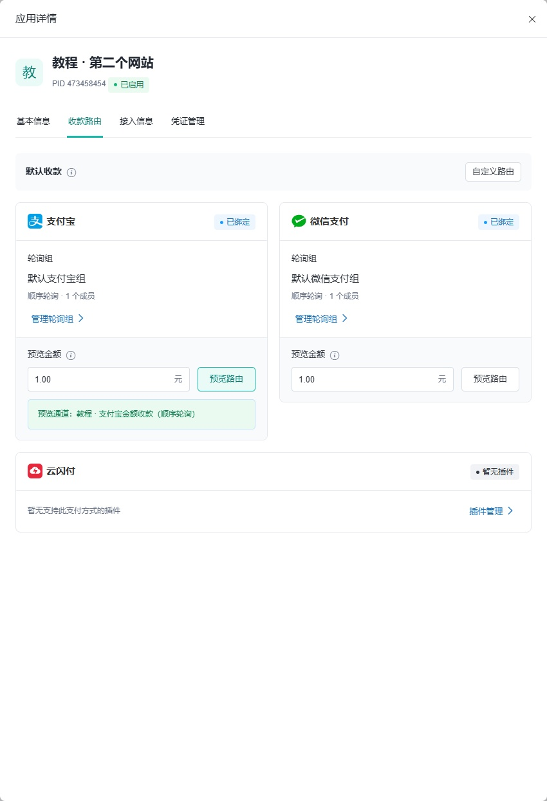
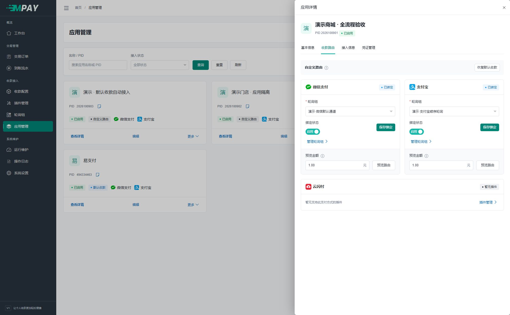

# 默认路由与轮询策略

安装创建默认应用及各支付方式的默认轮询组；新应用自动绑定，新通道自动加入对应默认组。组按支付方式内部关联识别，修改组名不会改变其默认身份。

## 首次使用

启用一个通道并保持“默认收款”为“启用”后，默认模式的应用即可按选路规则使用它，不需要手动再建立三层绑定。在通道的“高级选路策略”中关闭“默认收款”，只停止该通道参与默认组收款，仍可用于自定义组。

默认组与自定义组使用相同的编辑字段和“启用 / 关闭”开关。默认组自动维护成员，不能手工增删成员或单独关闭整组；可以调整名称、备注、策略、排序、权重和成员状态。自定义组由管理员添加或移除成员，系统不会用自动绑定覆盖它。

“成员状态”只控制通道是否参与当前组收款，不影响通道自身状态及其他组。同一通道可同时加入多个组，但在同一组内不能重复添加；各组的成员状态、排序、权重独立。默认组中该通道的“成员状态”，与通道编辑里的“默认收款”是同一个设置，在任一入口保存后，重新读取另一入口即可看到一致的状态。

### 第一次只做一次预览

1. 进入“应用管理”，点击准备接入网站的“查看详情”。
2. 切换“收款路由”，保持“默认收款”。
3. 在所需支付方式卡片中找到“预览金额”，填入一笔符合通道范围的金额，例如 1.00。
4. 点击该卡片的“预览路由”。看到“预览通道：……”后，说明这一刻按当前设置能选到通道。

如果通道配置了单笔最小金额 10 元，用 1 元预览就可能找不到通道。先换为实际打算支付的金额；不要因为一次预览失败就新建更多轮询组。

## 三种策略

| 策略 | 规则 | 示例 |
| --- | --- | --- |
| 顺序轮询 | 按排序轮流使用本次可用通道 | A、B、C 中 B 不可用时按 A、C 轮流 |
| 权重随机 | 权重越大，本次被选中概率越大 | 仅 A/B 可用且权重 3/7 时，理论概率为 30%/70% |
| 默认优先 | 先用可用默认成员，否则按排序选第一个可用成员 | 默认 A 达到限额后再选备用 B |

排序值越小越靠前，权重值越大概率越高，二者含义不同。随机策略不保证短期笔数严格符合比例，每组最多一个已启用的默认成员。

## 什么时候会跳过通道

应用或支付方式不可用、插件停用、通道停用、成员未参与、金额不在范围、日限额/限笔不足或不在可用时段，都可能使本次请求没有可选通道。收银台不展示完全没有可用通道的支付方式。

## 切换自定义

在“应用详情 → 收款路由”切换自定义，按支付方式选择已启用且类型相符的组。需要恢复默认时使用明确的恢复操作，系统会替换该应用全部方式绑定。

预览输入金额后显示本次候选结果，但不创建订单、不推进游标。收银台支付方式展示与后台路由预览均使用普通只读查询，不锁应用、支付方式、轮询组、配置或通道，也不预留额度。实际建单仍按原锁序重新核对策略、快照、归属及额度；其他请求可能改变可用性，随机预览也不保证命中下一笔。顺序游标随新支付尝试在事务内提交，同单幂等重试不会再走一次轮询。
