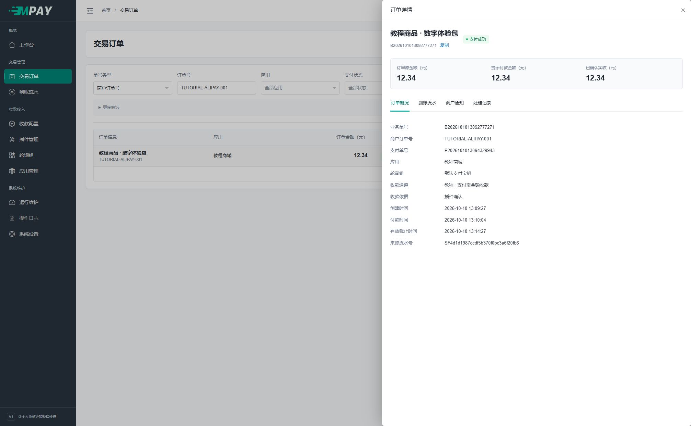

# 订单与到账流水

“交易订单”是日常入口，按应用、订单号、支付方式、日期、支付状态等条件查询。更多筛选包含通道、轮询组、下单 PID 及商户通知状态。

列表直接展示业务单号与商户订单号、应用与商品、支付方式、收款通道、订单金额与已确认实收、支付状态、商户通知、创建与付款时间。未确认实收显示“—”；尚未选择支付方式时显示“未选择”。付款时间为空不代表零元支付或成功。

点击蓝色业务单号或行右侧“详情”打开订单，查看支付单号、下单 PID、提示付款金额、收款依据和来源流水号；在“商户通知”页签查看发送记录，列表徽章仅展示状态。商户订单号可以直接选中文字复制。交易时间上行为创建时间，下行为付款时间，悬停可查看含义。长文字悬停可查看完整内容；窄窗口可横向滚动表格。

## 1. 用买家提供的订单号找订单

1. 点击左侧“交易订单”。
2. 先看编号来源：商城提供的号码选“商户订单号”；MPAY 的 B 开头号码选“业务单号”；P 开头号码选“支付单号”。
3. 把完整号码复制到“订单号”输入框。不要把商品名或金额填在这里。
4. 核对“创建日期”包含下单日期，再点“查询”。默认日期范围不包含所有历史订单。
5. 找到结果后，核对应用、商品和金额，点击该行右侧“详情”。

没有结果时，先改日期和单号类型，不要立即判断订单丢失。多个应用可能使用相同的商户订单号，应同时选择正确应用。

## 2. 看懂详情中的三个金额

| 位置 | 说明 | 实际操作 |
| --- | --- | --- |
| 订单原金额 | 商城要求支付的金额 | 与商城订单核对 |
| 提示付款金额 | 本次收银台要求付款者支付的金额 | 有金额识别偏移时可能比原金额略高 |
| 已确认实收 | 本次确认依据记录的收款金额 | 尚未确认时显示空值，不能当作已收款 |

详情下方的四个页签按用途查看：“订单概况”看通道和时间；“到账流水”看自动匹配依据；“商户通知”看商城是否应答；“处理记录”看人工操作等过程。

## 3. 更改每页数量或导出

在表格右下角点击“20 条/页”，可切换为 10、20、50、100 条。详情内的表格也有各自的分页，外层条数不会同时修改内层。

导出操作：先选择应用、支付方式、日期或状态并点击“查询”，确认结果符合需要，再点右上角“导出订单”。页面准备好文件后，浏览器下载 CSV；到浏览器下载列表打开它。单次最多 31 天、10000 条，超过时缩小日期或按应用分别导出。CSV 包含支付方式编码，尚未选择时为空。导出的长订单号在电子表格中应按文本导入，避免变成科学计数法。

**完成检查：** 下载文件存在，表头可读，订单范围与刚才的筛选一致。只有页面弹出下载提示时，还要确认浏览器没有拦截下载。

## 三类记录的区别

从通道“更多 → 测试”发起的付款也是普通订单，商品名为“通道收款测试”，保存所选应用的 PID。订单展示、状态、到账、人工操作、统计和导出均使用同一套规则，不设独立用途、徽章或筛选。所有订单仅依据是否提供通知地址决定是否创建异步通知；未提供时，列表显示“无通知地址”，悬停提示“未设置通知地址”。

| 记录 | 回答的问题 | 位置 |
| --- | --- | --- |
| 到账流水 | 哪条到账证据最终确认了哪笔订单？ | 订单详情、到账流水列表 |
| 商户通知 | MPAY 是否把结果发给业务网站，对方如何应答？ | 订单详情、交易订单上方的商户通知入口 |
| 通道回调日志 | 设备/平台向 MPAY 发来了什么类型的请求，是否通过校验？ | 运行维护、订单技术排查入口 |

一批采集可匹配多笔订单，但一条流水最终只绑定一笔订单，不合单、不拆单。数据库只保留最终匹配的流水；未匹配收款应查来源平台账单及接收日志，没有后台补匹配队列。

日常处理优先从“交易订单 → 详情”进入这些记录。只有需要跨订单排查时，再打开独立的流水、商户通知或回调日志列表。

人工确认的订单可以没有自动匹配流水；其依据在处理记录与人工证据中，不能把人工确认伪装为设备自动识别成功。通道回调日志按通道查询时可能包含其他订单的信息。每次 HTTP 回调最多关联一条已确认流水；列表和详情可直接打开该流水。未匹配、验证拒绝等记录没有关联流水，仍保留处理结果和请求编号供排查。主动采集继续按批次逐笔确认。

## 金额、日期和编号

业务金额是网站下单金额，提示金额用于付款识别，实收金额来自确认依据。对外通知 `money` 使用原业务金额，不因偏移而变成更大的值。

页面时间按上海时区。工作台成功金额按付款日期汇总，创建数/成功率按创建日期口径统计，帮助按钮中有具体解释。

业务号 B、支付号 P、通知号 N 和退款号 R 均为 20 位：一位前缀＋14 位创建时间＋5 位随机数，例如 `P2026100915304505189`。同秒内不承诺编号严格递增，按创建时间和内部 ID 排序；数据库唯一键负责最终防重复。

订单详情的“处理记录 → 技术信息”显示原单的支付产品（pay_product）及支付动作（pay_action），用于核对插件实际采用的付款准备路径。页面读取保存时的标识，不按当前通道配置推测；尚未准备材料时显示“—”。
