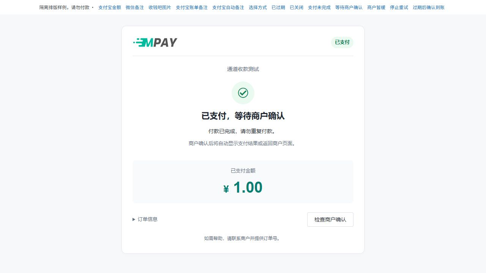
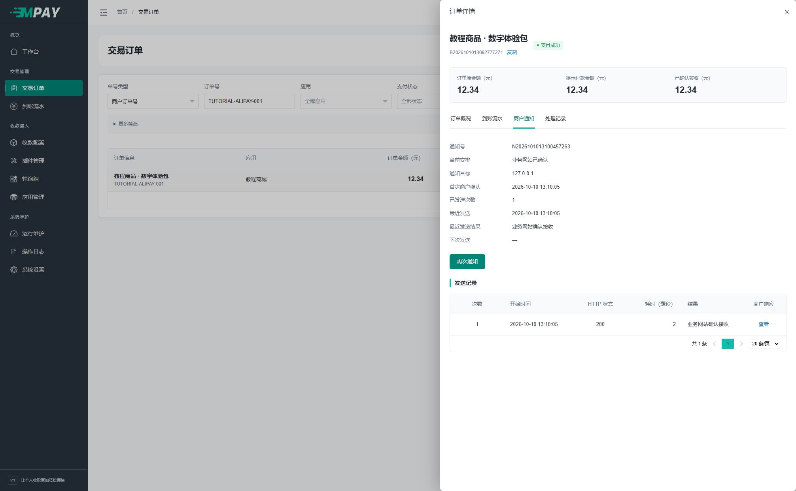
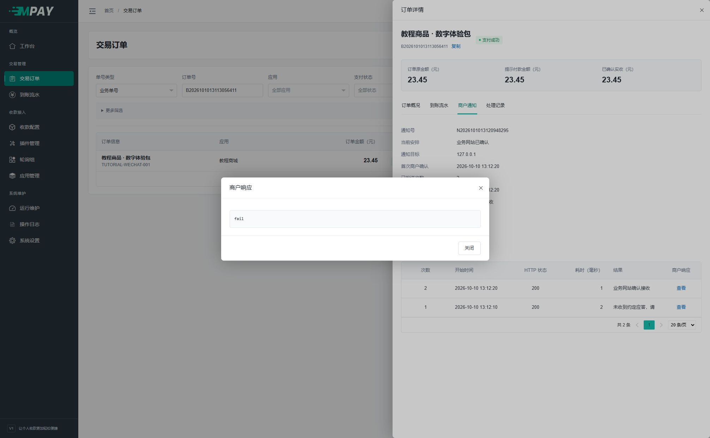
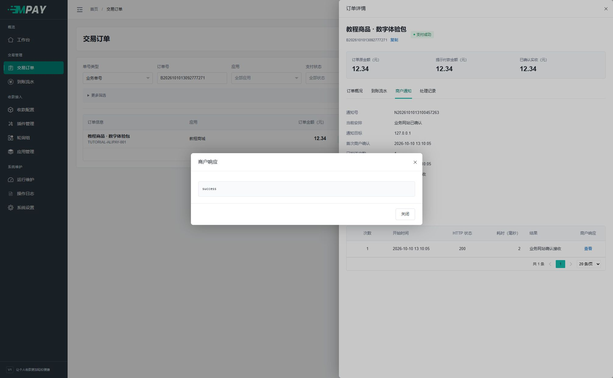
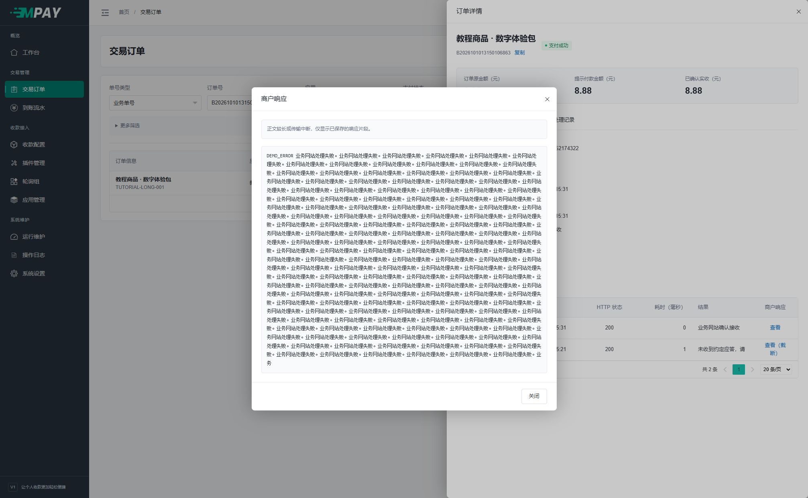
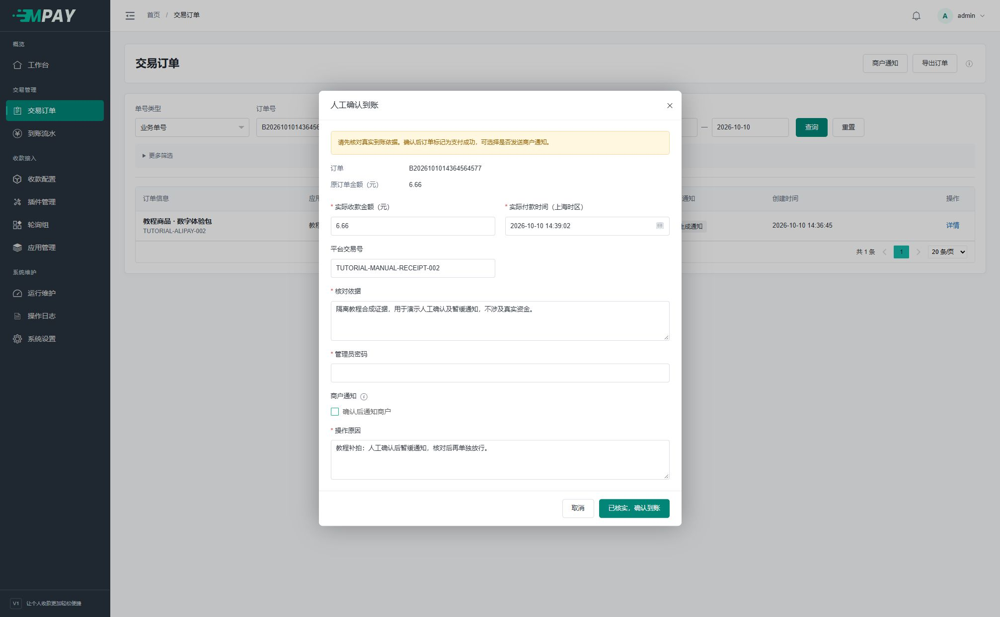
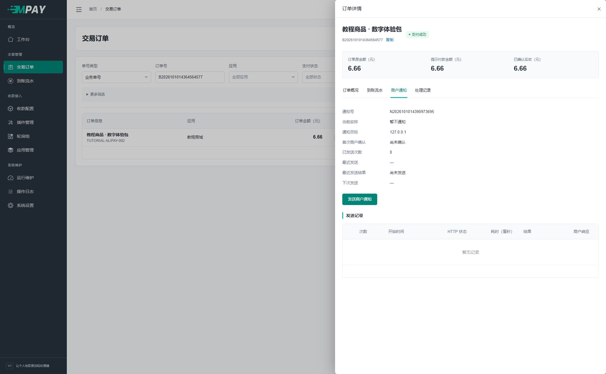
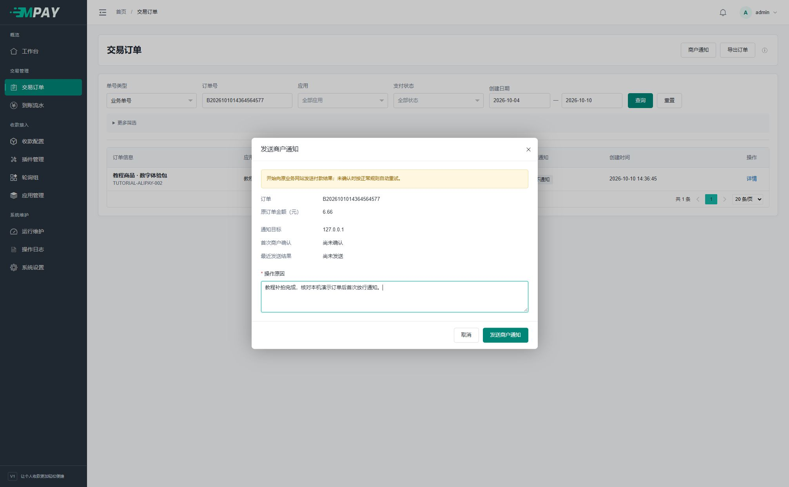
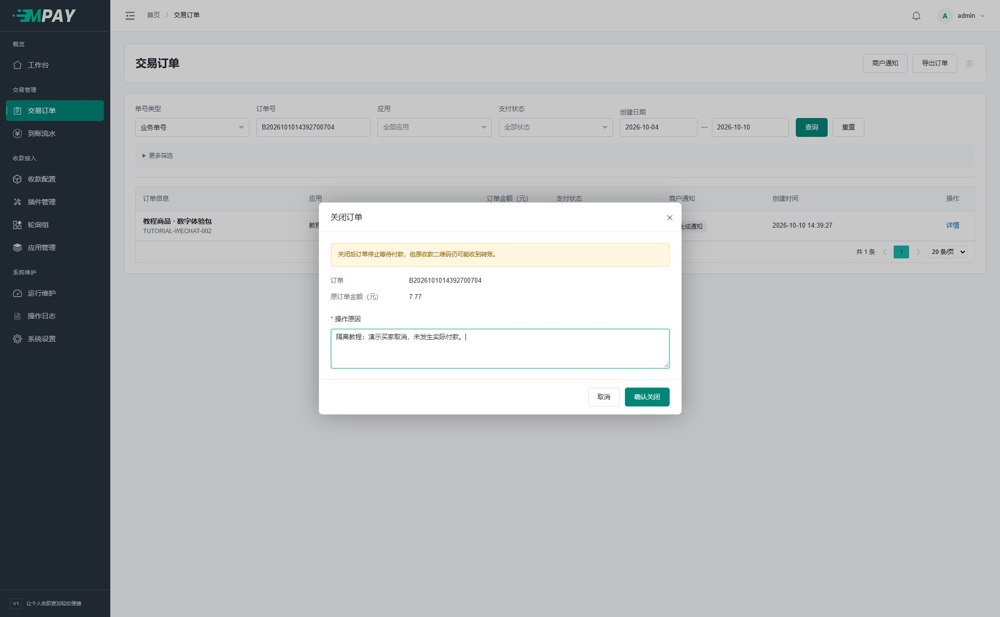

# 商户通知与人工处理

确认收款和通知业务网站是两个动作。付款已成功时，通知失败不会把订单改回未支付。

商户通知由 `payment:work` 自动发送。日常先从原订单查看发送状态和商户响应，按本页步骤处理；修改应用配置不会重写旧订单的通知地址和签名。

买家付款后，收银台会先显示商户确认状态：业务网站返回有效 `success` 且 MPAY 已记录首次确认，才自动回跳或进入默认完成页。本轮等待 60 秒仍未确认时，可以点击“重新检查通知”；这只查询原订单，不重新付款，也不直接补发商户通知。没有通知地址的后台通道测试无需等待外部应答。

## 1. 商城没更新，先看这张表

从“交易订单”找到原订单，点击“详情 → 商户通知”。不要再次付款，也不要重新建立另一笔订单来替代原单。

| 你看到的内容 | 下一步 |
| --- | --- |
| 尚未生成通知 | 回到“订单概况”，先检查是否确认到账 |
| 暂不通知，已发送次数为 0 | 这是人工选择暂缓；确认可以发送后再放行 |
| 待发送/等待重试 | 到“运行维护”检查“通知与订单维护”是否有近期活动 |
| 有发送记录但未确认 | 点击该次记录右侧“查看”，读商户返回内容 |
| 业务网站已确认 | 检查商城自己的订单和发货日志；MPAY 已收到它的有效应答 |

## 2. 查看一次失败和自动重试

以下演示中，第一次返回 fail，之后的重试返回 success。发送记录会保留两次，不会用成功结果覆盖失败记录。

在“商户响应”一列点击“查看”，弹窗显示对方返回的文本。例如下面的 fail 表示对方没有给出约定的成功应答；HTTP 200 本身不代表业务处理成功。

收到正确应答时，响应弹窗应能看到小写纯文本 success。后续仍需核对商城自己的业务结果。

先修复商城接收地址或处理程序，再根据当前状态选择提前发送或单次补发。不要在错误未处理时连续点击通知按钮。

超长响应会显示“查看（截断）”。点击后看到的是已保存片段，完整错误应到业务网站服务器的日志中查找。

## 人工确认到账

先在实际收款平台核对原交易，再到订单详情执行“确认到账”，填写实际金额、付款时间、平台号（如有）、核对依据、操作原因及管理员密码。

默认勾选“确认后通知商户”。取消后，订单确认成功，商户通知保存为“暂不通知”；之后可以单独放行。暂缓仅影响异步通知，订单查询和签名返回仍会体现已支付。

具体填写顺序：

1. 在实际收款账户中找到该笔付款，记下金额、付款时间、平台交易号及与原单对应的依据。
2. 打开原订单详情，点击“人工确认到账”。
3. 填写“实际收款金额”，单位为元；点击日期框选择实际付款日期和时间，按页面上海时区填写，不能把“现在”当作历史付款时间。
4. 如有平台交易号，复制原号；“核对依据”说明如何确认对应关系，“操作原因”说明为何需要人工处理。
5. 决定是否保留“确认后通知商户”的勾选；需要暂缓时取消勾选。
6. 输入 MPAY 管理员密码，点“已核实，确认到账”。

**完成检查：** 原订单显示“支付成功”、依据为“人工确认”。若取消了通知，切到“商户通知”应显示“暂不通知”和 0 次发送。

## 暂缓后如何发送

1. 回到同一订单的“商户通知”页签，点击“发送商户通知”。
2. 核对原订单、金额和通知目标，填写本次放行原因。
3. 点击弹窗中的“发送商户通知”。
4. 等待后台任务执行，重新打开详情核对发送记录和商户响应。

按钮提示“已安排商户通知”只是已经排入发送计划。看到“业务网站已确认”并核对商城自己的处理结果，才算完成这一步。

已有支付单的超时、关闭或失败订单，在满足证据和业务校验时仍可补确认；尚未发起支付的订单没有可核对的支付尝试，页面会说明无法补确认。重复确认或同笔到账重放不会自动解除暂缓。

## 按通知状态操作

| 状态 | 操作 | 结果 |
| --- | --- | --- |
| 暂不通知 | 发送商户通知 | 首次放行，从此开始正常发送与自动重试期限 |
| 等待发送/重试 | 立即发送 | 提前计划，不重置已用失败次数或期限 |
| 发送中 | 等待 | 由原进程完成，避免并发重复发送 |
| 停止自动重试 | 重新通知 | 追加一次发送，不重新开启一整轮自动重试 |
| 商户已确认 | 再次通知 | 明确确认后追加一次，保留原成功记录 |

实际发送由 `payment:work` 完成。手动安排成功不等于业务网站已应答，请继续看发送记录。所有操作复用原目标、参数和签名，不用当前 KEY 重签历史订单。

## 查看商户响应

每次尝试保存状态、时间、HTTP 信息及最多 4096 个 UTF-8 字节的响应片段；超长或中断正文带截断标记。HTML/JSON 按文本展示，便于发现业务网站返回错误页、验证码或 JSON 包装的问题。

商户有效应答需要 HTTP 2xx 和小写纯文本 `success`（允许首尾空白）。首次有效确认时间单独保留；后来一次补发失败，不会抹掉历史已确认事实。

默认自动发送最多八次，后续间隔为 10、30、120、600、1800、7200、21600 秒，自动期限为一天；实际执行还受队列积压、网络和进程状态影响。配置入口及预算见[后台任务](V1-18-部署与后台任务.md)。

通知可能重复送达，业务网站必须按原订单只处理一次。开发实现见[通知验签与联调排障](V1-17-通知验签与联调排障.md)；内部发送和回写约定见[通知责任与发送](V1-22-支付链路与数据约定.md#通知责任与发送)。

## 关闭、退款和审计

本地关闭只是停止继续等待，不能撤销平台静态收款码。实际到账后应核对原单，不能仅因本地超时就要求重新付款。

需要取消一笔尚未付款的订单时，打开详情点击“关闭订单”，确认订单号和金额，填写原因后点击“确认关闭”。结果应为“已关闭”，不会生成一条付款成功通知。

监听类插件不支持接口原路退款；易支付平台插件按第三方平台能力处理。需要退款时按[退款接口说明](V1-16-易支付V1接口参考.md#退款申请)核对原单；结果未知时不要换号重试。“关闭订单”不会退回已收到的钱。

确认到账、关闭订单、强制补发与 KEY 重置需原因；普通配置修改无需原因但仍记录审计。操作超时或结果不明时，先刷新原订单，避免重复提交。
