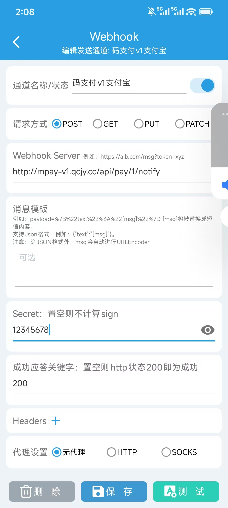
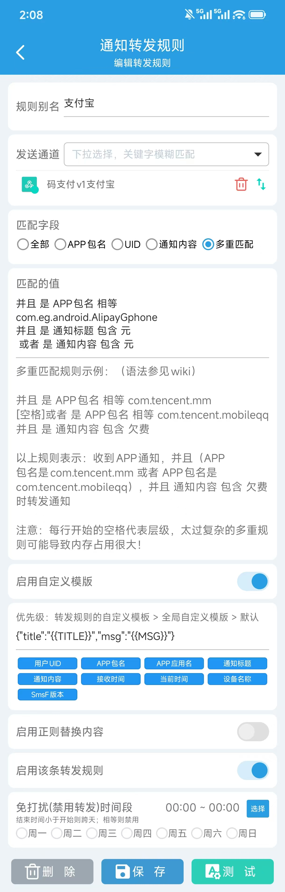

# 支付宝手机监听

插件：`alipay_receipt`，支持方式：`alipay`。它使用安卓到账通知，不需要支付宝开放平台私钥；需要账单查询时选择[支付宝账单插件](V1-13-支付宝账单收款.md)。

## 1. 建立通道

在“新增通道”选择支付宝与支付宝手机收款监听，填写自己的收款码。匹配方式、300 秒默认有效期、0～99 分偏移及图片要求见[配置约定](V1-07-插件管理与配置约定.md)。

设置 6～32 个字符的专属通知密钥，建议使用 16～32 位随机文本；时间容差默认 30 秒（可设 5～30），检查通知请求时间与服务器接收时间的偏差，设备与服务器需自动校时。保存并启用，取得该支付宝通道的通知地址，HTTP 或 HTTPS 均可。

不知道密钥怎么写时，按[通知密钥说明](V1-07-插件管理与配置约定.md#生成手机通知密钥)生成随机文本，把同一个值分别复制到 MPAY 与通知工具。不要给两边分别生成不同值。

## 2. 配置通知工具

工具安装在实际接收支付宝到账通知的安卓手机上，从 [SmsForwarder 官方项目](https://github.com/pppscn/SmsForwarder)取得工具并记录版本。先允许读取通知、自启动和后台运行，再依次配置：

配图来自 MPAY 演示站点，点击可查看原图。图中的域名、`/api/pay/1/notify` 和 Secret 只说明填写位置，应替换为你自己的支付宝通道地址和密钥；`12345678` 不是系统默认密钥。

### 发送通道

1. 在底部“发送通道”新增 Webhook，名称可填“MPAY 支付宝”，开启通道。
2. 请求方式选 POST；Server/WebServer 粘贴当前支付宝通道的完整通知地址。
3. Secret 粘贴与该通道相同的通知密钥；此页“消息模板”（webParams/请求参数）留空。
4. 若有成功响应关键字，填写 `200`，保存发送通道。

<p><a href="assets/tutorial/smsforwarder-alipay-webhook.jpg"></a></p>

填写时逐项核对：Server 是当前支付宝通道的地址；Secret 是它自己的通知密钥；Webhook 的 webParams 保持默认空值，应用通知规则中启用下方的自定义消息模板。不要复制微信通道的 URL，也不要把 JSON 模板填成 Webhook 整体请求参数。

### 转发规则

在“转发规则 → 应用”新增规则，别名可填“支付宝”；发送通道选择刚保存的支付宝 Webhook。匹配字段选“多重匹配”，将下面三行粘贴到“匹配的值”，只匹配支付宝包名及包含金额的标题/内容：

```text
并且 是 APP包名 相等 com.eg.android.AlipayGphone
并且 是 通知标题 包含 元
 或者 是 通知内容 包含 元
```

第三行开头保留一个半角空格。开启“启用自定义模板”，在该规则的模板框粘贴：

```json
{"title":"{{TITLE}}","msg":"{{MSG}}"}
```

<p><a href="assets/tutorial/smsforwarder-alipay-rule.jpg"></a></p>

开启“启用该条转发规则”，点击“保存”。本例不需要开启“正则替换内容”，也不要在免打扰时间内屏蔽需要接收的通知。注意：**发送通道的“消息模板”留空；这里的“自定义模板”要开启并填写 JSON**。

最终表单仍为 `from/content/timestamp/sign` 四字段，手机 `from` 必须是 `com.eg.android.AlipayGphone`。通知密钥不能填成 MPAY 应用 KEY。

四字段和签名由工具自动生成，无需手填。保存后确认发送通道和规则都已开启；对应请求格式见 [SmsForwarder 官方说明](https://github.com/pppscn/SmsForwarder/wiki/附录1：向webhook发送post-get-put-patch请求)。

## 3. 消息如何解释

标题是“收款通知”时解析正文，否则解析标题；文本应符合当前支持的到账、收款、成功收款或付款金额格式。备注模式要求被解析的文本包含四位付款备注。

支付宝发出的消费、广告或账户提醒不能作为收款依据。转发规则只是初筛，MPAY 仍校验格式、金额、时间和订单候选。通知模板变化应适配插件，不能通过修改旧订单或伪造收款文字强行匹配。

## 4. 实际核对

手机监听编号只用作 `event_key` 进行重复消息核对，不是支付宝交易号。消息未提供真实交易号时，流水及支付单的交易号为空，易支付查询的 `api_trade_no` 不返回合成编号。

使用默认 Accept 或 `Accept: text/plain` 时，本插件成功和业务拒绝的 HTTP 状态均为 200，字符串正文分别为 `200` 与 `400：错误原因`，例如 `400：来源消息认证失败`。原事件编号未变且仍通过校验的重复通知返回 `200`，不重复确认。明确请求 JSON 应答时遵循框架内容协商。程序故障保留 5xx，未知通道等插件调用前的入口错误保留其 HTTP 状态；按 X-Request-Id 查询服务器日志。

支付宝手机与微信手机使用相同的请求时间和事件编号方式，具体见[手机重发与时间的当前限制](V1-11-微信手机与PC监听.md#手机重发与时间的当前限制)。重发时修改 timestamp 或 content 会改变监听编号，不能承诺仍按原流水防重；历史到账先核对原单，不重新包装成新通知。

正文中的 `400` 是业务结果，不是 HTTP 状态；不能仅凭 HTTP 200 判断通知处理成功。成功关键字 `200` 只用于监听工具向 MPAY 投递消息。业务网站接收 MPAY 的付款通知时，仍按易支付协议返回 `success`。

创建待支付订单，按收银台金额与备注付款；确认支付宝有实际到账，再检查工具转发、MPAY 原订单和网站通知。手机系统版本和通知工具版本需按实际设备核对，模拟消息通过不代表真实通知已验证。

打开手机底部“转发日志 → 应用”，找到支付宝消息（来源为 `com.eg.android.AlipayGphone`），再点击对应发送通道的结果查看详情。重点看响应正文是 `200` 还是 `400：错误原因`，不是只看 `200 OK`。具体操作及列表、详情配图见[查看手机转发日志](V1-11-微信手机与PC监听.md#查看手机转发日志)；配图为微信样例，支付宝使用相同页面，核对时换成自己的支付宝通道。

常见问题与微信手机方案相同：后台保活、通知权限、Secret、通知地址可达性、时间同步和 URL 编码。MPAY 已支付而业务网站未更新时查看[通知记录](V1-10-商户通知与人工处理.md)。
