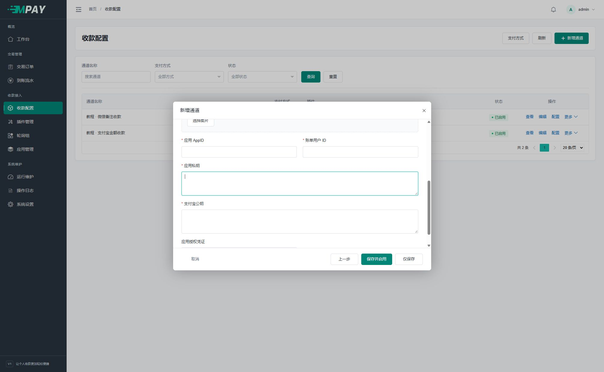

# 支付宝账单收款

这套方案由服务器定期查询支付宝账单来识别收款，不需要手机转发到账通知。插件编码为 `alipay_bill_receipt`，后台选择“支付宝账单收款”即可。

## 准备条件

准备可使用 `alipay.data.bill.accountlog.query` 的支付宝应用、账单账户和相应授权。账号权限及平台字段以支付宝开放平台实际配置为准；普通收款码并不自动具备账单接口权限。

只有普通收款码和安卓手机、没有这些平台资料时，先使用[支付宝手机监听](V1-12-支付宝手机监听.md)。本页说明 MPAY 中的填写位置，不提供未经核验的开放平台开通路径；接口权限和资料需要先在自己的支付宝应用中确认。

## 通道配置

新增支付宝通道，选择“支付宝账单收款”。先填写收款码与[通用插件参数](V1-07-插件管理与配置约定.md)，再填写：

操作路径为“收款配置 → 新增通道 → 支付宝 → 支付宝账单收款 → 通道配置 → 插件参数”。到第四步后在弹窗内向下滚动，即可看到 AppID 和密钥字段。

| 字段 | 来源与说明 |
| --- | --- |
| 应用 AppID `app_id` | 支付宝开放平台应用 ID，16～32 字符；不是 MPAY 应用 PID |
| 账单用户 ID `bill_user_id` | 被查询账单所属支付宝用户 ID，16～32 字符；不是登录手机号 |
| 应用私钥 `private_key` | 与该 AppID 公钥配置配对的 RSA 私钥；秘密字段，不填写文件路径 |
| 支付宝公钥 `alipay_public_key` | 平台响应验签公钥；不是你的应用公钥或私钥 |
| 应用授权凭证 `app_auth_token` | 需要代理授权时填写相应凭证；无此要求时保持未设置 |

密钥使用 PEM 或受支持的 Base64 RSA 文本。插件不读取你填入的服务器文件路径；不要在公开截图中展示私钥或授权凭证。

逐项从平台资料或你保存的密钥文件复制，不要手抄：AppID 复制应用编号；账单用户 ID 复制被查询账号的编号；应用私钥复制与该应用配对的完整私钥文本；支付宝公钥复制平台验签公钥。有应用授权凭证时继续向下滚动填写，没有代理授权要求则保持空白。

两种公钥名称相似，不能互换。“应用私钥”也不是 MPAY 应用 KEY。资料尚未准备齐时先退出表单，不要用任意数字或伪造密钥保存并启用。

## 启动与观察

1. 保存并启用通道，确认已进入所需默认组或自定义组。
2. 按[部署指南](V1-18-部署与后台任务.md)运行 watch 与 work。
3. 在运行维护检查采集状态和错误分类。
4. 从业务网站发起订单，用匹配的收款账户核对实际到账与原订单。

查询失败时，在“运行维护”查看原因，先处理权限、密钥或平台返回问题。只有本次账单完整读取并核对后才记为采集完成，不会把查询出错显示成“没有收款”。

## 同账号多通道

每个通道配置独立保存。插件根据 AppID 与账单用户定义查询身份；相同查询可合并，账单 API 无需建立登录会话。不同凭证发生冲突时应查看运行记录并修正对应通道，不关闭验签。

## 常见问题

| 现象 | 优先检查 |
| --- | --- |
| 无接口权限 | AppID 对应应用是否开通接口，被查询账号是否有有效授权 |
| 验签失败 | 应用私钥与 AppID 是否配套、平台公钥是否正确、响应是否完整 |
| 能查但无匹配 | 实际账单用户、付款时间窗口、金额/备注与原订单是否一致 |
| 协议或分页错误 | 平台字段、金额方向、分页总数及响应结构，保留脱敏证据后适配 |

当前接收与本地签名合同已有实现；真实平台权限、账单可见延迟和字段样本仍需按实际账号验证。不要将隔离签名测试写成平台接入已经通过。
