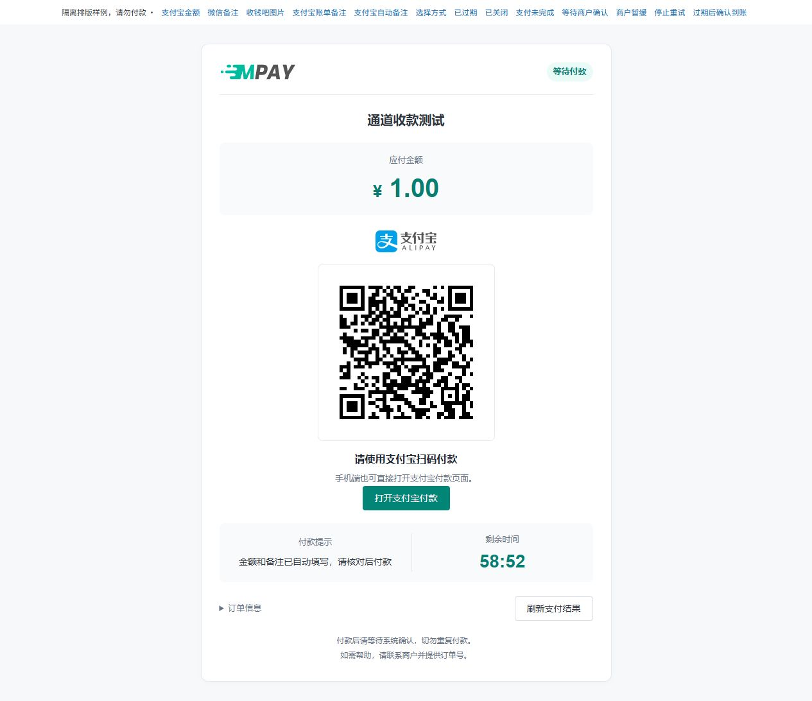

# 支付宝账单收款

这套方案由服务器根据待核对订单查询支付宝账单来识别收款，不需要手机转发到账通知。插件编码为 `alipay_bill_receipt`，后台选择“支付宝账单收款”即可。

## 准备条件

准备可使用 `alipay.data.bill.accountlog.query` 的支付宝应用、账单账户和相应授权。账号权限及平台字段以支付宝开放平台实际配置为准；普通收款码并不自动具备账单接口权限。

只有普通收款码和安卓手机、没有这些平台资料时，先使用[支付宝手机监听](V1-12-支付宝手机监听.md)。本页说明 MPAY 中的填写位置，不提供未经核验的开放平台开通路径；接口权限和资料需要先在自己的支付宝应用中确认。

## 通道配置

新增支付宝通道，选择“支付宝账单收款”。先选择下文的匹配方式及[通用插件参数](V1-07-插件管理与配置约定.md)，再填写账单应用资料：

操作路径为“收款配置 → 新增通道 → 支付宝 → 支付宝账单收款 → 通道配置 → 插件参数”。到第四步后在弹窗内向下滚动，即可看到 AppID 和密钥字段。

| 字段 | 来源与说明 |
| --- | --- |
| 应用 AppID `app_id` | 支付宝开放平台应用 ID，16～32 字符；不是 MPAY 应用 PID |
| 账单用户 ID `bill_user_id` | 被查询账单所属支付宝用户 ID，16～32 位数字字符串；不是登录手机号 |
| 应用私钥 `private_key` | 与该 AppID 公钥配置配对的 RSA 私钥；秘密字段，不填写文件路径 |
| 支付宝公钥 `alipay_public_key` | 平台响应验签公钥；不是你的应用公钥或私钥 |
| 应用授权凭证 `app_auth_token` | 需要代理授权时填写相应凭证；无此要求时保持未设置 |

密钥使用 PEM 或受支持的 Base64 RSA 文本。插件不读取你填入的服务器文件路径；不要在公开截图中展示私钥或授权凭证。

账单用户 ID 的必填、字符串类型及数字位数统一由插件 schema 在保存、启用时检查；生成自动金额/备注入口时直接使用原配置，不再重复同一正则校验。平台响应验签、账单归属、订单金额和匹配窗口核验仍照常执行。更新字段声明后，通过插件管理刷新定义，再核对已有参数，不自动改写旧值。

逐项从平台资料或你保存的密钥文件复制，不要手抄：AppID 复制应用编号；账单用户 ID 复制被查询账号的编号；应用私钥复制与该应用配对的完整私钥文本；支付宝公钥复制平台验签公钥。有应用授权凭证时继续向下滚动填写，没有代理授权要求则保持空白。

两种公钥名称相似，不能互换。“应用私钥”也不是 MPAY 应用 KEY。资料尚未准备齐时先退出表单，不要用任意数字或伪造密钥保存并启用。

## 选择匹配方式

在“插件参数 → 匹配方式”选择实际需要的一种：

| 选项 | 需要配置 | 付款者怎么操作 |
| --- | --- | --- |
| 按金额识别 | 本人的收款码内容或图片、金额偏移上限 | 按收银台的准确应付金额付款 |
| 手动填写备注 | 本人的收款码内容或图片 | 按应付金额付款，并完整填写本单四位备注 |
| 自动填写金额和备注 | 有效的账单应用资料；收款方使用账单用户 ID | 电脑扫本单生成的码，或在手机使用页面上的支付宝入口，再核对收款方、金额和备注 |

自动填写模式的内部编码为 `alipay_transfer`，日常配置只需选择中文选项。该模式隐藏收款码内容、图片与金额偏移字段；程序为每笔订单生成带本单金额和备注的公开付款入口，不需要另外粘贴付款链接。它仍通过账单识别到账，不是支付宝官方下单接口或接口退款功能。

先从“更多 → 测试”验证自己的支付宝客户端是否正确带入金额和备注。页面打开、客户端唤起和字段自动填写都不代表付款成功；如果客户端未按预期带入，请先停止付款并核对接入情况，或改用已经验证的手动备注/金额模式。修改只影响之后新建的订单。

## 启动与观察

1. 保存并启用通道，确认已进入所需默认组或自定义组。
2. 按[部署指南](V1-18-部署与后台任务.md)运行 watch 与 work。
3. 在“收款配置”找到该通道，点击“更多 → 测试”，选择应用与金额，打开收银台；也可以从业务网站发起订单。
4. 按收银台的金额和备注付款，在“运行维护”查看待核对订单、最近成功查询及错误提示，再核对实际账户与 MPAY 原订单。

**没有待核对订单时不查询账单。** 只启用通道但没有下单，查询时间未更新是正常现象；支付宝账单通过逐次请求签名认证，没有网页登录或预登录保活。

每个账单账户每轮只查询一次，时间范围来自相关订单，取最新最多 200 条，不翻页。达到 200 条仍匹配本批记录，并提示已达条数上限；这不代表查询了时间范围内的全部流水。查询失败时先处理权限、密钥或平台返回问题，不把错误当成“没有收款”。

## 同账号多通道

每个通道配置独立保存。当前插件按账单用户 ID 合并同一账户的待核对订单，一轮共用一次查询；AppID、私钥及授权凭证仍须有权读取该账户。相同账户的多个通道应填写一致、有效的授权资料，不要依赖重复填写来增加查询次数。修改通道认证参数后，只有账单用户未改变时，原订单才可使用更新后的认证资料。

匹配仍按各订单的通道 ID 区分。相同账户下两个通道出现相同金额/备注和重叠付款窗口时，可能无法判断流水归属；插件记录 `ambiguous_channel` 并跳过，不按通道排序强行分配。请核对平台记录和原订单后处理，日常可先只启用该账号的一条通道。

## 常见问题

| 现象 | 优先检查 |
| --- | --- |
| 无接口权限 | AppID 对应应用是否开通接口，被查询账号是否有有效授权 |
| 验签失败 | 应用私钥与 AppID 是否配套、平台公钥是否正确、响应是否完整 |
| 能查但无匹配 | 实际账单用户、付款时间窗口、金额/备注与原订单是否一致 |
| 协议错误 | 平台字段、金额方向、时间及响应结构，保留脱敏证据后适配 |
| 达到 200 条上限 | 到平台账单核对原订单对应流水；系统不会自动翻页补齐更早记录 |
| 提示 ambiguous_channel | 同一账单账户下是否有多个通道的候选同时符合；先核对原订单，不重复付款 |

当前接收与本地签名合同已有实现；真实平台权限、账单可见延迟和字段样本仍需按实际账号验证。不要将隔离签名测试写成平台接入已经通过。
