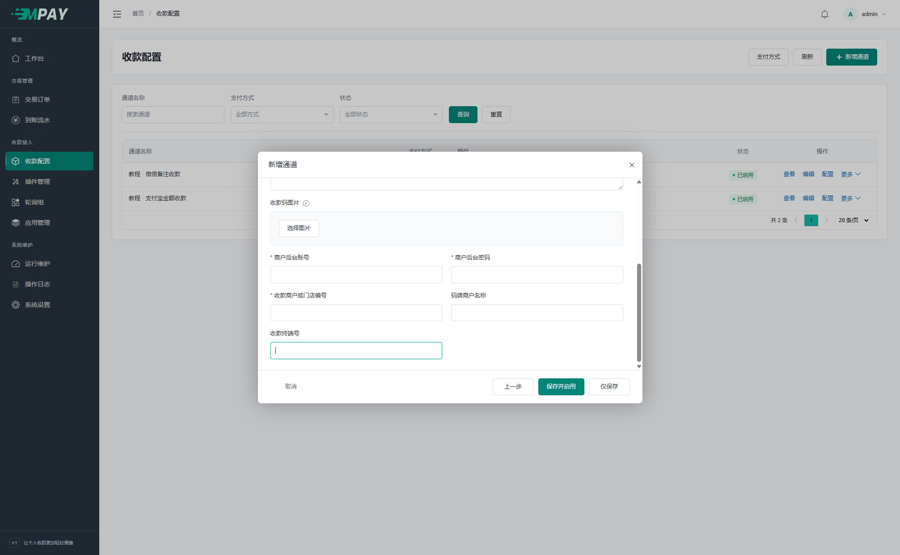

# 收钱吧码牌收款

这套方案由服务器查询收钱吧商户后台流水来识别收款，支持支付宝和微信支付。后台选择“收钱吧码牌收款”即可，插件编码为 `shouqianba_receipt`。

## 准备资料

准备能登录并查看目标收款范围的商户后台账号、对应商户/门店编号、实际码牌以及需要时的终端号。登录账户、查询范围和展示给付款人的二维码必须一致。

## 参数填写

新增通道时选择支付方式和收钱吧插件。两种方式可分别建立通道，参数独立保存。

以支付宝为例，依次点击“收款配置 → 新增通道 → 支付宝 → 收钱吧码牌收款”，填写通道名称和金额范围，再到“插件参数”。填写收款码后向下滚动，出现下面的账号和范围字段。

| 字段 | 填写方法 |
| --- | --- |
| 商户后台账号 `watcher_username` | 能查看目标收款记录的实际登录账号 |
| 商户后台密码 `watcher_password` | 对应密码，秘密字段；不要填写 MPAY 管理密码 |
| 收款商户或门店编号 `receipt_account_no` | 来自目标商户/门店资料的真实编号，不填显示名称、手机号或随意自定义标记 |
| 码牌商户名称 `receipt_merchant_name` | 需要选择商户上下文时填写实际商户名称，可空 |
| 收款终端号 `receipt_terminal_no` | 可填平台终端编号或码牌指纹；留空时尝试从收钱吧码牌链接读取指纹，无法读取时不限定终端 |

平台界面未直接显示编号时，应从该账号有权访问的资料或平台接口说明取得；不同编号不能因长度相近就互换。当前插件按平台返回的商户、门店及终端字段核对范围，不根据名称猜测所有权。

终端编号使用平台的 `terminal_sn` 查询字段；码牌链接中的指纹，以及按当前平台约定填写的 16 位及以上纯数字指纹，使用 `device_fingerprint`。显式填写的终端优先于链接中的指纹；查询与流水核对使用相同目标。不同码牌仍分别处理，不会因为共用登录账号而合并收款范围。

先在收钱吧自己的商户后台确认账号可以看到目标门店的流水，再把相同资料复制到表单。一个账号能看多个门店时，尤其要核对“收款商户或门店编号”；不清楚编号时先取得平台资料，再启用通道。当前页面截图只展示输入位置，不代表图中的空白配置能够连接平台。

收款码、识别模式、有效期、偏移说明见[插件参数](V1-07-插件管理与配置约定.md)。只有真实流水携带付款备注时才使用备注匹配。

## 启用与核对

保存并启用，确认路由预览可选，然后运行 `payment:watch` 和 `payment:work`。在平台后台与 MPAY 订单中核对同一笔真实付款，不以登录成功或能拉取列表代替到账匹配验证。

可以先从该通道“更多 → 测试”选择应用与金额，按收银台要求付款，再检查原订单及“运行维护”。这会生成普通订单，测试成功后还需从业务网站验证下单与商户通知。

该插件不接受平台 HTTP 推送，通道“接入信息”显示后台采集说明，无需向收钱吧填写 MPAY 回调地址。到账来自 watch 主动查询。

有待核对订单时，每登录账号每轮只查询一个收款范围，带订单时间范围取最新最多 200 条，不翻页。达到上限仍处理已返回流水，并提示条数上限；超过本次返回范围的收款，需要到平台账单核对。

没有订单但通道启用时，插件仍会低频验证登录状态，默认间隔 600 秒。验证只取最近 10 分钟的 1 条记录，不确认订单；本轮已正式查单的账号不会再重复验证。普通用户无需另外添加保活任务或寻找表单开关。

## 相同账号的处理

多个通道可以使用同一账号，插件按登录用户名复用状态；不同门店或终端范围逐轮切换，每轮仍只查询一个范围。管理员仍需确保各通道的密码、门店及终端范围填对。

同登录配置了不同密码时允许保存。已验证凭证仍在配置中时优先复用；无法确定使用哪份凭证时才报告冲突并延后，不交替使用两个密码反复登录。检查相关通道，修正或停用错误配置；有在途订单时先处理原付款责任。

登录状态保存在私有 `runtime/receipt` 文件缓存中，重启任务可复用，不按固定缓存时长删除。网络失败保留已有状态，平台明确拒绝认证后才重新认证。看到缓存文件或登录验证成功，都不能代替实际订单到账检查。

定位收款范围时，先读取当前商户；与目标一致则直接复用，只有尚未选择或不一致时才选择商户并重新核对。选择商户接口按平台成功码判断动作结果，其 `data` 可为字符串；其他查询接口仍检查业务数据结构，选择动作成功不能代替流水查询及到账确认。

账号复用只减少登录和查询；金额、备注仍在每个通道内独立分配。同一条流水若同时符合多个通道的候选，插件记录 `ambiguous_channel` 并跳过。先到平台核对门店、终端、金额、备注和付款时间，再处理对应原订单，不用另一张订单重复确认同一流水。

## 排查方向

在“运行维护 → 采集状态 → 详情”查看失败阶段、平台错误码和原始错误说明。登录接口返回 `50105：账号或者密码错误` 属于认证失败，应核对账号密码；商户接口的同码可能表示尚未选择商户，不能仅按数字认定为收款范围错误。若来源显示“插件”，则说明失败发生在本地配置或平台数据核对，说明文字会指出对应检查。恢复后保留最近错误，并显示恢复时间。

| 状态 | 检查 |
| --- | --- |
| 认证异常 | 账号密码、平台认证要求、重复配置的凭证是否一致 |
| 范围异常 | 当前账号能否进入目标商户/门店，编号、名称和终端是否对应 |
| 协议异常 | 平台返回结构、成功状态、交易金额及交易号是否符合当前适配 |
| 有真实到账但未匹配 | 支付方式、原单时间、提示金额/备注、终端过滤 |

程序只保存已匹配流水。未匹配的完整平台流水不留在 MPAY，排查时需同时查看来源平台。平台协议及登录策略会变化，应使用真实授权账号联调，不保证任意账号和码牌都已适配。
