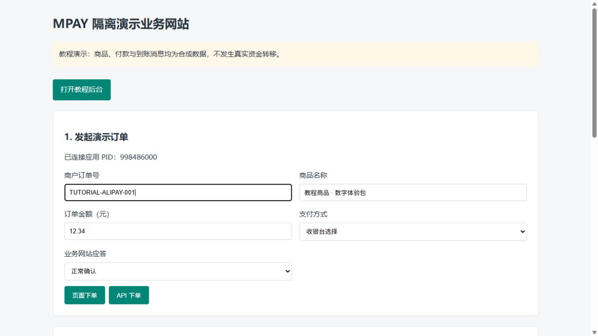
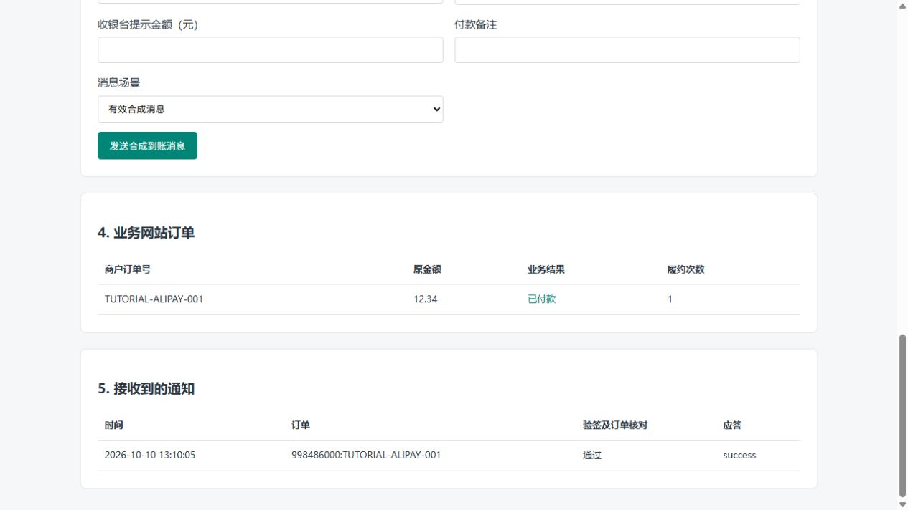

# 业务网站接入

已有商城、发卡站或其他支持“易支付”的系统时，优先使用它的易支付 V1 支付模块。不同系统对字段名称的叫法不一致，应按用途填写。

## 接入前

- MPAY 至少有一个已启用并可选路的通道。
- 在 MPAY 新建或选择该网站对应的应用。
- 应用允许域名可留空或填写 `*`；填写具体名单时，须包含实际 `notify_url` 和 `return_url` 的域名。
- 网站服务器与 MPAY 能相互访问配置的 HTTP 或 HTTPS 地址。

## 字段对应

先在 MPAY 完成[应用与凭证教程](V1-05-应用与接入凭证.md)，再打开业务网站自己的“支付设置/支付接口/易支付”页面。不同商城的菜单名称不同，以下按字段用途对应，不要求购买或安装某个指定商城。

| 业务网站常见字段 | 填入什么 |
| --- | --- |
| 接口地址 / 网关 / API 地址 | MPAY 的站点根地址，或模块明确要求的完整 `/submit.php`、`/mapi.php` 地址 |
| 商户 ID / PID | MPAY 应用的 PID |
| 商户密钥 / KEY | 同一个 MPAY 应用的 KEY |
| 支付方式 | 支付宝为 `alipay`，微信为 `wxpay`；只启用实际有通道的方式 |
| 回调域名 / 网站地址 | 业务网站自身的地址，不是收款平台后台地址 |

例如根地址为 `https://pay.example.com/`，页面支付地址是 `https://pay.example.com/submit.php`。如果模块会自行追加 `submit.php`，只填写根地址，避免出现两次路径。

不知道模块要求哪一种时，查看该字段旁的示例或模块说明，确认是否由模块追加路径；不要把 `/admin/login`、`/install` 或通道的 `/api/pay/.../notify` 地址当作易支付网关。

MPAY 的应用 KEY 与微信/支付宝通知密钥、支付宝 RSA 私钥、收钱吧密码完全不同。付款者浏览器不能获得应用 KEY；签名应由业务网站服务端完成。

## 按顺序填写，避免两边填反

1. 在业务网站选择“易支付 V1”或确认模块实现的是 V1 协议。
2. 网关地址从 MPAY 应用详情“接入信息”复制。确认模块要求根地址还是完整下单地址。
3. 在 MPAY 应用卡片点击复制 PID，粘贴到业务网站的商户 ID/PID。
4. 在同一应用的“凭证管理”通过管理员密码复核复制 KEY，粘贴到商户密钥/KEY。
5. 在业务网站只启用已配置通道的支付方式，例如支付宝、微信；不要因为列表有云闪付就启用它。
6. 保存业务网站的设置；如果 MPAY 应用填写了具体允许域名，检查名单包含实际回调和返回页面的域名。留空或 `*` 不限制域名。

例如启用域名限制后，支付页使用 shop.example.com，而回调接收程序在 api.example.com，两者都要分别填写，每行一个。只填写域名，不填写协议、端口和路径。是否使用两个域名，应以业务网站实际生成的地址为准。

## 配置后怎么验证

从业务网站正常创建订单，确认跳转到 MPAY；按[第一笔收款](V1-04-完成第一笔收款.md)核对到账、MPAY 状态和网站订单。页面返回成功但业务订单未更新时，查看异步通知，不以浏览器回跳替代服务端处理。

可以按以下检查表完成第一次接入：

| 操作 | 完成后应看到什么 | 没有看到时 |
| --- | --- | --- |
| 在商城正常点购买/支付 | 跳到 MPAY 收银台，商品和金额正确 | 核对网关地址、PID/KEY、允许域名及接口路由 |
| 在 MPAY 后台搜索商城订单号 | 能找到同一应用的原订单 | 核对是否真的请求了这一套 MPAY，以及查询日期 |
| 完成真实付款并等待识别 | MPAY 原单确认成功，有对应依据 | 查真实账户、设备/采集及原单金额/备注 |
| 查看“商户通知” | 业务网站已确认，响应正文 success | 打开每次响应，并查商城接收程序 |
| 回到商城原订单 | 商品交付/充值等业务完成一次 | 查商城验签、金额校验及业务提交，不再次付款 |

下面是独立演示网站发起订单的填写位置，仅用于展示“业务网站下单”的概念；你的商城页面不会要求手填每个购买订单号。

业务网站收到同一笔通知两次，也只能执行一次发货/充值。演示网站中的“履约次数 1”展示的是这个要求：

暂不提供针对未核验版本的第三方商城截图教程。使用异次元、独角、WordPress 等模块时，先核对模块支持易支付 V1 以及字段实际含义；不直接套用 V2 的商户后台、V2 签名或接口路径。

## 自行开发

阅读[完整接口参考](V1-16-易支付V1接口参考.md)，使用[PHP 签名示例](examples/epay-sign.php)实现请求签名。通知验签和幂等处理见[通知与排障](V1-17-通知验签与联调排障.md)。示例仅演示签名，不包含你的订单数据库或发货逻辑。
