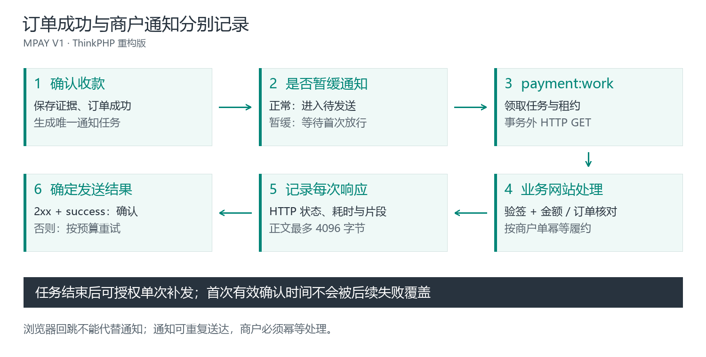

# 通知验签与联调排障

已有商城但不修改代码时，先按[后台查看商户通知](V1-10-商户通知与人工处理.md)找到失败响应，再将脱敏结果交给该网站维护人员。下文的 PHP 和事务要求用于开发接收程序，不是需要粘贴到 MPAY 后台的设置。

先区分三个方向：



设备/平台 → MPAY 的到账通知，与 MPAY → 业务网站的付款通知使用不同地址和认证合同。`return_url` 则由付款者浏览器访问，仅负责返回页面。

## 接收 MPAY 的付款通知

1. 接收 GET 参数，按易支付 V1 规则验证全部签名参数。
2. 核对 PID、`out_trade_no`、原订单金额及 `trade_status=TRADE_SUCCESS`。
3. 以业务订单建立幂等约束，在事务内完成订单状态与可靠的履约记录。
4. 提交成功后以 HTTP 2xx 返回纯文本小写 `success`。
5. 重复通知已处理订单时仍返回 `success`，但不能重复发货或记账。

响应示例：

```php
// 仅在验签、订单核对及业务事务已经成功提交之后执行。
header('Content-Type: text/plain; charset=utf-8');
http_response_code(200);
echo 'success';
```

`{"code":200}`、`ok`、空正文、HTML 页面及 HTTP 500 下的 `success` 都不符合本版有效应答合同。网络超时或应答丢失可能导致重复发送，因此业务网站必须幂等。

## KEY 重置后的旧订单

通知沿用下单时的 PID、KEY 版本和目标地址。业务网站应根据原订单记录选择对应旧 KEY，而不是对所有订单只使用当前活动 KEY。签名验证后仍要检查订单归属与金额。

## 按现象排查

| 现象 | 排查顺序 |
| --- | --- |
| 业务网站根本未收到请求 | MPAY 原订单是否确认到账 → 通知是否暂缓 → work 是否运行 → 任务下一次时间 → URL、域名、HTTPS 与网络 |
| 返回登录页、验证码、403 | 通知入口应能被 MPAY 服务端直接访问，不依赖浏览器登录或页面 CSRF 表单 |
| 验签失败 | PID/KEY、旧订单凭证、参数原值、空值处理、排序、URL 编码顺序、URL 自带参数 |
| HTTP 200 仍重试 | 查看商户响应，是否准确返回小写纯文本 `success` |
| MPAY 最近补发失败，但以前成功 | 区分最近一次结果和首次商户确认，两者可以同时存在 |
| 网站已处理但 MPAY 重试 | 应答未到达或格式不符；保留幂等，不重复履约 |
| 暂不通知但网站查单显示成功 | 正常；暂缓只控制异步通知，不隐瞒已经确认的支付事实 |

后台最多显示每次响应的 4096 字节片段，超长或中断带截断标记。技术错误用请求编号与业务编号关联，不公开 KEY、完整签名地址、Cookie、私钥或用户资料。

## 联调记录建议

记录应用、业务订单号、MPAY 支付号、发起时间、实际到账时间、MPAY 成功时间、通知尝试和网站处理结果。区分“合成回调验证”和“真实平台到账”，不能把手工改状态作为完整支付验证。
