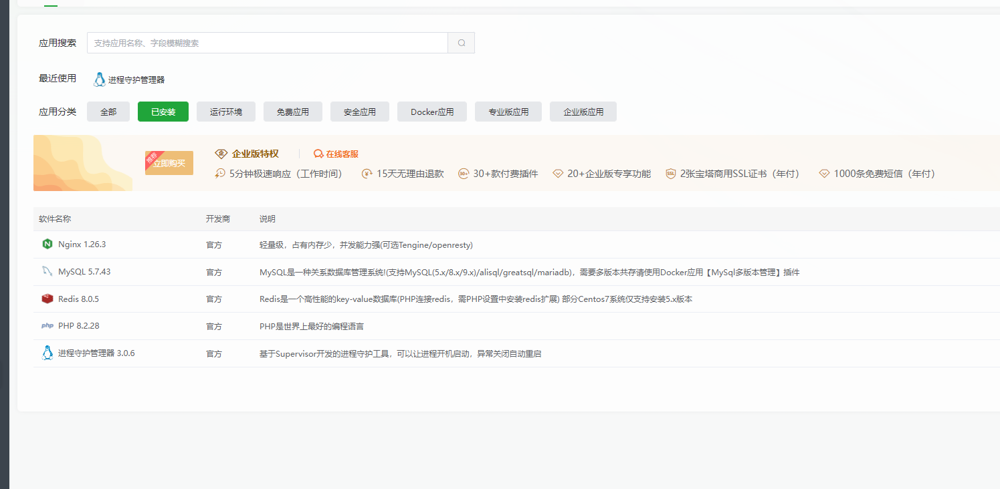
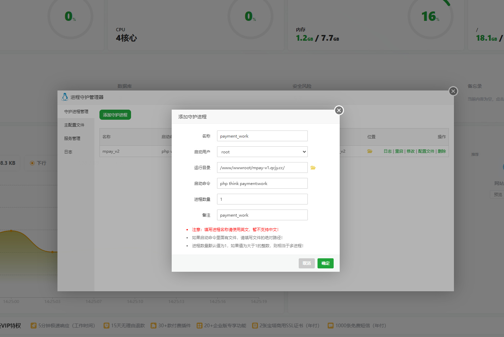
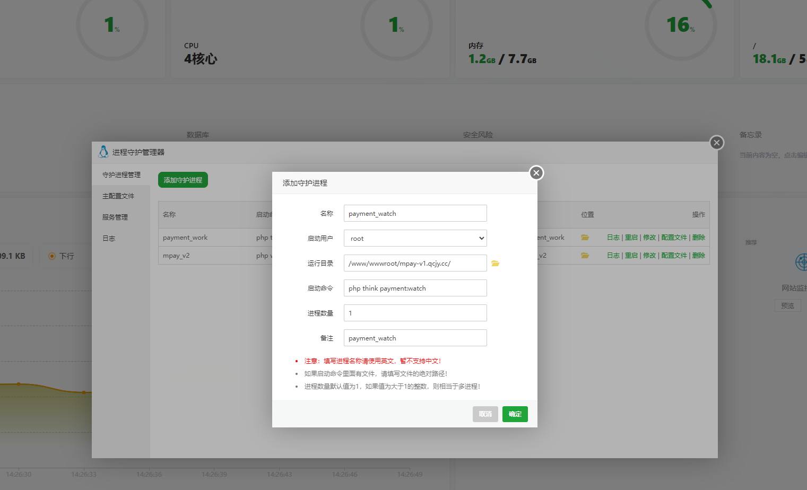

# 部署与后台任务

MPAY 使用常规 PHP 网站和两个原生 CLI 守护命令。网站运行目录为 `public`；无需 Redis、Workerman 或额外队列进程。

## Web 服务器

使用宝塔面板时，先按[宝塔部署图文](新手-宝塔建站准备.md)完成 PHP 建站、`/public` 运行目录及 ThinkPHP 伪静态；可直接复制[面板专用片段](examples/baota-nginx-rewrite.conf.example)。下面的 Nginx 文件是完整站点配置模板，不要整份粘贴进宝塔伪静态输入框。

宝塔伪静态以本版片段为准，不直接沿用不同版本的 `thinkphp` 预置模板；重写放在 server 层，不包裹 `location /`。保留主配置中的敏感目录保护，当前后台运行维护使用 `/admin/maintenance` 和 `/adminapi/maintenance`，无需放行 `runtime`。

准备独立目录、数据库和运行账户，按[安装要求](V1-03-安装与环境要求.md)配置 PHP 扩展。允许写入 `runtime`、`public/storage`，安装时允许保存根目录配置；公开目录以外文件不能通过网站下载。

可下载的示例：

- [Nginx HTTPS](examples/nginx-https.conf.example)
- [Nginx HTTP](examples/nginx-http.conf.example)
- [Apache](examples/apache.conf.example)
- [Supervisor 两进程](examples/supervisor.conf.example)与[路径环境变量](examples/workers.env.example)
- [systemd 模板](examples/mpay-v1@.service.example)

所有示例路径、运行用户、域名、证书与 PHP-FPM socket 都是占位值，使用前替换。HTTPS 示例中的证书路径需匹配当前站点。PHP-FPM 可以使用面板管理的池，不必额外部署另一套 PHP。

宝塔部署时，**网站 PHP 和两个后台任务统一使用 `www` 用户**，不要让后台任务以 `root` 运行。Supervisor 和 systemd 示例均已明确设置 `www`；若站点使用专用 PHP-FPM 用户，应将两个任务同步改成该用户。运行用户须能读取程序和 `.env`，并读写 `runtime` 及其下级文件，避免网站和任务生成的缓存、日志或心跳互相无法访问。

登录验证码和请求限流使用独立的短期缓存：可用时自动使用已有 `/dev/shm` 内存盘，否则使用 `runtime/access/`。无需手工挂载、添加 Redis 或另建守护任务；Web 与 CLI 的用户、目录访问权限和 PHP 环境需保持一致。具体目录选择与清理见[访问保护存储说明](V1-31-登录验证码与请求限流.md#存储和清理)，不要清空 `runtime/receipt` 来处理验证码问题。

### 路由检查

`/submit.php`、`/mapi.php`、`/api.php` 是 ThinkPHP 显式路由，不是要上传的独立 PHP 文件。Web 服务器必须将这些路径转给 `public/index.php`，并保留原始业务路径和查询串。任意其他磁盘 PHP 文件不应因此开放执行。

上传目录只提供已允许的静态图片，禁止 PHP 执行和目录列表。多个域名可指向同一站点，应用按当前访问域名生成站内链接；外部设备或业务网站保存的旧地址仍须自行更新。

生产环境核对 `APP_DEBUG=false`、`MPAY_ENV=production`。站点地址和协议统一使用 ThinkPHP 原生 Request；HTTP、HTTPS 和标准代理访问不需要选择应用模式或配置固定站点网址。

HTTP 和 HTTPS 均可访问后台及设备通知接口；程序不以协议作为准入条件，也不使用 `COOKIE_SECURE`。两种协议共用当前主机的 `mpay_session` 和框架文件会话，Cookie 固定为 `secure=false`、`HttpOnly`、`SameSite=Lax`，不按请求动态切换。写请求保留 CSRF、跨站标识和载荷检查，设备通知保留签名、时间及消息校验。

站点链接由 ThinkPHP 原生 Request 和 url() 生成。使用反向代理时，由服务器正确传递实际访问主机和协议，保证生成的绝对链接可用；程序不比较浏览器 Origin 与后端识别的地址，不提供代理专用模式或协议开关。

## 只配置两个守护入口

两个命令分别管理采集和通知。下面的 `/path/to/` 是路径占位符；按下一节从面板复制实际路径后，再填写到守护工具中。

```sh
/path/to/php /path/to/mpay/think payment:watch
/path/to/php /path/to/mpay/think payment:work
```

| 命令 | 职责 |
| --- | --- |
| `payment:watch` | 按订单调度账单/码牌插件、批量识别、低频登录保活 |
| `payment:work` | 商户通知及其重试、订单过期维护、有限运行文件清理 |

两个命令默认持续运行，无需额外参数，也不会每小时主动退出。以前台方式交给 Supervisor **或** systemd，二选一；Supervisor 用 `autorestart=true`，systemd 用 `Restart=always`，让进程意外退出后自动恢复。不要再加 cron 反复启动同一工作者。

付款准备只在下单或收银台请求中执行，已经保存的材料直接复用。图片缺失或配置失效由该请求明确提示，后台不反复准备付款。到期处理按单隔离故障，失败单在当前进程暂缓 60 秒且不占用其他订单的批次名额；不据异常修改支付事实。通知请求故障按原通知任务的退避与次数处理。插件未能正常返回采集批次时，默认暂缓该插件 60 秒，其他插件继续；数据库和共享运行设施故障仍会明确报错退出。

`autorestart=true` 不表示启动失败时无限重试。示例配置要求进程先稳定运行 3 秒；启动阶段连续失败超过 `startretries` 后会进入 `FATAL` 并停止自动拉起。此时先修复日志指出的原因，再手动启动任务；增加启动重试次数不能消除持续存在的故障。

旧日志和已退出心跳的例行清理失败会记录 runtime.prune_failed，并等下次清理周期再尝试，不中断商户通知。当前进程心跳写入、数据库访问等必要运行条件失败仍会明确上报。

请求中断且尚未保存付款材料时，由原下单请求重试或收银台准备入口继续；已认领的执行须在原执行期限到达后，按原订单和当前执行 token 重新准备，保留原识别事实与付款窗口。没有继续访问的订单等待到期，不自动调用插件 pay()。已准备订单的流水核对、到账确认和商户通知不依赖收银台保持打开。

更新程序或环境配置后，在守护工具中主动重启这两个任务，使新代码和配置生效。如果之前的启动命令带有 `--max-seconds=3600`，删除该参数、保存并重启任务即可使用默认常驻方式。

### 准备命令中的路径

| 需要的值 | 从哪里复制 | 示例 |
| --- | --- | --- |
| PHP 命令行文件 | 服务器实际安装的 PHP 可执行文件完整路径 | `/www/server/php/82/bin/php` |
| 程序目录 | 包含 think、app、public 的那一级目录 | `/www/wwwroot/pay.example.com` |

示例里的 82 不是强制版本目录，程序目录不要复制成 public。下面一段适用于服务器的 **Bash 终端**，可以整段复制；按两次提示粘贴路径即可。它只检查 PHP 版本并打印命令，不会启动任务或修改站点：

```bash
{
read -r -p '请粘贴 PHP 可执行文件完整路径：' MPAY_DOC_PHP
read -r -p '请粘贴含 think 文件的程序目录：' MPAY_DOC_ROOT
MPAY_DOC_ROOT=${MPAY_DOC_ROOT%/}
if [ ! -x "$MPAY_DOC_PHP" ] || [ ! -f "$MPAY_DOC_ROOT/think" ]; then
    printf '路径检查失败，请重新核对 PHP 文件和程序目录。\n'
else
    "$MPAY_DOC_PHP" -v
    printf '\n任务一：流水采集\n%q %q payment:watch\n' "$MPAY_DOC_PHP" "$MPAY_DOC_ROOT/think"
    printf '\n任务二：通知与维护\n%q %q payment:work\n' "$MPAY_DOC_PHP" "$MPAY_DOC_ROOT/think"
    printf '\n两个任务的工作目录\n%s\n' "$MPAY_DOC_ROOT"
    printf '\n环境诊断命令\n%q %q system:doctor\n' "$MPAY_DOC_PHP" "$MPAY_DOC_ROOT/think"
fi
}
```

确认输出中的 PHP 至少为 8.2，再分别复制任务一和任务二下面的一行命令。不要把标题、整段输出或两条命令一起粘贴到一个守护任务。终端变量只用于这次填写，不需要加入 MPAY 的 `.env`；在守护工具中保存打印出来的完整命令。

### 用进程守护工具添加任务

以下以宝塔“进程守护管理器”为例，先完成 MPAY 网页安装，再依次添加两个进程。截图中的目录属于演示站点，填写时换成你自己的程序目录；任务名称使用英文，例如 `payment_work` 和 `payment_watch`。点击图片可查看原图。

下方两张任务配置图为“修改守护进程”窗口，新增时按相同字段填写即可；“运行目录”和“进程目录”均指包含 `think` 的程序目录。启动优先级如有显示，保留默认 `999`。

#### 第一步：安装并打开进程守护管理器

1. 打开宝塔 **软件商店**，搜索“进程守护管理器”。
2. 尚未安装时先安装；已经安装则在“已安装”中找到它并打开。
3. 进入 **守护进程管理 → 添加守护进程**。

<p><a href="assets/tutorial/bt-supervisor-installed.png"></a></p>

图中 PHP、MySQL 和守护工具的版本只是截图环境，不要求与你的小版本相同；列表中的 Redis 属于该服务器其他用途，MPAY V1 不需要因此安装 Redis。

#### 第二步：添加通知与维护进程 payment_work

点击“添加守护进程”，按以下字段填写：

| 字段 | 填写内容 |
| --- | --- |
| 名称 | `payment_work`，这是面板里的任务名，使用英文，不填中文 |
| 启动用户 | **选择 `www`**，与网站 PHP 运行用户一致；须能读取程序、`.env` 并读写 `runtime` 及其下级文件 |
| 运行目录 | 含 `think` 的程序目录，例如 `/www/wwwroot/pay.example.com`；不是 `/public` |
| 启动命令 | 上一节生成的“通知与维护”完整命令，或使用下面的完整路径示例 |
| 进程数量 | `1` |
| 备注 | 可填 `payment_work`，便于识别 |

PHP 8.2 的常见路径示例，先替换为你的实际 PHP 和程序路径，再复制到“启动命令”：

```sh
/www/server/php/82/bin/php /www/wwwroot/pay.example.com/think payment:work
```

<p><a href="assets/tutorial/bt-supervisor-work.png"></a></p>

截图使用简写 `php think payment:work`，依赖运行目录正确且系统默认 php 满足要求；不确定默认版本时使用上面的完整路径。再次核对启动用户为 **www**，填写完成点击 **确定**。

#### 第三步：添加流水采集进程 payment_watch

再次点击“添加守护进程”，新建第二个任务：

| 字段 | 填写内容 |
| --- | --- |
| 名称 | `payment_watch` |
| 启动用户 | **选择 `www`**，与上一任务及网站 PHP 运行用户一致 |
| 运行目录 | 与上一任务使用同一程序目录 |
| 启动命令 | 上一节生成的“流水采集”完整命令，末尾为 `payment:watch` |
| 进程数量 | `1` |
| 备注 | 可填 `payment_watch` |

```sh
/www/server/php/82/bin/php /www/wwwroot/pay.example.com/think payment:watch
```

<p><a href="assets/tutorial/bt-supervisor-watch.png"></a></p>

确认两个任务的命令末尾分别是 `payment:work` 和 `payment:watch`，不要复制后忘记修改。点击 **确定**。面板名称中的下划线和命令中的冒号用途不同，不要把命令写成 `payment_work`。

#### 第四步：确认两个进程都在运行

返回“守护进程管理”，检查 `payment_work`、`payment_watch` 两行：

1. “启动用户”均为 **www**，“进程数量”均为 1，状态为 **RUNNING / 运行中**，并显示各自进程 ID。
2. 点击每行的“日志”，确认没有立即退出或反复启动；没有业务待办时，日志不持续输出也可能正常。
3. 确认守护服务随系统启动、任务自动启动，并在进程退出后自动恢复。若插件把这些选项放在“服务管理”或“配置文件”，到对应位置核对；Supervisor 对应 `autostart=true`、`autorestart=true`。
4. 登录 MPAY，按下一节检查“运行维护”的两个任务近期活动。

截图里其他任务属于别的程序，不需要照着添加。RUNNING 证明进程正在运行，不证明平台账号已登录、流水已采集或商户已确认；仍应核对 MPAY 后台与原订单。

#### 已经用 root 启动过，如何改为 www

1. 在守护进程管理中停止本站的 `payment_work` 和 `payment_watch`，不要操作其他项目的任务。
2. 分别点击“修改”，将两项“启动用户”都选为 `www`，点击“确定”保存。
3. 打开宝塔 **文件**，进入本站程序目录，查看 `runtime` 及其下级目录和文件的所有者、权限。若之前由 `root` 创建，请将这些运行文件的所有者改为 `www`，保证 `www` 能读写文件、进入目录；重点检查 `runtime/workers` 和 `runtime/receipt`。只处理本站运行目录，不删除心跳、会话、安装锁或其他运行数据，也不要把整个站点改成 `777`。
4. 启动两个任务，核对启动用户 `www`、状态 RUNNING 和日志；再刷新 MPAY“运行维护”，确认两个任务的最近活动时间持续更新。

只修改启动用户不会自动修复已有文件的所有者。若任务显示 RUNNING，但后台仍提示缺少近期活动，应检查 `runtime` 下级目录是否仍归 `root` 所有；仅检查 `runtime` 根目录可写并不足够。

#### 使用简写命令与日常操作

如果要使用截图中的简写，先在服务器终端执行下面的只读检查，确认默认 PHP 至少为 8.2、扩展符合要求：

```sh
php -v
php --ini
php -m
```

然后在正确设置运行目录的前提下，两个任务的启动命令可以分别填写：

```sh
php think payment:work
```

```sh
php think payment:watch
```

完整路径与简写是同一任务的两种填写方式，**每个任务只选一种，不额外再建一组任务**。面板守护服务找不到 php 或使用了不同版本时，改用完整路径。

更新程序或 `.env` 后，分别点击两个任务的“重启”。修改 PHP 路径、程序目录或命令时，先点“修改”保存，再重启；需要停止采集和通知时停止这两个任务，不必删除配置。备份期间的停写顺序见[备份与恢复](V1-19-备份恢复与域名迁移.md)。

每个任务只粘贴一行命令。无需在同一行追加 `&`、nohup 或再启动一层守护程序。面板已有守护工具时，不再同时安装另一份 systemd/Supervisor 任务运行相同命令。

若面板没有进程守护入口，请服务器管理者配置 Supervisor 或 systemd 中的一种，不要改用每分钟重复执行的计划任务。

### 常见启动结果

在 MPAY 左侧打开“运行维护”（`/admin/maintenance`），顶部两张卡片分别对应两个任务。点击“刷新”，核对最近活动时间；手机通道在下方显示“等待认证推送”时，继续到设备端核对通知权限和转发。


图中两个合成演示通道已主动停用，因此显示“采集暂停”，不表示两个任务停止。实际使用时分别核对任务心跳、通道启停状态和待核对订单。

| 看到什么 | 怎么处理 |
| --- | --- |
| 找不到 PHP 或 think | 按上面的路径表重新复制完整路径；程序目录不是 public |
| 缺少扩展、依赖不满足 | 检查命令行使用的 PHP；它可能与网站选用版本不同 |
| 数据库连接失败 | 核对该程序目录的 .env 和数据库授权，不能只凭网页可打开判断 CLI 正常 |
| 显示 BACKOFF、FATAL 或启动后很快退出 | 点该任务“日志”，先查 PHP/think 路径、运行用户权限、依赖和数据库；不要通过增加进程数量解决 |
| 任务 RUNNING，但后台读不到近期活动或提示权限不足 | 核对两个任务和网站 PHP 是否同为 `www`，按上文检查 `runtime/workers`、`runtime/receipt` 等已有文件的所有者和读写权限 |
| 提示已有相同角色进程运行 | 核对是否另开了手工命令、重复守护或计划任务；同一站点保留一组 work/watch |
| 每隔固定时间正常退出又启动 | 检查启动命令是否仍带 `--max-seconds`，或守护工具是否配置了定时重启；普通部署均无需设置 |
| 停止后进程数量越来越多 | 检查是否重复添加任务或又配置了定时启动，保留同一实例的一组 watch/work |

普通部署只使用上面的两行命令。需要手工处理有界批次时，可使用 `--once`，配合 `--limit` 指定最多处理数量（1～1000，默认 100）。它会处理真实待办，不能当作纯只读诊断。

`--max-seconds` 是可选的运维参数，仅显式指定 60～86400 秒时启用期限；不指定则没有运行时长上限。常驻进程在完成当前轮次后检查期限并正常退出；如选择此模式，守护工具须在正常退出后也自动续启。普通部署不需要这个参数。

不要求 fork/exec/posix。pcntl 可选，启用时可响应 TERM/INT 平滑退出；没有时由守护工具停止，通知按持久任务恢复，采集重新读取待核对订单。两个入口分开可避免慢平台查询直接阻塞商户通知，但不能保证任意积压下零延迟。

## 诊断与日常检查

```sh
/path/to/php /path/to/mpay/think system:doctor
```

在工作者实际使用的 PHP 下执行，检查 CLI 环境；后台“运行维护”的诊断是 Web PHP 环境。检查进程、服务器时间、采集进度、认证/协议错误及通知积压，不能只看页面可以打开。

可复制上面路径检查输出的“环境诊断命令”，粘贴到服务器终端执行。`[ok]` 表示该项检查通过，`[warning]` 需要结合提示判断，出现错误应先处理对应项目。不要只看到有输出就关掉窗口。

手机通知插件不需要主动采集任务记录；“等待推送”不是“手机已在线”。设备在线与通知权限须在设备端确认。

只有手机监听，或账单插件尚无待核对订单时，可能没有主动查询成功记录。先分别看两个任务的近期心跳，再按插件类型检查设备转发或发起一笔通道测试；不要把没有查询记录直接判断为进程停止。


图中的“采集暂停 2 个”对应主动停用的演示通道。诊断通过表示相应环境检查通过，不能替代真实收款验证；PHP/MySQL 版本与迁移步数按本站实际版本显示。

## 参数与延迟

工程默认值位于 `config/receipt.php`、`config/notify.php`，不需要为每个插件增加守护入口：

| 项目 | 默认值 |
| --- | --- |
| 采集查询窗口 | 按相关订单的付款窗口合并，截止不超过当前时间 |
| 扫描等待 / 账号正常查询间隔 | 3 秒 / 3 秒 |
| 平台单次流水数量 | 最新最多 200 条，只查第一页、不翻页 |
| 付款截止后补查 / 预登录验证间隔 | 300 秒 / 600 秒 |
| 单账号 / 单插件预算 | 15 秒 / 30 秒 |
| 登录状态缓存 | 永久保存，实际失效由插件判断 |
| 普通任务心跳 / 采集摘要保存 | 最多每 10 秒一次普通更新；失败及其他关键变化立即保存，网络阻塞时可能延后 |
| 通知连接 / HTTP 总超时 | 3 秒 / 10 秒 |
| 通知自动期限 | 首次可发送起算一天；人工暂缓在首次放行后起算 |

每站点只运行一个 watch；不得在不同主机同时监听同一账号。收钱吧正式查单与预登录不重复请求，保活只查询近 10 分钟的 1 条记录。运行页分别显示查询与登录验证时间，未查单不等于异常。详细规则见[主动采集](V1-25-主动采集与会话协作.md)。

这些是预算与默认配置，不代表实际平台允许的频率或账单到账速度。调整前核对平台规则、实际延迟与负载；更新常驻进程配置后应重启加载。SQL 等待、网络和积压仍需单独排查。

后台正常心跳不需要每秒变化，近期活动仍按 120 秒判断。采集异常时，在“运行维护”中按收款通道筛选并打开详情，查看最近错误的来源、阶段、平台码、说明和恢复时间；显示“已恢复”后保留上次错误供核对。收款配置页只管理配置，不展示采集诊断。具体保存时机与边界见[运行文件写入频率](V1-25-主动采集与会话协作.md#7-运行文件写入频率)。
