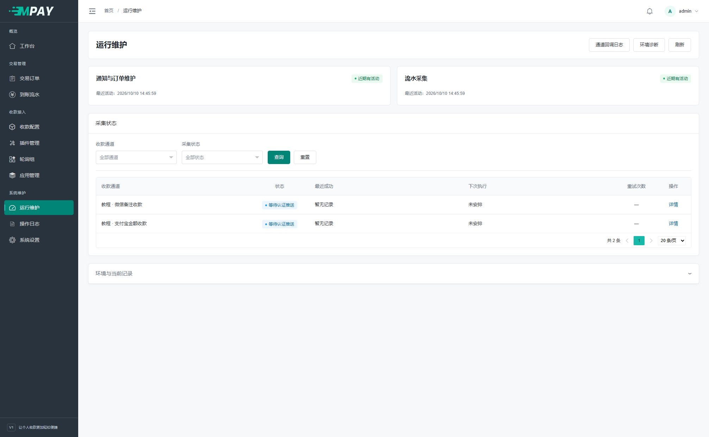
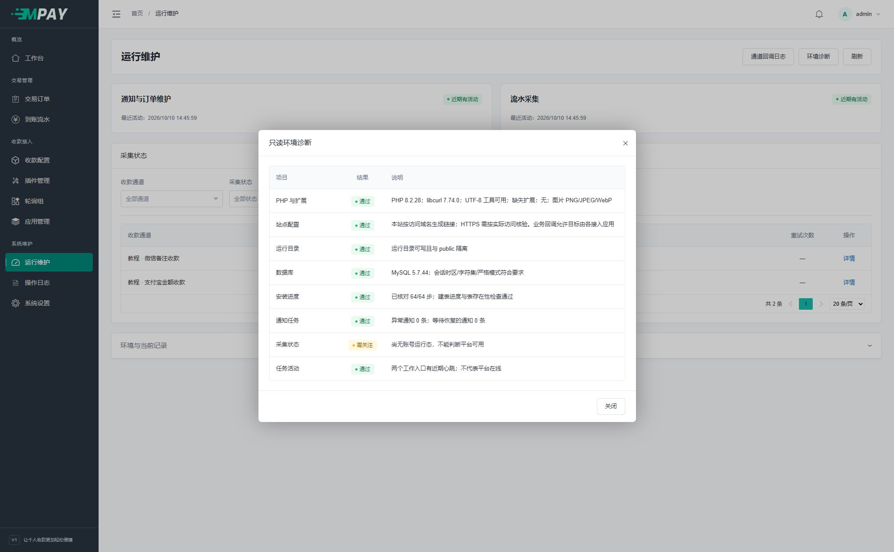

# 部署与后台任务

MPAY 使用常规 PHP 网站和两个原生 CLI 守护命令。网站运行目录为 `public`；无需 Redis、Workerman 或额外队列进程。

## Web 服务器

准备独立目录、数据库和运行账户，按[安装要求](V1-03-安装与环境要求.md)配置 PHP 扩展。允许写入 `runtime`、`public/storage`，安装时允许保存根目录配置；公开目录以外文件不能通过网站下载。

可下载的示例：

- [Nginx HTTPS](examples/nginx-https.conf.example)
- [Nginx HTTP 开发站](examples/nginx-http.conf.example)
- [Apache](examples/apache.conf.example)
- [Supervisor 两进程](examples/supervisor.conf.example)与[路径环境变量](examples/workers.env.example)
- [systemd 模板](examples/mpay-v1@.service.example)

所有示例路径、运行用户、域名、证书与 PHP-FPM socket 都是占位值，使用前替换。HTTPS 示例中的证书路径需匹配当前站点。PHP-FPM 可以使用面板管理的池，不必额外部署另一套 PHP。

### 路由检查

`/submit.php`、`/mapi.php`、`/api.php` 是 ThinkPHP 显式路由，不是要上传的独立 PHP 文件。Web 服务器必须将这些路径转给 `public/index.php`，并保留原始业务路径和查询串。任意其他磁盘 PHP 文件不应因此开放执行。

上传目录只提供已允许的静态图片，禁止 PHP 执行和目录列表。多个域名可指向同一站点，应用按当前访问域名生成站内链接；外部设备或业务网站保存的旧地址仍须自行更新。

生产环境核对 `APP_DEBUG=false`、`MPAY_ENV=production`、`COOKIE_SECURE=true`。反向代理应由可信服务器正确传递 HTTPS 状态，不接受客户端随意声明“已经 HTTPS”。

## 只配置两个守护入口

两个命令分别管理采集和通知。下面的 `/path/to/` 是路径占位符；按下一节从面板复制实际路径后，再填写到守护工具中。

```sh
/path/to/php /path/to/mpay/think payment:watch
/path/to/php /path/to/mpay/think payment:work
```

| 命令 | 职责 |
| --- | --- |
| `payment:watch` | 按订单调度账单/码牌插件、批量识别、低频登录保活 |
| `payment:work` | 商户通知、过期维护、任务恢复及有限运行文件清理 |

两个命令默认持续运行，无需额外参数，也不会每小时主动退出。以前台方式交给 Supervisor **或** systemd，二选一；Supervisor 用 `autorestart=true`，systemd 用 `Restart=always`，让进程意外退出后自动恢复。不要再加 cron 反复启动同一工作者。

更新程序或环境配置后，在守护工具中主动重启这两个任务，使新代码和配置生效。如果之前的启动命令带有 `--max-seconds=3600`，删除该参数、保存并重启任务即可使用默认常驻方式。

### 准备命令中的路径

| 需要的值 | 从哪里复制 | 示例 |
| --- | --- | --- |
| PHP 命令行文件 | 服务器实际安装的 PHP 可执行文件完整路径 | `/www/server/php/82/bin/php` |
| 程序目录 | 包含 think、app、public 的那一级目录 | `/www/wwwroot/pay.example.com` |

示例里的 82 不是强制版本目录，程序目录不要复制成 public。下面一段适用于服务器的 **Bash 终端**，可以整段复制；按两次提示粘贴路径即可。它只检查 PHP 版本并打印命令，不会启动任务或修改站点：

```bash
{
read -r -p '请粘贴 PHP 可执行文件完整路径：' MPAY_DOC_PHP
read -r -p '请粘贴含 think 文件的程序目录：' MPAY_DOC_ROOT
MPAY_DOC_ROOT=${MPAY_DOC_ROOT%/}
if [ ! -x "$MPAY_DOC_PHP" ] || [ ! -f "$MPAY_DOC_ROOT/think" ]; then
    printf '路径检查失败，请重新核对 PHP 文件和程序目录。\n'
else
    "$MPAY_DOC_PHP" -v
    printf '\n任务一：流水采集\n%q %q payment:watch\n' "$MPAY_DOC_PHP" "$MPAY_DOC_ROOT/think"
    printf '\n任务二：通知与维护\n%q %q payment:work\n' "$MPAY_DOC_PHP" "$MPAY_DOC_ROOT/think"
    printf '\n两个任务的工作目录\n%s\n' "$MPAY_DOC_ROOT"
    printf '\n环境诊断命令\n%q %q system:doctor\n' "$MPAY_DOC_PHP" "$MPAY_DOC_ROOT/think"
fi
}
```

确认输出中的 PHP 至少为 8.2，再分别复制任务一和任务二下面的一行命令。不要把标题、整段输出或两条命令一起粘贴到一个守护任务。终端变量只用于这次填写，不需要加入 MPAY 的 `.env`；在守护工具中保存打印出来的完整命令。

### 用进程守护工具添加任务

1. 完成网页安装，再打开所用守护工具的“新增任务”。
2. 名称填写“MPAY 流水采集”，启动命令粘贴上一节的任务一；工作目录粘贴程序目录，进程数量填 1。
3. 选择本站的运行用户。该用户应能读取 .env、程序文件并写入 runtime，不能随意选一个无权限的账户。
4. 开启启动和退出后自动重启，包含命令正常退出的情况，保存。
5. 再建“MPAY 通知与维护”，使用任务二，其余同上。
6. 确认两个任务均显示运行中，且不会立即反复退出；查看各自输出日志。

每个任务只粘贴一行命令。无需在同一行追加 `&`、nohup 或再启动一层守护程序。面板已有守护工具时，不再同时安装另一份 systemd/Supervisor 任务运行相同命令。

若面板没有进程守护入口，请服务器管理者配置 Supervisor 或 systemd 中的一种，不要改用每分钟重复执行的计划任务。

### 常见启动结果

在 MPAY 左侧打开“运行维护”，顶部两张卡片分别对应两个任务。点击“刷新”，核对最近活动时间；手机通道在下方显示“等待认证推送”时，继续到设备端核对通知权限和转发。



| 看到什么 | 怎么处理 |
| --- | --- |
| 找不到 PHP 或 think | 按上面的路径表重新复制完整路径；程序目录不是 public |
| 缺少扩展、依赖不满足 | 检查命令行使用的 PHP；它可能与网站选用版本不同 |
| 数据库连接失败 | 核对该程序目录的 .env 和数据库授权，不能只凭网页可打开判断 CLI 正常 |
| 每隔固定时间正常退出又启动 | 检查启动命令是否仍带 `--max-seconds`，或守护工具是否配置了定时重启；普通部署均无需设置 |
| 停止后进程数量越来越多 | 检查是否重复添加任务或又配置了定时启动，保留同一实例的一组 watch/work |

普通部署只使用上面的两行命令。需要手工处理有界批次时，可使用 `--once`，配合 `--limit` 指定最多处理数量（1～1000，默认 100）。它会处理真实待办，不能当作纯只读诊断。

`--max-seconds` 是可选的运维参数，仅显式指定 60～86400 秒时启用期限；不指定则没有运行时长上限。常驻进程在完成当前轮次后检查期限并正常退出；如选择此模式，守护工具须在正常退出后也自动续启。普通部署不需要这个参数。

不要求 fork/exec/posix。pcntl 可选，启用时可响应 TERM/INT 平滑退出；没有时由守护工具停止，通知按持久任务恢复，采集重新读取待核对订单。两个入口分开可避免慢平台查询直接阻塞商户通知，但不能保证任意积压下零延迟。

## 诊断与日常检查

```sh
/path/to/php /path/to/mpay/think system:doctor
```

在工作者实际使用的 PHP 下执行，检查 CLI 环境；后台“运行维护”的诊断是 Web PHP 环境。检查进程、服务器时间、采集进度、认证/协议错误及通知积压，不能只看页面可以打开。

可复制上面路径检查输出的“环境诊断命令”，粘贴到服务器终端执行。`[ok]` 表示该项检查通过，`[warning]` 需要结合提示判断，出现错误应先处理对应项目。不要只看到有输出就关掉窗口。

手机通知插件不需要主动采集任务记录；“等待推送”不是“手机已在线”。设备在线与通知权限须在设备端确认。

因此，只配置手机监听时，诊断提示“尚无账号运行态，不能判断平台可用”并不等于后台任务没启动；分别看两个任务的近期心跳，再到手机检查实际转发。配置账单或收钱吧后，则需要继续看对应采集记录。



## 参数与延迟

工程默认值位于 `config/receipt.php`、`config/notify.php`，不需要为每个插件增加守护入口：

| 项目 | 默认值 |
| --- | --- |
| 采集查询窗口 | 按相关订单的付款窗口合并，截止不超过当前时间 |
| 扫描等待 / 账号正常查询间隔 | 3 秒 / 3 秒 |
| 平台单次流水数量 | 最新最多 200 条，只查第一页、不翻页 |
| 付款截止后补查 / 预登录验证间隔 | 300 秒 / 600 秒 |
| 单账号 / 单插件预算 | 15 秒 / 30 秒 |
| 登录状态缓存 | 永久保存，实际失效由插件判断 |
| 通知连接 / HTTP 总超时 | 3 秒 / 10 秒 |
| 通知自动期限 | 首次可发送起算一天；人工暂缓在首次放行后起算 |

每站点只运行一个 watch；不得在不同主机同时监听同一账号。收钱吧正式查单与预登录不重复请求，保活只查询近 10 分钟的 1 条记录。运行页分别显示查询与登录验证时间，未查单不等于异常。详细规则见[主动采集](V1-25-主动采集与会话协作.md)。

这些是预算与默认配置，不代表实际平台允许的频率或账单到账速度。调整前核对平台规则、实际延迟与负载；更新常驻进程配置后应重启加载。SQL 等待、网络和积压仍需单独排查。
