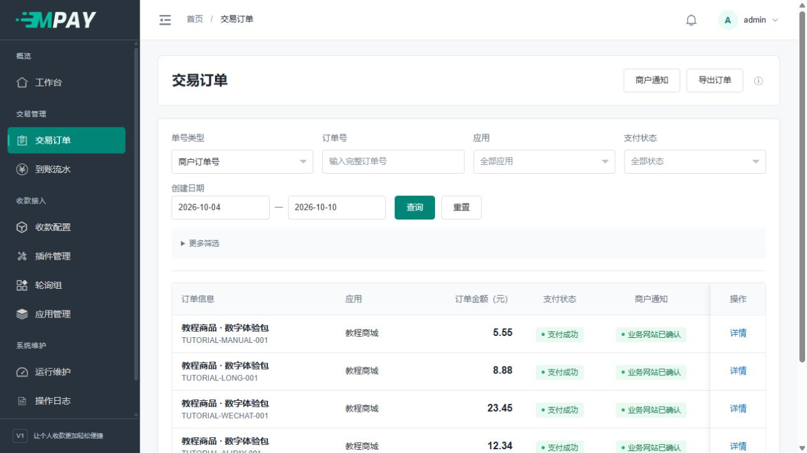

# 备份、恢复与域名迁移

完整恢复需要程序、数据库、配置和上传图片。各项备份应来自同一站点、同一备份时间点；仅解压程序文件无法恢复订单和收款配置。

## 开始前先确认

你需要能管理 MPAY 的网站目录、数据库和两个后台任务。如果只是想换域名而服务器和数据库不变，不必重新安装；先配置新域名和 HTTPS，再更新设备及业务网站保存的地址。

准备一个只有站点管理者能访问的备份位置，放在 public 之外；完成后再下载到自己控制的安全位置。备份目录名称可以使用当天日期，避免覆盖上一份。

## 备份内容

| 内容 | 用途 |
| --- | --- |
| 对应源码与 composer.lock | 恢复同一代码/依赖合同 |
| 专用数据库完整备份（含迁移账本） | 应用、KEY 原值及其版本、历史配置、订单、到账、通知及审计 |
| .env、runtime/install.lock 与私有部署配置 | 数据库连接及环境配置 |
| public/storage 中登记的图片 | 恢复原通道的收款材料 |
| 备份时间、摘要、数据库/源码身份 | 检查备份对应关系，不以文件名猜版本 |

数据库备份包含应用 KEY、插件参数与平台会话原值，应只交给站点管理者并限制读取权限。

运行心跳、Session 和缓存不是支付事实，恢复时不把旧进程标成在线。技术日志按排障需要另行受限保存，不公开平台报文或秘密。

## 一致备份顺序

1. 将本实例 Web 入口进入维护/停写状态，停止 work、watch 并等进程退出。对外设备可能仍继续报账，应明确停机窗口和后续补查范围。
2. 用专用账号和私有客户端配置调用原生 mysqldump，保存本实例完整库；不要把数据库密码写入命令行或备份摘要。
3. 在保持停写期间复制配置、图片和对应源码/锁文件，记录各份摘要与时间。
4. 检查备份可读、受限权限及内容清单后再恢复站点和两工作者。备份完成不等于恢复演练通过。

### 使用面板时怎么操作

1. 记录当前 MPAY 域名、程序目录、数据库名、PHP 版本和两个守护任务的名称。通过 .env 核对库名，但不要把其中密码粘贴到公共笔记。
2. 暂停当前 MPAY 网站的访问，或启用该站点已有的维护配置；不要停止整台服务器的 Nginx/MySQL，否则会影响其他网站。
3. 在进程守护工具中停止这套 MPAY 的“流水采集”和“通知与维护”，确认都已停止。
4. 在数据库管理中找到刚才核对的 MPAY 库，执行完整备份，等待完成并下载；保留备份工具生成的原文件，不用 Excel 打开保存 SQL。
5. 在文件管理中打包同一时点的程序和下表所列文件。开启隐藏文件显示，确认包含 .env；检查压缩包能列出 runtime/install.lock 和 public/storage。
6. 把数据库备份、程序包和部署资料放在同一份私有备份目录中，记录时间、库名和对应版本。
7. 确认文件大小正常、压缩包可打开，再恢复当前站点及两个任务；到 MPAY“运行维护”检查近期活动。

不要只下载网站压缩包就结束。数据库里的订单、应用密钥和通道配置不会自动包含在普通网站文件包中。

## 恢复到新目录、新域名

1. 建立独立目录、专用空数据库及新站点。恢复对应源码，用 composer.lock 安装依赖。
2. 导入整份数据库及迁移账本，放回图片和私有配置，修改本地路径与数据库连接；**不重新 initialize，不重置恢复数据中的应用 KEY**。
3. 恢复已完成的 runtime/install.lock，防止再次显示安装页；即使锁缺失，非空库检查也拒绝重装。Web root 指向 public，设置新域名/HTTPS，核对权限、数据库与实际结构。数据库中的应用历史 KEY/订单目标原样保留。
4. 在设备、业务网站或平台端更新其保存的 MPAY 回调/API 地址。新访问生成新域名的站内链接；数据库里的外部业务通知目标不应被全站替换成 MPAY 域名。
5. 先核对待处理订单、通知、采集水位和停机欠查窗口，再启动两个工作者，核对补查、重复消息和旧单通知。

本站允许多个域名，但浏览器 Cookie/Session 按域名隔离，不能承诺多域名共享登录。旧二维码/设备配置若保存旧域名，还需外部更新或由部署者维持旧域名服务。

### 按页面检查恢复结果

完成导入后，先保持新站点的两个后台任务停止，依次核对：

1. 用新域名打开 `/admin/login`，使用备份时的 MPAY 管理员凭证登录。恢复站点应直接进入登录流程，**不用再走“立即安装”**。
2. 打开“应用管理”，核对原 PID、应用名称和允许域名是否仍在；不要为了测试而重置 KEY。
3. 打开“收款配置”，核对原通道及收款图片；图片丢失时先检查 public/storage 是否完整恢复。
4. 打开“交易订单”，找备份之前的一笔已成功订单和一笔未完成订单；核对金额、时间、通道和商户通知。
5. 看“商户通知”的历史发送记录，而不只看订单列表的成功徽章。第一次确认时间和失败重试记录应保留。
6. 确认将由哪套站点承担后续工作，原站停止对应任务后，再启动新站的两个任务，避免两套恢复副本同时处理同一批历史待办。

**完成标准：** 原账号能登录、应用和通道保留、历史订单及通知对得上、图片可访问，接着验证新的订单和回调地址。看到“安装成功”不属于已有站点恢复的验收标准。

### 换域名时分别修改哪里

| 位置 | 应更新的内容 |
| --- | --- |
| 新网站设置 | MPAY 新域名、HTTPS、public 运行目录和路由 |
| 商城等业务网站 | 它保存的 MPAY 网关地址；同一恢复数据的 PID/KEY 继续使用 |
| 手机通知工具 | 从新域名登录 MPAY 后重新复制当前通道通知地址 |
| 反向代理/防火墙 | 确认业务网站和设备能访问新 HTTPS 地址 |
| MPAY 应用允许域名 | 只有业务网站自己的域名也变了才相应调整 |

历史订单保存的是创建时的商户通知目标。业务网站换域名后，原有未完成订单的旧通知地址也要保持可用或由业务方安排处理；不要直接批量替换数据库中的所有域名。

## 禁止用旧备份覆盖新到账

一旦新站或原站在备份之后收到新款，直接回滚数据库会丢失新事实并可能重复通知/分配。先停写保全两个状态，再人工核对恢复方案；不能通过清空日志、流水或重新分配已消费交易号完成“恢复”。源码回退也不能自动撤销数据库或外部副作用。
