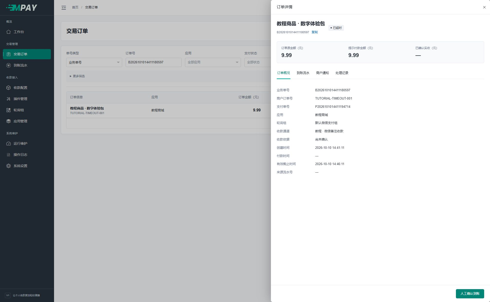

# 常见问题与运行排查

先保留原订单，再按链路排查；已经付款时不要反复创建新单或再次付款。

## 快速定位

先确定停在哪一步：打不开安装页查环境与站点；能下单但未成功查收款识别；MPAY 已成功但商城未更新查商户通知。无需从头重装来排查一笔订单。

| 现象 | 到哪里查 | 核对内容 |
| --- | --- | --- |
| 安装数据库连接失败 | 安装提示与私有技术日志 | 实际数据库主机、端口、库名、来源授权、账号密码 |
| 设置了远程数据库仍连本机 | 安装或 `.env` | `127.0.0.1` 指网站服务器自身，不是另一台数据库服务器 |
| 验证码错误、过期或显示“点击重试” | 登录页的验证码图片 | 点击图片重新获取，在两分钟内填写当前字符；保留 Cookie，避免多个标签页互相刷新。详见[登录说明](V1-31-登录验证码与请求限流.md#登录验证码) |
| 请求过于频繁、HTTP 429 | 页面等待提示或响应头 `Retry-After` | 等待后再操作，减少重复点击和并行轮询；不要重新建单或让买家再次付款。详见[响应与重试](V1-31-登录验证码与请求限流.md#接口响应与重试) |
| HTTP 503 且日志为 `request.rate_storage_unavailable` | 本站技术日志和 PHP 运行环境 | 检查 Web/CLI 用户、短期缓存目录权限及存储可用性；不通过清空数据库或关闭验证码解决 |
| 页面能开但 `/submit.php` 404 | Web 服务器配置 | 协议路径是否交给 index.php，是否保留原 URI |
| 没有可用支付方式 | 应用收款路由、通道和插件管理 | 默认/自定义绑定、启用状态、限额和时段 |
| 云闪付不能新增通道 | 支付方式和插件管理 | 启用 `unionpay`，刷新并启用收钱吧码牌插件，再建立云闪付通道；平台账号及码牌须已开通对应能力，见[收钱吧配置](V1-14-收钱吧码牌收款.md) |
| 通道配置保存后停用了 | 收款配置 | 插件参数更新后重新核对并启用，仅影响该通道 |
| 提示收款码图片缺失或不可读取 | 对应通道的插件配置、服务器上传目录 | 恢复原图片或为当前通道重新上传；旧订单仍引用原材料。保存/启用和请求付款准备时都会检查，不会用别的图片替代；payment:work 不执行付款准备，无需读取该图片 |
| 下单被平台拒绝或显示结果未知 | 私有技术日志的 `payment.execution_error`，按支付号或请求关联号定位 | 查看 `reason_code` 和已脱敏的 `error_message`，核对通道参数、平台权限及网络情况；未知结果不能当作未收款，不要另建订单重复付款。说明超长时会截断并标记 `message_truncated` |
| 退款返回 HTTP 405 | 接入程序的请求方法和地址 | 使用 POST /api.php?act=refund，正文提交凭证、订单号和金额，不在正文重复 act；GET 退款不会进入退款服务 |
| 退款结果待核实 | 私有技术日志的 `payment.refund_unknown` | 按 pay_no、refund_no、plugin_code 或 request_id 查看已脱敏的超时、HTTP 或解析说明；额度仍占用，不换号重复退款，也不因网络恢复自动重发 |
| 某笔订单持续处理失败 | 私有技术日志的订单号、通道及异常位置 | 该单会被隔离并短暂退避，其他任务继续；先修复素材或配置，不反复付款，也不把未知结果当成支付失败 |
| 手机有到账但系统未成功 | 设备转发日志、收款回调、订单 | 通知地址可达性、Secret、时间、模板、实付金额、备注、原单窗口 |
| 插件已定位订单，但核心未确认到账 | 私有技术日志的 `receipt.confirmation_rejected` | 按 pay_no、channel_id、plugin_code、trace_no 查 reason_code，例如证据不足、事件内容冲突或流水已消费；该日志不代表付款成功，也不保存未匹配流水正文 |
| 通知 HTTP 200，但正文为 `400：…` | 设备转发日志的完整应答正文 | HTTP 成功不代表业务已通过；按正文原因处理，监听工具的成功关键字是 `200`，商户应答仍是 `success` |
| 守护任务改成 www 后无法启动、反复退出或近期活动不更新 | [启动用户调整后的处理步骤](V1-18-部署与后台任务.md#已经用-root-启动过如何改为-www) | 先停止两个任务；删除 runtime/workers 和 runtime/receipt，或将这两个目录及子文件的所有者改为 www，再启动 |
| 账单采集不动 | 运行维护与 watch 日志 | 是否有待核对订单、任务心跳、认证、平台范围及协议错误；无订单时支付宝账单不查询 |
| 提示流水达到条数上限 | 来源平台账单、MPAY 原订单 | 每账号每轮只取最新最多 200 条；仍匹配本批，不自动翻页补齐 |
| 收钱吧无订单仍有登录验证 | 运行维护的登录验证时间 | 启用通道默认每 600 秒低频保活；查单成功可替代保活，不等于已收到付款 |
| 日志出现 ambiguous_channel | 同账号下各通道的订单、平台流水 | 一条流水同时符合多个通道；核对收款范围、金额、备注和原付款窗口，不能重复确认 |
| 手机通知校验时间失败 | 手机与服务器时间、插件参数、转发日志 | 容差默认 30 秒、范围 5～30 秒；自动校时并检查转发延迟，不与 300 秒付款有效期混用 |
| 手机通知通过时间校验但仍不能确认 | 原订单付款窗口、手机与服务器时钟 | 当前手机请求时间也参与到账时间判断；设备时钟偏快可能在最终确认时被拒绝，见[重发与时间限制](V1-11-微信手机与PC监听.md#手机重发与时间的当前限制) |
| 已付款却还停在收银台 | 原订单的商户通知记录 | 等待业务网站有效应答；60 秒后可重新检查，不能据此再次付款 |
| MPAY 已成功而网站未更新 | 商户通知发送记录 | 是否暂缓、work 是否运行、目标响应、验签和业务提交 |
| 补发失败但仍显示商户曾确认 | 通知详情 | 首次有效 ACK 与最近一次尝试分开保存，这是正常区分 |
| 数据库里没有未匹配流水 | 来源平台账单 | 按设计仅保存最终匹配流水，没有补匹配队列 |
| 多域名不能共享登录 | 浏览器会话 | Cookie/Session 按域名隔离；多域名访问不等于共享登录 |
| 忘记后台密码 | 服务器维护人员 | 当前没有邮箱/短信找回入口，不通过重新安装重置原库 |
| 文档图片或附件打不开 | 本页下方“文档附件” | 查看原图或从对应源码包离线读取 |

## 日志各管什么

`receipt.confirmation_rejected` 中，`insufficient_receipt_evidence` 表示付款时间缺失或晚于接收时间，`event_content_conflict` 表示同事件证据不一致，`platform_trade_already_consumed` 表示流水已绑定其他订单。这里记录核心返回的固定原因码；HTTP 仍按插件原应答规则返回，采集只累计实际确认成功的笔数，不因写日志继续确认失败项。

### 买家说已付款，按这个顺序查

1. 取得商城订单号，在 MPAY“交易订单”选择正确单号类型、应用和创建日期，找到原单。
2. 到实际微信、支付宝或收钱吧账户核对到账。没有真实到账依据时，不做人工确认。
3. 若账户已到账但 MPAY 未成功，核对原单的通道、提示金额、付款备注和有效期。
4. 手机模式去“运行维护 → 收款回调”，按来源通道与时间查询；没有记录时先查设备转发，存在记录则看校验结果。
5. 账单/码牌模式在“运行维护”选中通道，看待核对订单、上次查询和“最近错误”，打开详情核对错误来源、失败阶段、平台错误码和说明；登录验证时间只表示认证检查。错误说明过长会标注截断，恢复后仍可看到最近错误及恢复时间。没有待核对订单时先核对原付款截止与补查范围，不靠反复建单触发查询。
6. MPAY 已成功时改查“商户通知”，查看次数、首次确认及每次响应，不再沿着手机通知方向反复排查。

### 已超时是不是一定没付款

不是。超时表示当前等待窗口已经结束；静态收款码仍可能收到转账。先核对实际账户及原单，再按[人工处理](V1-10-商户通知与人工处理.md)处理确有依据的到账。



### 本地多套站点互相退出登录

同一浏览器中，多套 MPAY 使用同一个主机名、只用端口区分时，可能共用 Cookie 名称。为每套实例分配独立主机名再登录；不要通过延长会话时间、关闭认证或修改订单代码解决。正式部署同样应为独立系统使用各自站点域名。

### 找到日志后应该看哪一类

- 订单处理记录：交易动作与结果，优先从原订单进入。
- 收款回调：设备/平台的接收与校验；按通道看可能含其他订单。
- 通知尝试：MPAY 向网站发送结果及受限响应正文。
- 操作日志：管理员配置、凭证和特殊交易动作审计。
- `runtime/log`：技术诊断，用公开错误中的请求编号定位。

原始密钥、Cookie、平台完整报文不应进入公开日志或问题反馈。不要删除流水、通知责任或迁移账本来“解除报错”。

## 提示数据库迁移版本不匹配

“数据库迁移记录不属于当前安装基线”表示库内记录的迁移版本或步骤不属于当前程序；它与摘要格式损坏、已执行 SQL 内容改变是不同问题。先核对程序版本、数据库来源和安装记录。即使当前表结构看起来接近，也不能据此改写摘要或删除账本冒充新装。当前安装器不负责旧迁移链升级，处理前须备份并确定适用方案，见[业务边界与回归验收](V1-32-业务边界与回归验收.md#修改与发布原则)。

## 发起问题反馈

可直接复制下面的模板，填写知道的项目；不知道的写“不清楚”，不要为找版本而修改数据库：

```text
发生时间（上海时间）：
MPAY 版本或源码提交号：
PHP / MySQL 版本：
使用的插件、设备及通知工具版本：
页面名称或接口路径：
操作步骤：
预期结果：
实际提示：
请求编号：
已检查的内容：
```

截图遮蔽私钥、KEY、Cookie、完整回调签名及业务个人信息。仅在受限支持渠道按需要补充订单号、脱敏消息或响应片段，不上传完整数据库、`.env` 或平台报文。

代码实现、合成测试、真实平台联调、生产运行是不同范围。反馈时写清使用了哪种路径，便于定位。

## 文档附件打不开时

截图中的“教程”名称、演示地址和编号用于说明界面，不能照抄为自己的配置。图片太小时点击或在新标签页打开原图，再核对按钮位置。

Gitee Wiki 当前的图片和可下载附件使用 GitHub raw 地址，网络不能访问时可能出现空白。可改用另一端 Wiki，或从对应 `v1` 源码压缩包的 `docs/wiki/assets`、`docs/wiki/examples` 查阅本地原图和附件。页面没有图片不代表安装步骤需要省略。
