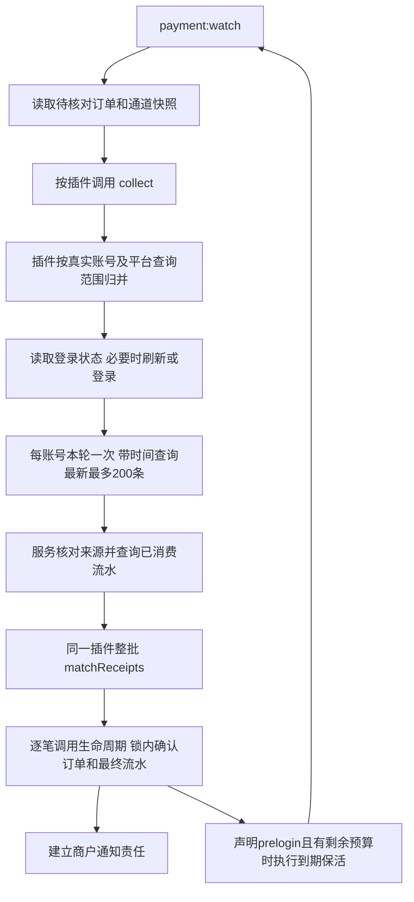

# 主动采集与会话协作

`payment:watch` 是系统内置的流水监听进程。公共服务按待核对订单调用插件；插件归并真实账号、管理登录态、请求平台并匹配流水。`payment:work` 处理商户通知和维护，两者共用系统代码与数据库。

## 1. 调用顺序与职责



| 位置 | 职责 |
| --- | --- |
| PaymentWatchCommand | 循环、角色锁、退出及本机心跳 |
| ReceiptWatcherService | 读取订单及通道版本、按接口调用、记录运行摘要 |
| 插件主类 | 解释账号字段、按真实账号合并、缓存认证、决定平台查询范围、整批定位订单 |
| SDK | HTTP、签名、登录协议、平台响应解析；不查询本系统订单 |
| PayOrderCallbackService | 校验规范流水及批次来源、批量查询已消费记录、调用匹配及确认 |
| PayOrderLifecycleService | 锁内复核标准金额、归属与重复事实，同事务确认成功、存最终流水和通知责任 |

服务不识别平台的用户名、Cookie、商户、门店或终端字段。新插件实现接口即可参加调度，不添加平台专属命令或服务分支。插件主类在 `app/common/payment`，接口和 SDK 分别在 `app/common/interface`、`app/common/sdk`。

## 2. 订单和通道输入

仅实现 `ReceiptCollectorInterface` 的插件参与主动查单；手机/PC 推送仍使用认证后的 HTTP 通知入口。服务读取的候选状态为创建、待付、本地关闭或超时，且尚在原付款截止后的 300 秒补查期内。支付成功、确定失败和超出补查期的订单不再调度。插件在 collect 内检查自身准备快照，只对已准备订单查询；服务不解析 personal_receipt 或判断具体匹配模式。

数据库每页读取 500 条，只用于控制本地取数；收齐同插件候选后才调用一次 collect，不按数据库分页反复请求平台。同插件超过 10000 条候选时本轮拒绝使用截断集合，记录容量问题并继续其他插件。

`$orders` 以支付号为键，每条包含：

| 字段 | 含义 |
| --- | --- |
| id / pay_no | 内部 ID（数字字符串）与支付号 |
| channel_id | 本单实际通道，识别候选必须按此范围区分 |
| channel_revision_id | 冻结的通道版本 ID，用于读取本单配置 |
| pay_type | 支付方式编码 |
| pay_amount | 当前支付金额，整数分，解释遵循插件原单快照 |
| ext_json | 已按普通字段定位订单后读取的快照，插件自行解释其私有准备信息；不可原样公开或记录日志 |
| request_at / expire_at / created_at | 发起、付款截止及创建时间，上海时间字符串 |

`$channels` 以通道版本 ID 为键，包含 channel_id、api_config_id、config_version、plugin_code、receipt_scope_key、configuration（冻结参数），以及 current_configuration/current_config_version（当前参数及版本，可空）。插件只在自身确认收款主体未改变时取当前认证参数；不能将新账号凭证用于旧账号订单。公共服务不合并或猜测配置字段。

## 3. 主动查询接口

```php
public function collect(
    array $orders,
    array $channels,
    DateTimeImmutable $deadline,
): iterable;
```

返回一个或多个账号查询批次，每批形状如下：

```php
yield [
    'channel_revision_ids' => ['12', '19'], // 本次响应真实覆盖的输入版本
    'records' => $records,                // list，最多 200 条
    'limit_reached' => false,
    'error' => null,
];
```

每账号每轮只发一次带时间范围的流水请求，固定第一页、最新最多 200 条；不翻页、不切分时间窗口补齐。达到 200 条仍匹配全部返回记录，设置 limit_reached 并提示上限，不能宣称已覆盖整个历史窗口。

时间范围取该账号相关订单的最早 request_at 至最晚 expire_at，终点不超过当前时间；SDK 处理平台秒/毫秒、日期及端点差异。最终付款证据必须落在各订单自身的 `[request_at, expire_at)` 窗口内，补查期不延长付款有效期。

records 每项包含 pay_type、event_key（稳定唯一标识）、trade_no（可空）、amount（整数分）、paid_at（上海时间或 null）、remark（可空）。可选 extra 为最多 4096 字节的 JSON 数组，只能存脱敏后的平台补充信息，不得带认证状态或整份报文。实际匹配需要可靠付款时间。

可恢复平台失败返回空 records 和 `error = ['code' => 整数状态常量, 'reason' => 固定原因码, 'retry_after' => 秒数]`。code 按 ReceiptRuntimeConstant::failure(reason) 生成，reason 使用 ReceiptCollectionException 的允许值。网络失败、限流和明确认证拒绝分别处理，错误不带平台报文或秘密。程序错误继续抛出，不能伪装成查询成功。

## 4. 整批匹配

```php
public function matchReceipts(array $receipts, array $orders, array $channels): array;
```

服务先校验整个响应并查询数据库的已消费记录，再把 `list<array{record:array,consumed_pay_no:?string}>` 一次交给同一插件。orders/channels 只包含本次响应覆盖的原输入。consumed_pay_no 非空表示已被某笔订单消费，插件不得重新分配。

插件返回[标准 success 结果](V1-23-支付插件开发.md#6-notify-与整批匹配)列表；未匹配不返回。同批每笔订单至多选择一次，每条流水最终只绑定一笔订单；不合单、不拆单。现有账单/码牌插件按方式、实收金额、备注及付款窗口过滤，先按 channel_id 区分候选。同条流水符合多个通道时跳过并记录 ambiguous_channel；仅一个通道匹配时，再按距发起时间选择，等距使用创建时间和内部 ID 稳定排序。同批已选过的订单仍参与跨通道歧义检查，防止后续流水被错误地分配给另一个通道。

服务核对结果引用原批次证据，再逐笔进入生命周期。数据库以插件/事件键、插件/平台交易号等唯一约束防重；进程重启或清除缓存不能让已消费流水换绑新订单。仅最终匹配流水入库，未匹配流水不保存。

## 5. 登录状态与预登录

主动采集插件统一实现 `ReceiptCollectorInterface`。预登录是插件代码声明的调度选项，在元信息中设置布尔值 `prelogin`，通过强类型方法读取：

```php
// 放入本插件已有的元信息数组；不放进 config_schema。
private array $paymentInfo = [
    // 其他元信息略。
    'prelogin' => true,
];

public function isPreloginEnabled(): bool
{
    return $this->paymentInfo['prelogin'] ?? false;
}

public function prelogin(array $channels, DateTimeImmutable $deadline): iterable;
// yield ['channel_revision_ids' => [...], 'verified' => true, 'error' => null];
```

未声明时返回 false；只使用 true/false，不传 `"false"`、0 或 1，不强制转换错误类型。工厂发现/刷新插件时会读取并核对；声明在初始化之前即可读取，不依赖某个通道账号。它不存为后台可编辑字段，也不需要数据库迁移，代码更新后重启 watch。

调度器只对 `prelogin=true` 的采集插件补充“没有待付订单的启用通道”，并在正式查单后、预算允许时调用 `prelogin()`。是否到达间隔、如何登录和验证仍由插件决定。false 不影响正常订单采集；没有登录态的插件仍实现该方法并返回 `[]`，调度器不会调用它。

登录态通过 ThinkPHP `receipt` 文件缓存存于 `runtime/receipt`，使用 expire=0 永久保留。Cookie、token、session 是同一个插件私有状态的一部分，公共接口不解释结构；平台提供的有效期只帮助刷新，缺失或为零不等于立即失效。平台明确拒绝认证才清除失效登录态，网络超时保留已取得的状态。登录/刷新成功立即缓存，后续查询失败不会无故丢掉新凭证。

收钱吧按登录用户名合并，门店/终端范围由插件分类；同账号多个范围逐轮切换，每轮仍只查询一次。可用凭证在配置中时优先复用，不在相互冲突的密码之间循环登录；普通二维码/有效期修改不清状态。修改唯一认证参数时可以重新验证。

预登录仍在 watch 进程内，默认距离上次有效验证 600 秒后执行。正式查单优先，同账号本轮已查单便不再探测。收钱吧声明 prelogin=true，以最近 10 分钟、第一页 1 条的真实流水请求验证状态；成功查单可替代专门保活。没有订单但通道仍启用时可低频预登录；停用且无待核对订单的账号退出。支付宝账单使用请求签名，没有网页登录，未声明 prelogin（默认 false），保活方法返回空数组。

## 6. 默认预算与运行维护

| 配置（config/receipt.php） | 默认值 | 用途 |
| --- | --- | --- |
| scan_interval_seconds | 3 秒 | watch 空闲扫描等待 |
| query_interval_seconds | 3 秒 | 同账号正常查单间隔 |
| late_check_seconds | 300 秒 | 原付款截止后继续核对迟到记录 |
| order_page_size / max_orders_per_plugin | 500 / 10000 | 本地订单读取批量与内存上限 |
| account_budget_seconds / plugin_budget_seconds | 15 / 30 秒 | 网络请求和单轮插件预算 |
| prelogin_interval_seconds | 600 秒 | 低频登录验证间隔，不是缓存 TTL |

网络失败采用有上限的退避；平台实际到账延迟、频率限制和权限另行核对。运行维护页分别显示待核对订单、上次成功查询、上次登录验证、耗时、确认笔数及错误摘要，不把心跳或缓存存在显示为平台在线。

每站点只运行一个 watch；角色文件锁只覆盖相同运行目录，不提供跨主机多实例协调。部署代码后重启两个命令。登录状态不是业务事实，备份交易以数据库为准；缓存目录含秘密，不得置于 public 或公开下载。清空该目录会触发重新登录，不影响数据库流水幂等。
