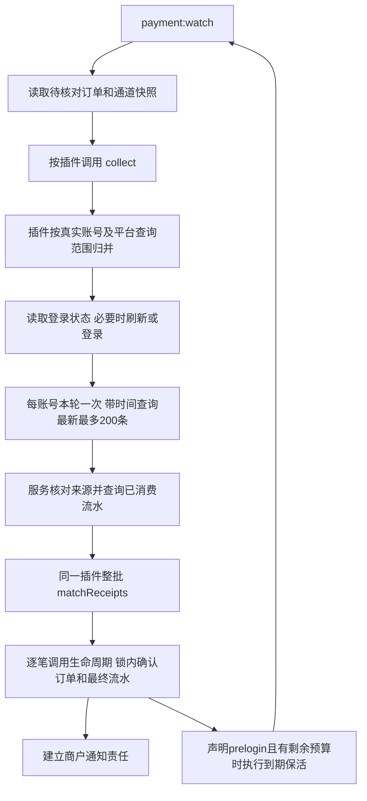

# 主动采集与会话协作

`payment:watch` 是系统内置的流水监听进程。公共服务按待核对订单调用插件；插件归并真实账号、管理登录态、请求平台并匹配流水。`payment:work` 处理商户通知和维护，两者共用系统代码与数据库。

## 1. 调用顺序与职责



| 位置 | 职责 |
| --- | --- |
| PaymentWatchCommand | 循环、角色锁、退出及本机心跳 |
| ReceiptWatcherService | 读取订单及通道版本、按接口调用、记录运行摘要 |
| 插件主类 | 解释账号字段、按真实账号合并、缓存认证、决定平台查询范围、整批定位订单 |
| SDK | HTTP、签名、登录协议、平台响应解析；不查询本系统订单 |
| PayOrderCallbackService | 校验规范流水及批次来源、批量查询已消费记录、调用匹配及确认 |
| PayOrderLifecycleService | 锁内复核标准金额、归属与重复事实，同事务确认成功、存最终流水和通知责任 |

服务不识别平台的用户名、Cookie、商户、门店或终端字段。新插件实现接口即可参加调度，不添加平台专属命令或服务分支。插件主类在 `app/common/payment`，接口和 SDK 分别在 `app/common/interface`、`app/common/sdk`。

## 2. 订单和通道输入

仅实现 `ReceiptCollectorInterface` 的插件参与主动查单；手机/PC 推送仍使用认证后的 HTTP 通知入口。服务读取的候选状态为创建、待付、本地关闭或超时，且尚在原付款截止后的 300 秒补查期内。支付成功、确定失败和超出补查期的订单不再调度。插件在 collect 内检查自身准备快照，只对已准备订单查询；服务不解析 personal_receipt 或判断具体匹配模式。

数据库每页读取 500 条，只用于控制本地取数；收齐同插件候选后才调用一次 collect，不按数据库分页反复请求平台。同插件超过 10000 条候选时本轮拒绝使用截断集合，记录容量问题并继续其他插件。订单候选与预登录启用通道引用的版本 ID 合并去重后，一次批量读取快照，再逐项核对存在性及所属通道；不按每页重复加载，不跨轮缓存配置。

`$orders` 以支付号为键，每条包含：

| 字段 | 含义 |
| --- | --- |
| id / pay_no | 内部 ID（数字字符串）与支付号 |
| channel_id | 本单实际通道，识别候选必须按此范围区分 |
| channel_revision_id | 冻结的通道版本 ID，用于读取本单配置 |
| pay_type | 支付方式编码 |
| pay_amount | 当前支付金额，整数分，解释遵循插件原单快照 |
| ext_json | 已按普通字段定位订单后读取的快照，插件自行解释其私有准备信息；不可原样公开或记录日志 |
| request_at / expire_at / created_at | 发起、付款截止及创建时间，上海时间字符串 |

`$channels` 以通道版本 ID 为键，包含 channel_id、api_config_id、config_version、plugin_code、receipt_scope_key、configuration（冻结参数），以及 current_configuration（当前参数，可空）。插件只在自身确认收款主体未改变时取当前认证参数；不能将新账号凭证用于旧账号订单。公共服务不合并或猜测配置字段。

## 3. 主动查询接口

```php
public function collect(
    array $orders,
    array $channels,
    DateTimeImmutable $deadline,
): iterable;
```

返回一个或多个账号查询批次，每批形状如下：

```php
yield [
    'channel_revision_ids' => ['12', '19'], // 本次响应真实覆盖的输入版本
    'records' => $records,                // list，最多 200 条
    'limit_reached' => false,
    'error' => null,
];
```

每账号每轮只发一次带时间范围的流水请求，固定第一页、最新最多 200 条；不翻页、不切分时间窗口补齐。达到 200 条仍匹配全部返回记录，设置 limit_reached 并提示上限，不能宣称已覆盖整个历史窗口。

时间范围取该账号相关订单的最早 request_at 至最晚 expire_at，终点不超过当前时间；SDK 处理平台秒/毫秒、日期及端点差异。最终付款证据必须落在各订单自身的 `[request_at, expire_at)` 窗口内，补查期不延长付款有效期。

records 每项遵循[标准流水字段表](V1-23-支付插件开发.md#标准流水字段)：pay_type、event_key、trade_no、amount、paid_at、remark 六个键必须存在，可空值明确传 null。amount 使用实际到账的整数分；event_key/trade_no 的长度按字节、remark 按 UTF-8 字符计算。可选 extra 只存有界、脱敏的平台补充信息；payload_digest 由服务重新计算。实际匹配需要可靠付款时间。

可恢复失败返回空 records 和 `error = ['reason' => 固定原因码, 'retry_after' => 秒数]`。reason 使用 ReceiptCollectionException::REASONS 的允许值，retry_after 为 1～86400 的整数秒。展示状态由服务映射，插件不返回重复的内部状态码。网络失败、限流和明确认证拒绝分别处理；不能以空 records 加 error=null 掩盖失败。

账号故障优先在插件账号边界返回上述错误批次，让其他账号继续。插件准备、迭代或批次处理抛出未处理异常时，监听服务记录 receipt.task_failed、插件编码及脱敏异常，暂缓该插件后继续其他插件；默认退避 60 秒，ReceiptCollectionException 明确给出等待时间时使用该时间。该兜底不推断平台错误来源、失败阶段或受影响账号，不写入通道采集摘要；通道最近错误仍来自插件明确返回的批次。它也不重放已提交的确认；不能确定安全匹配范围时，不拆掉异常候选后继续猜测其他订单。重启后可提前重新检查，数据库交易幂等不依赖进程内退避。数据库或共享运行设施故障仍明确上抛。

失败可在同一个 error 数组补充以下诊断字段；collect 与 prelogin 使用相同合同：

| 字段 | 规则与用途 |
| --- | --- |
| source | `platform` 为第三方明确返回的错误，`plugin` 为插件配置、响应解析、验签等检查失败，`system` 为网络/调度等本地故障 |
| stage | 插件声明的失败阶段，UTF-8 文本最多 64 字节，例如“登录”“查询流水”“验证响应签名”；核心不维护各平台阶段表 |
| platform_code | 平台实际错误码，最多 128 字节；没有则 null/省略，不把内部 reason 当成平台码 |
| message | 平台说明保持原意；插件/系统错误使用自身明确说明。先脱敏，最多保留 2048 个 UTF-8 字节 |
| http_status | 实际收到的 HTTP 状态（100～599）；未收到响应时 null/省略 |
| message_truncated | 布尔值；说明被截断时为 true，后台明确标注 |

SDK 可使用既有 `ReceiptCollectionException($reason, $retryAfter, $diagnostic)`：第三个参数传 source、stage、platform_code、message、http_status；异常负责截断 message 并提供 diagnostic 数组。插件确定重试等待后，将 diagnostic 合入 error。SDK 只提取平台错误码和说明，移除本次请求中可能被回显的密码、密钥及 token；禁止传完整请求/响应、登录态或异常堆栈。页面按纯文本转义显示，不渲染平台返回的 HTML。

例如收钱吧登录失败返回 `source=platform`、`stage=登录`、`platform_code=50105`、`message=账号或者密码错误`、`http_status=200`，reason 为 authentication_expired。同一个平台码在不同接口的含义由收钱吧 SDK 判断，核心不猜测；本地商户/门店匹配失败应标记为 plugin，并说明哪个检查未通过。支付宝已验签的业务拒绝保留 code/sub_code 与 msg/sub_msg；响应验签失败标记为插件检查失败，不宣称是平台业务拒绝。

## 4. 整批匹配

匹配结果在批次边界统一验证后逐笔确认，不在提交前重复校验同一份结果。每次确认的内部上下文明确携带 channel_id、scope_key、pay_type 和已定位的支付单；未匹配流水不创建空订单事件。归属锁、流水幂等和交易状态核对仍在生命周期事务内执行。

支付宝账单和收钱吧在每批匹配内复用已解析的候选订单识别信息及时间，不跨批次缓存。付款窗口、金额/备注、距离排序、等距稳定顺序及多通道歧义判断不变。收钱吧账号分组与 SDK 的范围缓存共用同一个范围标识规则，仍由该插件解释商户、门店及终端字段。

每笔确认独立提交。单笔业务拒绝或任务异常记录 receipt.confirmation_rejected 及支付号、通道、批次关联号后继续其他结果，不把失败计入成功笔数，不覆盖已提交的收款事实。数据库异常不吞掉，由进程入口明确报错。

```php
public function matchReceipts(array $receipts, array $orders, array $channels): array;
```

服务先校验整个响应并查询数据库的已消费记录，再把 `list<array{record:array,consumed_pay_no:?string}>` 一次交给同一插件。orders/channels 只包含本次响应覆盖的原输入。consumed_pay_no 非空表示已被某笔订单消费，插件不得重新分配。

插件返回[标准 success 结果](V1-23-支付插件开发.md#6-notify-与整批匹配)列表；未匹配不返回。同批每笔订单至多选择一次，每条流水最终只绑定一笔订单；不合单、不拆单。现有账单/码牌插件按方式、实收金额、备注及付款窗口过滤，先按 channel_id 区分候选。同条流水符合多个通道时跳过并记录 ambiguous_channel；仅一个通道匹配时，再按距发起时间选择，等距使用创建时间和内部 ID 稳定排序。同批已选过的订单仍参与跨通道歧义检查，防止后续流水被错误地分配给另一个通道。

服务核对结果引用原批次证据，再逐笔进入生命周期。数据库以插件/事件键、插件/平台交易号等唯一约束防重；进程重启或清除缓存不能让已消费流水换绑新订单。仅最终匹配流水入库，未匹配流水不保存。

核心内部 `PayOrderCallbackService::receiveCollected()` 返回本批经生命周期确认的笔数（`int`），供监听进程汇总；不额外返回未使用的忽略条数。这不改变插件 `matchReceipts()` 返回标准结果列表的接口。

## 5. 登录状态与预登录

主动采集插件统一实现 `ReceiptCollectorInterface`。预登录是插件代码声明的调度选项，在元信息中设置布尔值 `prelogin`，通过强类型方法读取：

```php
// 放入本插件已有的元信息数组；不放进 config_schema。
private array $paymentInfo = [
    // 其他元信息略。
    'prelogin' => true,
];

public function isPreloginEnabled(): bool
{
    return $this->paymentInfo['prelogin'] ?? false;
}

public function prelogin(array $channels, DateTimeImmutable $deadline): iterable;
// yield ['channel_revision_ids' => [...], 'error' => null];
// error=null 表示本次验证成功，无需再传 verified。
```

未声明时返回 false；只使用 true/false，不传 `"false"`、0 或 1，不强制转换错误类型。工厂发现/刷新插件时会读取并核对；声明在初始化之前即可读取，不依赖某个通道账号。它不存为后台可编辑字段，也不需要数据库迁移，代码更新后重启 watch。

调度器只对 `prelogin=true` 的采集插件补充“没有待付订单的启用通道”，并在正式查单后、预算允许时调用 `prelogin()`。是否到达间隔、如何登录和验证仍由插件决定。false 不影响正常订单采集；没有登录态的插件仍实现该方法并返回 `[]`，调度器不会调用它。

登录态通过 ThinkPHP `receipt` 文件缓存存于 `runtime/receipt`，使用 expire=0 永久保留。Cookie、token、session 是同一个插件私有状态的一部分，公共接口不解释结构；平台提供的有效期只帮助刷新，缺失或为零不等于立即失效。平台明确拒绝认证才清除失效登录态，网络超时保留已取得的状态。登录/刷新成功立即缓存，后续查询失败不会无故丢掉新凭证。

收钱吧按登录用户名合并，门店/终端范围由插件分类；同账号多个范围逐轮切换，每轮仍只查询一次。可用凭证在配置中时优先复用，不在相互冲突的密码之间循环登录；普通二维码/有效期修改不清状态。修改唯一认证参数时可以重新验证。

收钱吧每次 collect 或 prelogin 只读取一次账号轮转位置，分组直接使用本次读取值。批次内的凭证候选只保存摘要到密码的映射，查询配置仍按门店/终端范围保留；不会为每个凭证候选再复制整份配置。密码摘要归一化、已验证凭证优先、冲突处理与登录态缓存规则保持不变。

预登录仍在 watch 进程内，默认距离上次有效验证 600 秒后执行。正式查单优先，同账号本轮已查单便不再探测。收钱吧声明 prelogin=true，以最近 10 分钟、第一页 1 条的真实流水请求验证状态；成功查单可替代专门保活。没有订单但通道仍启用时可低频预登录；停用且无待核对订单的账号退出。支付宝账单使用请求签名，没有网页登录，未声明 prelogin（默认 false），保活方法返回空数组。

## 6. 默认预算与运行维护

| 配置（config/receipt.php） | 默认值 | 用途 |
| --- | --- | --- |
| scan_interval_seconds | 3 秒 | watch 空闲扫描等待 |
| query_interval_seconds | 3 秒 | 同账号正常查单间隔 |
| late_check_seconds | 300 秒 | 原付款截止后继续核对迟到记录 |
| order_page_size / max_orders_per_plugin | 500 / 10000 | 本地订单读取批量与内存上限 |
| account_budget_seconds / plugin_budget_seconds | 15 / 30 秒 | 网络请求和单轮插件预算 |
| prelogin_interval_seconds | 600 秒 | 低频登录验证间隔，不是缓存 TTL |

网络失败采用有上限的退避；平台实际到账延迟、频率限制和权限另行核对。运行维护页分别显示待核对订单、上次成功查询、上次登录验证、耗时、确认笔数及错误摘要，不把心跳或缓存存在显示为平台在线。连续失败批次仅统计该通道收到的连续错误批次，成功批次归零，不代表账号实际登录/重试次数。公共服务不推算或展示下一次查询时间，实际调度由插件账号状态决定。

运行维护的“最近错误”显示安全说明，详情展示来源、阶段、平台码、HTTP 状态和发生时间，可按收款通道筛选。采集诊断集中在运行维护；收款通道列表和详情只管理配置，不重复展示运行摘要。通道“启用”只决定能否接收新订单，不表示采集正常。

现有采集摘要缓存只保存最近一次错误，不新增数据库表。失败立即保存；后续查询或认证验证成功记录恢复时间，保留错误并标注“已恢复”。新的失败覆盖上一条错误；配置版本变化重新开始该版本的摘要，完整排障历史查看技术日志。同样的安全诊断随 receipt.collection / receipt.prelogin 事件记录，未提供诊断的错误仍显示固定分类说明。

## 7. 运行文件写入频率

运行状态继续使用磁盘文件，不要求内存盘或额外存储服务。减少写入不改变数据库扫描、平台查询和失败重试间隔：

- `runtime/workers`：每个进程的正常心跳最多每 10 秒写一次，首次上报和正常退出立即写。后台仍以 120 秒内的活动记录判断“近期有活动”；心跳不承担订单确认或进程互斥，角色锁继续保持。
- `runtime/receipt` 的轮转位置：插件扫描、账号采集及保活批次结束时保存最终位置，与已保存位置相同则不重写。正常提前结束批次也会保存已经处理到的位置。
- 收钱吧账号状态：登录或刷新得到新认证时立即保存，未变化的登录态不在查询前重复写。每次实际查询结束仍保存查询时间、失败等待、范围及验证状态；支付宝同样逐次保存最终调度状态。因此进程重启后不会因状态只在内存而清空已保存的重试等待。
- 后台采集摘要：普通更新按 10 秒合并；已有待写内存摘要时直接复用，没有时才读取文件缓存。循环及等待期间写入到期摘要；首次查询成功、配置版本或状态变化、失败及确认到账立即写。正常退出保存尚未写入的展示摘要。异常终止可能丢失最后一段普通展示更新，但数据库交易事实、已保存登录态及重试进度不在该缓冲中。

心跳和普通摘要的节流使用单调时钟。后台显示时间仍是服务器时间；同步网络调用期间不会中断请求来刷新展示，因此阻塞请求可能使页面更新时间晚于 10 秒。现有技术日志仍按原策略记录，文件写入优化不等于停止日志写入。

每站点只运行一个 watch；角色文件锁只覆盖相同运行目录，不提供跨主机多实例协调。部署代码后重启两个命令。登录状态不是业务事实，备份交易以数据库为准；缓存目录含秘密，不得置于 public 或公开下载。清空该目录会触发重新登录，不影响数据库流水幂等。
