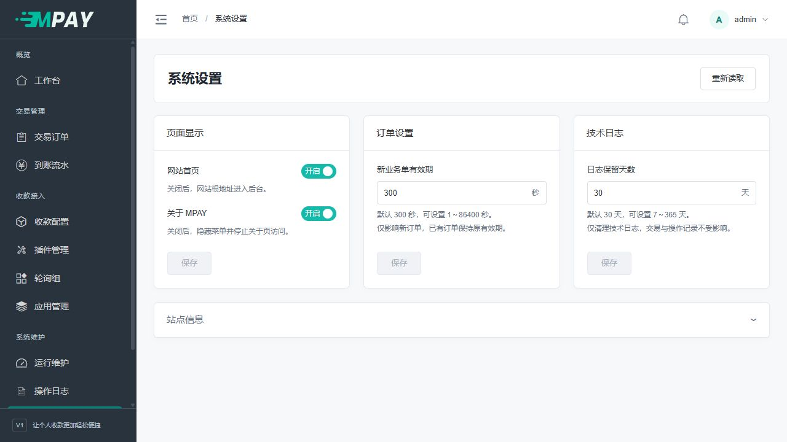
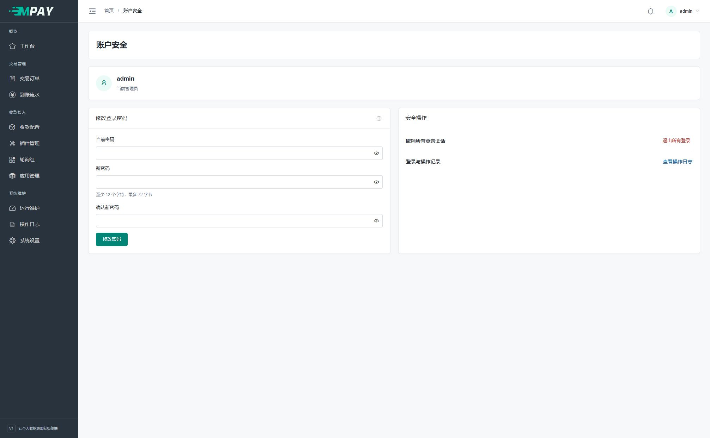

# 后台设置与日常检查

本篇用于开始收款后的日常管理。第一次安装可以保留系统默认值，不需要先把每个菜单都配置一遍。

## 1. 工作台先看什么

打开左侧“工作台”，选择统计日期和应用，点击“查询”。没有订单的新站显示 0 是正常现象；需要核对历史订单时先选对日期。

| 区域 | 用来做什么 |
| --- | --- |
| 成功订单金额 | 看业务网站订单原金额的合计 |
| 已确认实收 | 看核对到账的实际金额；金额识别模式下可能比原订单金额略高 |
| 创建订单数、创建订单成功率 | 看所选日期创建订单的数量和成功情况 |
| 待处理事项 | 查看仍需处理的订单或通知，点击对应入口继续查 |
| 后台任务 | 查看两个任务是否有近期活动，异常时打开“查看运行详情” |

金额和笔数旁的 ⓘ 可展开统计口径。付款日期与创建日期不是同一个概念，不要用不同口径的数字直接判断丢单；单笔核对以[订单详情](V1-09-订单与到账流水.md)为准。

工作台统一统计所选范围内的订单。从通道测试入口创建的付款同样计入所属应用的金额、实收和笔数，不按商品名称或入口排除。

## 2. 修改订单有效期或技术日志保留期

点击左侧“系统设置”。页面显示、订单设置和技术日志使用独立卡片、分别保存，改完哪一组就点击该卡片的“保存”。没有修改时保存按钮不可用；出现“有未保存的修改”表示当前输入尚未生效，改回原值会取消提示。

| 设置 | 第一次使用 | 想修改时怎么操作 |
| --- | --- | --- |
| 新业务单有效期 | 保留默认 300 秒，即 5 分钟 | 填写 1～86400 的整数，点击订单设置区域的“保存” |
| 日志保留天数 | 保留默认 30 天 | 填写 7～365 的整数，点击技术日志区域的“保存” |

**完成检查：** 出现“设置已保存”，重新进入页面后仍显示保存值。修改后仅影响后续行为，不会重新计算已有订单的到期时间。

业务单有效期限制整笔订单；通道插件里的付款有效期限制该次付款等待。实际截止时间以较早者为准。例如业务单还剩 2 分钟，即使插件填 5 分钟，付款窗口也不会延长到 5 分钟。修改插件有效期要到“收款配置 → 当前通道 → 配置”。

技术日志保留期由后台维护任务执行，**不会删除交易订单、到账流水、商户通知或操作日志**。不要为了减少数据库里的订单而修改这个设置。

页面提示“配置已变化”或保存结果不明时，先记下需要保留的输入，再点击“重新读取”，核对实际保存值后继续。“重新读取”会替换尚未保存的输入。

下方“站点信息”显示当前访问地址。MPAY 支持多个域名，不需要在这里绑定固定网址；迁移时按[域名迁移说明](V1-19-备份恢复与域名迁移.md)更新业务网站和设备保存的地址。

### 首页与关于页的显示

在“页面显示”区域设置两个开关，点击“保存”。新安装默认均开启，两项独立控制。

| 开关 | 开启时 | 关闭时 |
| --- | --- | --- |
| 网站首页 | 网站根地址展示项目介绍、使用文档与管理后台入口 | 根地址进入后台入口，未登录时进入登录页，已登录时进入工作台 |
| 关于 MPAY | 登录后可从侧栏“关于 MPAY”查看项目资料、作者联系方式与定制服务 | 隐藏该菜单，直接访问关于页也会返回资源不存在 |

两个页面全部关闭后，仍可从 `/admin` 进入后台，再到系统设置重新开启。尚未完成安装时，网站根地址优先引导安装；页面开关不改变安装保护或收款流程。

保存后当前页面的关于菜单同步更新，其他已打开页面在下次访问或刷新时使用新设置。作者联系方式和定制信息只在后台关于页展示，公开首页不展示。

首页中的收银台为静态界面示例，不对应真实订单，不能用于付款。实际付款请从业务网站创建订单后进入收银台。

## 3. 修改管理员密码

1. 点击右上角管理员名字，选择“账户安全”。
2. 在“当前密码”填写正在使用的 MPAY 登录密码。
3. 填写“新密码”和“确认新密码”，至少 12 个字符、最多 72 字节，并妥善保存。
4. 点击“修改密码”。成功后原有登录会话失效，使用新密码重新登录。

修改管理员密码不会替你更改业务网站使用的应用 KEY 或手机通知密钥。忘记管理员密码时，当前没有邮箱或短信找回入口，请联系服务器维护人员处理；不要通过重新安装覆盖原站点。

## 4. 退出登录与查看操作记录

在账户安全页点击“退出所有登录”，或在右上角账户菜单选择同名操作，确认后包括当前浏览器在内的所有管理员会话都会退出。它不停止网站收款和后台任务。

想核对配置是谁在什么时间修改的，点击“查看操作日志”或左侧“操作日志”，按时间等条件查询，再打开对应记录查看脱敏摘要。普通配置保存也有记录，但不要求填写操作原因；人工确认到账等特殊动作另需填写原因。

## 5. 日常只检查这几项

- 工作台是否有待处理事项；出现异常时查对应原订单。
- “运行维护”两个后台任务是否有近期活动；手机设备的通知权限和后台运行状态需在手机端查看。
- 订单中的“商户通知”是否已被业务网站确认；失败时先查响应，再按[通知处理](V1-10-商户通知与人工处理.md)操作。
- 修改通道插件参数后，是否已重新核对并启用该通道。
- 最近的完整备份是否包含程序、数据库、配置和收款图片，详见[备份恢复](V1-19-备份恢复与域名迁移.md)。

第一次完成安装与收款后，可收藏本页和[常见问题](V1-20-常见问题与运行排查.md)，无需每天重新配置应用或轮询组。
