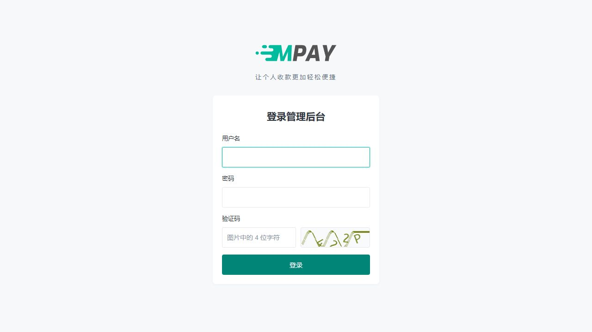

# 登录验证码与请求限流

MPAY 的后台登录需要图片验证码。关键接口使用程序内限流，无需另配 Nginx 限流、Redis 或新增守护命令。

## 登录验证码

验证码是登录页右侧图片中的字符，用于减少自动化登录尝试，不是短信验证码，也不是管理员密码。第一次使用可以按以下顺序操作：

1. 打开自己的 MPAY 后台登录页，输入安装时设置的用户名和密码。
2. 在“验证码”输入右侧当前图片的 4 位字符；看不清时点击图片更换。
3. 点击“登录”。若失败，按新图片重新输入验证码和密码；若提示等待，先等倒计时结束。
4. 进入管理工作台后表示本次登录成功，收款能力仍需按[第一笔收款](V1-04-完成第一笔收款.md)单独核对。

截图仅用于说明字段位置，请填写自己页面上的当前验证码。

在用户名、密码下方输入图片中的 4 位字母或数字，不区分大小写。点击图片可以更换；验证码有效期为 120 秒，刷新后原图失效。校验时会取出并删除当前验证码，失败后需要重新获取图片。

登录失败会刷新验证码并清空密码，用户名保留。看到等待提示时，请在倒计时结束后重试。原有“同一 IP 十分钟内累计十次密码登录失败”的保护继续生效；图片验证码不会清除这项限制。

验证码绑定当前浏览器会话。关闭 Cookie、频繁切换域名或在多个标签页同时刷新图片，可能导致当前图片失效。验证码显示“点击重试”时，可以点击图片区域重新加载。

后台采用官方 `topthink/think-captcha`。图片唯一公开入口为 `GET /adminapi/captcha`，不支持传入配置名称；组件默认的 `/captcha` 路由在公共入口被关闭。图片不缓存，浏览器只能取得图片，不会收到答案。登录服务用框架缓存保存带期限的摘要，验证时调用原生 `pull()` 读取并删除，再交给官方组件校验；服务返回图片字节，Controller 设置 HTTP 图片响应。系统不额外加锁，不保证多个同时到达的请求只能有一个取得摘要；账号密码验证、会话绑定和原有登录失败限制仍然生效。

## 请求频率

规则集中在 `config/throttle.php`，采用 `topthink/think-throttle` 官方滑动窗口和 ThinkPHP 原生 File 缓存。限流用于常规防刷，允许并发时少量计数偏差，不承诺精确到每一次请求。以下为默认值，不是服务器容量承诺。前端按钮禁用只改善交互，真正的限制由服务端执行。

| 规则 | 身份及用途 | 频率 |
| --- | --- | --- |
| captcha | IP，获取验证码 | 20 次/分钟 |
| login | IP，提交登录 | 10 次/分钟 |
| admin_ip | IP，后台页面和 API 入口 | 600 次/分钟 |
| admin_read | 已认证管理员，普通查询 | 300 次/分钟 |
| admin_write | 已认证管理员，普通写操作 | 60 次/分钟 |
| admin_sensitive | 管理员＋操作类别，改密、KEY 查看/重置、人工确认、重新通知 | 10 次/分钟 |
| admin_expensive | 管理员＋操作类别，导出、环境诊断、刷新插件目录 | 5 次/分钟 |
| epay_ip | IP，易支付入口 | 600 次/分钟 |
| epay_create | 已认证应用，submit.php 与 mapi.php 共用 | 120 次/分钟 |
| epay_query | 已认证应用，易支付查询 | 300 次/分钟 |
| epay_refund | 已认证应用，退款申请 | 10 次/分钟 |
| cashier_ip | IP，收银台页面与 API | 600 次/分钟 |
| cashier_read | 已验证订单，详情、状态和商户确认查询共用 | 60 次/分钟 |
| cashier_write | 已验证订单，选路和准备支付共用 | 10 次/分钟 |
| channel_notify | IP，设备到账通知，独立额度 | 300 次/分钟 |
| install | IP，安装数据库检查和执行安装共用 | 5 次/分钟 |

后台敏感和较重操作同时受普通查询/写入额度约束。不同域名访问同一站点共用计数。来源 IP 取服务器的 `REMOTE_ADDR`，不直接信任请求中的转发头；反向代理后的真实来源应由现有 Web 服务配置提供。同一出口的多个设备或业务网站会共用 IP 入口额度，调整时应结合正常峰值。

修改频率时使用组件格式，例如 `120/m`、`30/60`。本项目限定单规则最多 1000 次、窗口最长 3600 秒，限制单个身份的计数记录大小；还需考虑收银台正常每 2～3 秒一次查询及并行标签页。配置不是后台可编辑业务数据，更新后常驻进程需按常规部署方式重启读取配置。

## 接口响应与重试

超限返回 HTTP `429` 和 `Retry-After` 秒数。后台及收银台沿用 `code/message/data/request_id`，应用码为 `42900`，`data.retry_after` 给出等待秒数；易支付 `/mapi.php` 返回 `code=0/msg`，查询/退款共用的 `/api.php` 返回 `code=-1/msg`，避免限流被误认为退款成功；页面入口显示错误页面。

后台保留表单内容，不自动重新提交保存操作。收银台延后下一次查询，不把受限请求判定为支付失败。设备通知超限不会返回接收成功，发送端应按其能力重试，并满足插件原有签名及时间窗要求。插件正常应答仍按[设备监听合同](V1-12-支付宝手机监听.md)执行。

组件报告缓存读写故障时返回 HTTP `503`。缓存缺失、过期按官方驱动语义处理，计数可重新开始；没有有效验证码则拒绝登录。保护层明确拒绝、尚未执行业务的响应包含 `X-Request-Rejected: 1`；这个标记不表示一般网络中断或其他 5xx 可以安全重投。其他交易结果未知场景仍先核对原订单。

## 存储和清理

`config/cache.php` 定义独立的 `access` 缓存，驱动直接使用官方 `File`。Linux 检查 `/dev/shm` 已挂载为 tmpfs 且可写时，使用 `/dev/shm/mpay-站点标识/access/`；Windows、没有可用 tmpfs 或受到 `open_basedir` 等限制时，使用 `runtime/access/`。回退目录与默认的 `runtime/cache/` 同级，清空普通缓存不会连带清空限流和验证码。程序不另建缓存驱动，文件读写、序列化和 TTL 均由框架负责。

默认连接仍为 `file`。容器注入和门面调用均通过 `store('access')` 取得短期缓存连接，通过 `store('receipt')` 取得插件状态连接；取得连接不会修改全局默认值，也无需用完后切回。读写同一数据时必须使用同一个连接。

不自动挂载 tmpfs，不需要管理员权限。tmpfs 可能使用系统交换空间，因此不能理解为绝对没有磁盘读写。站点标识来自项目路径，不来自域名；多个 PHP 进程共用目录，不同安装目录相互隔离。

目录由配置加载时的环境决定，不保存选择标记，不在一次请求的读写失败后切换到另一处。Web PHP 与后台守护应使用同一个站点运行用户、一致的文件系统视图和目录访问配置；部署方式见[后台任务](V1-18-部署与后台任务.md)。更换挂载、PHP 配置或运行环境后，应统一重启相关进程。目录切换可能重新开始短期计数，不修改业务数据。

这里只保存请求计数、汇总信息和短期验证码摘要，不保存验证码明文，不迁移交易、日志或插件登录状态。tmpfs 重启后数据丢失可重新建立；登录失败审计仍保留在数据库。

限流和验证码直接调用官方缓存 API，不增加跨请求锁、文件数量配额或缓存内容格式检查。并发计数、受限次数汇总和验证码取出删除遵循原生组件语义，不能用于金额、订单幂等或严格业务配额。交易数据的数据库锁、唯一约束及持久化规则不受影响。

官方 File 在读取时处理过期缓存；长期不再读取的旧文件，由 `RuntimePruneService` 通过 `payment:work` 每分钟以小预算补充清理。维护只删除修改时间已超过最大有效期加一分钟的缓存文件，不解析文件头、不删除目录。默认最长期限为一小时，验证码配置更长时采用更长值；不新增第三个守护入口。清理失败不会停止原有商户通知任务。

技术日志中的 `request.rate_limited` 按规则约每分钟输出一次阶段汇总，并发时允许偏差，不记录密码、KEY、验证码、订单令牌或完整请求。已经确定超限后，辅助汇总失败不改变本次 429 拒绝。`request.rate_storage_unavailable` 表示短期存储异常，HTTP 与后台维护通过原有 runtime 文件缓存抑制重复诊断，应检查 PHP 运行用户、目录权限和存储是否仍可用。

## 开发接入位置

| 位置 | 职责 |
| --- | --- |
| `app/http/middleware/RateLimitMiddleware.php` | 路由声明规则，取连接 IP 或已经核验的管理员身份 |
| `app/service/system/access/RequestRateLimiter.php` | 调用官方算法，统一配置和受限事件汇总 |
| `config/cache.php` | 原生 `access` File 缓存及 tmpfs/runtime 目录选择 |
| `app/service/system/runtime/RuntimePruneService.php` | 通过现有维护入口回收超过最大有效期的缓存文件 |
| `app/service/system/access/LoginCaptchaService.php` | 官方验证码生成/校验、两分钟期限及原生缓存取出删除 |
| `app/service/payment/epay/EpayV1ProtocolService.php` | 验签或 KEY 认证成功后检查应用额度 |
| `app/service/payment/cashier/CashierService.php` | 公开查询核验凭证并检查额度，写操作通过内部派发与展示流程返回结果，不暴露跳过限流参数 |
| `app/ExceptionHandle.php` | 将限流及存储故障转换为各入口协议响应 |

未认证的 PID、通道编号或订单号不得直接用作受害方的额度键。接口入站限流不替代认证、CSRF、载荷限制、签名、订单幂等或管理员操作审计；`payment:watch` 内部采集与 `payment:work` 发出的商户通知不受入站额度限制。
