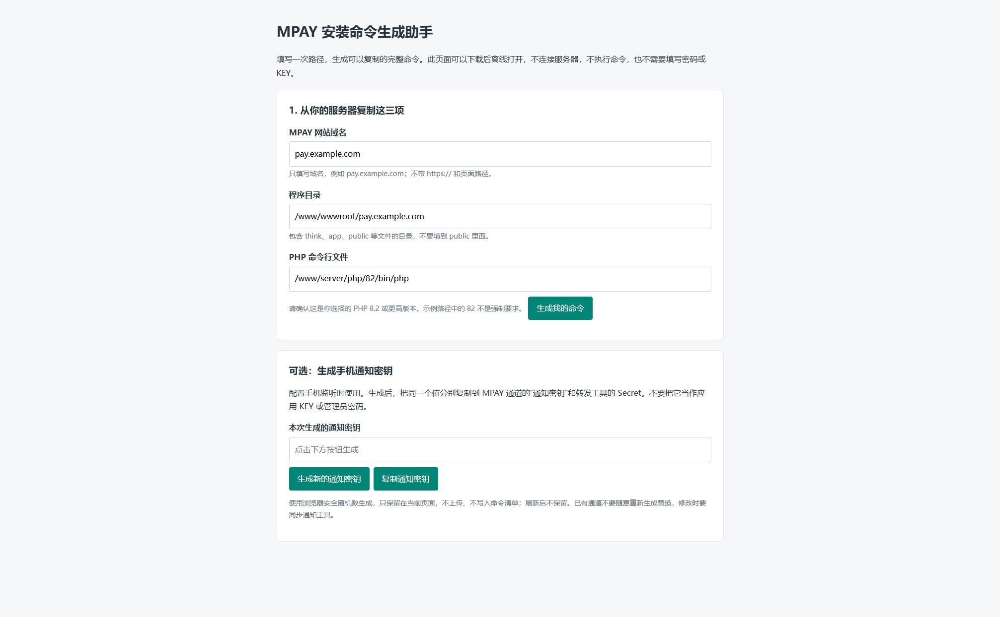

# 不手写命令：填写路径后复制

这个助手把你填写的网站资料转换为完整命令。它不会执行命令，不读取密码，也不需要安装额外软件。

## 1. 保存并打开助手

打开[安装命令生成助手](examples/setup-helper.html)。如果在线显示的是 HTML 源码，将文件保存为 `setup-helper.html`，再用浏览器打开本机文件。

完整源码包中也可以直接打开 `docs/wiki/examples/setup-helper.html`，不需要联网。

## 2. 填写三项信息

| 字段 | 怎么取得 | 举例 |
| --- | --- | --- |
| MPAY 网站域名 | 从网站设置复制，去掉协议和路径 | `pay.example.com` |
| 程序目录 | 从面板文件管理复制含有 think 文件的完整目录 | `/www/wwwroot/pay.example.com` |
| PHP 命令行文件 | 复制实际选用版本的 PHP 可执行文件路径 | `/www/server/php/82/bin/php` |

PHP 路径里的 82 是示例，不要求所有服务器都使用同一路径。程序目录不要填写为 public 目录；助手会拦截这种常见错误。

点击“生成我的命令”。每一段都有用途和“复制”按钮；浏览器未允许访问剪贴板时，按钮会选中内容，再按 Ctrl+C 即可。

## 3. 先检查 PHP

复制“检查命令行 PHP”，粘贴到服务器终端并执行。输出第一行应是实际 PHP 版本，最低为 PHP 8.2，并满足本版锁定依赖。

若显示“文件不存在”或“找不到命令”，回到 PHP 安装位置重新复制路径，不要继续配置后台任务。

## 4. 添加两个后台任务

网页安装完成后再做这一步。打开所用进程守护工具的新增任务页面：

| 表单项目 | 第一个任务 | 第二个任务 |
| --- | --- | --- |
| 名称 | MPAY 流水采集 | MPAY 通知与维护 |
| 启动命令 | 复制助手生成的“任务一” | 复制助手生成的“任务二” |
| 运行／工作目录 | 复制助手生成的程序目录 | 与第一个相同 |
| 进程数量 | 1 | 1 |
| 退出后自动重启 | 开启，包括正常退出 | 开启，包括正常退出 |

不要把两个命令放在同一个任务，也不要重复添加同一个任务。具体 Supervisor/systemd 配置见[后台任务指南](V1-18-部署与后台任务.md)。

**完成后检查：** 两个任务都在运行；MPAY 后台“运行维护”能看到对应近期活动。只有程序启动日志还不足以证明实际收款成功，收款验证继续按[第一笔收款](V1-04-完成第一笔收款.md)进行。

## 5. 下载自己的命令清单

点击“下载我的命令清单”，得到 `mpay-commands.txt`。文件内保留了生成时的域名与路径，换服务器、换目录或换 PHP 后应重新生成。

清单不含数据库密码和 KEY，不会替你更改网站或守护配置。每次只复制正在进行的那一步，不要把整份清单直接粘贴到终端。

## 手机插件的通知密钥怎么生成

1. 在助手下方找到“生成手机通知密钥”。
2. 点击“生成新的通知密钥”，再点击“复制通知密钥”。
3. 粘贴到 MPAY 当前通道的“通知密钥”。
4. 把同一个值粘贴到手机转发工具的 Secret。

密钥不会上传或写进命令清单，刷新页面后不保留。完成两处配置后妥善保存；不要重新生成一次分别填到两处，否则验签会失败。该值与业务网站使用的应用 KEY 是两回事。
