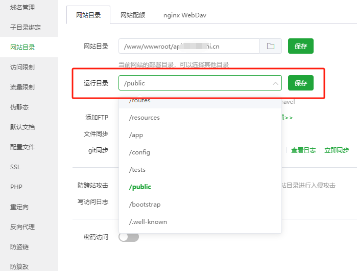
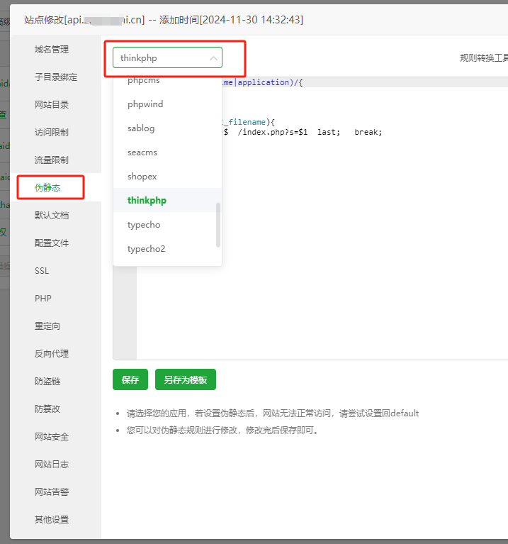

# 宝塔部署：建站、运行目录与伪静态

从已经登录宝塔面板开始，按顺序完成：**建 PHP 站点 → 上传解压 → 运行目录选 `/public` → 设置伪静态 → 网页安装 → 添加两个后台任务**。

本文适用于 MPAY V1 的 ThinkPHP 重构版，以下伪静态使用 Nginx。V1 通过宝塔选择的 PHP 运行；V2 的纯静态站点、Webman 启动命令和 8787 反向代理配置不适用于本页。宝塔、MPAY 和业务网站是三个独立入口，各自使用自己的账号。

## 1. 准备环境和程序

在宝塔“软件商店 → 已安装”确认以下环境可用：

| 项目 | 本版要求 |
| --- | --- |
| Web 服务 | 本教程使用 Nginx；Apache 说明见下方伪静态章节 |
| PHP | 64 位 PHP 8.2 及以上，不限定补丁版本 |
| MySQL | 5.7.9 及以上；5.7.44 满足要求 |
| 程序 | 明确对应本版的纯净安装包，或 `v1` 分支源码 |
| 域名 | 指向网站服务器，例如 `pay.example.com` |

PHP 扩展与依赖详见[环境要求](V1-03-安装与环境要求.md#环境要求)。纯净安装包带生产 vendor，服务器无需执行 Composer；源码包需要按[依赖准备](V1-03-安装与环境要求.md#源码部署的依赖准备)安装。不要把旧版或 V2 的文件覆盖进本版。

本页统一用 `/www/wwwroot/pay.example.com` 举例。你只需把它换成宝塔里实际创建的目录，不要求域名和示例一致。

## 2. 新建 PHP 网站和数据库

点击 **网站 → PHP 项目 → 添加站点 → 传统项目**。部分面板版本直接显示“添加站点”，填写内容相同：

| 表单项 | 怎么填写 |
| --- | --- |
| 域名 | MPAY 的域名，例如 `pay.example.com`，不带 `https://` 或 `/install` |
| 根目录 | 使用 MPAY 独立目录，例如 `/www/wwwroot/pay.example.com` |
| FTP | 通过宝塔文件管理上传时，可选择“不创建” |
| 数据库 | 选择 MySQL，同时创建 MPAY 专用空库；字符集选 utf8mb4 |
| 数据库账号、密码 | 使用本次生成或设置的值，保存好，稍后从面板复制到安装页 |
| PHP 版本 | 选择已经安装的 PHP 8.2 或更高版本，例如面板中的 `PHP-82`；不要选“纯静态” |

点击“确定”。网站列表应出现该域名，“数据库 → MySQL”中也应出现新库。比如商城使用 `shop.example.com`，MPAY 可单独使用 `pay.example.com`，二者目录和数据库分别创建。

如果建站时选择了“不创建数据库”，稍后到“数据库 → MySQL → 添加数据库”创建即可，不要重复创建已有的 MPAY 空库。面板入口可对照[宝塔创建站点说明](https://docs.bt.cn/getting-started/create-web/)。

## 3. 上传并正确解压

1. 返回“网站 → PHP 项目”，点击 MPAY 这一行的根目录，进入文件管理器。
2. 点击“上传”，选中程序压缩包；上传完成后对该压缩包执行“解压”。
3. 打开解压后的目录，找到 `think` 文件。它应与 `app`、`config`、`public` 在同一级。
4. 若多套了一层 `mpay` 或分支名称的文件夹，可把其中的**全部文件和目录（含隐藏文件）**移动到刚创建的独立站点根目录；也可在下一步把“网站目录”改到实际包含 `think` 的目录。两种做法选一种，不要漏掉隐藏文件或重复套目录。
5. 确认 `vendor/autoload.php` 存在；源码包缺失依赖时先完成第 1 步链接中的依赖准备。

最终应类似：

```text
/www/wwwroot/pay.example.com/     ← 程序目录，也是宝塔“网站目录”
├── app/
├── config/
├── public/                      ← 宝塔“运行目录”选 /public
│   ├── index.php
│   ├── .htaccess
│   └── assets/
├── runtime/
├── vendor/
│   └── autoload.php
├── composer.json
├── composer.lock
└── think
```

如果看到 `pay.example.com/mpay/public`，说明实际程序目录仍在 `mpay` 那层；不要把站点指向不存在的 `pay.example.com/public`。不同版本不要叠加解压，也不要从别的项目复制 vendor。

## 4. 把运行目录指向 public

1. 返回网站列表，点击 **MPAY 域名 → 网站目录**。
2. 核对“网站目录”：必须是上一步包含 `think` 的程序目录；有修改先点击这一项右侧的“保存”。
3. 在下方“运行目录”下拉框选择 **`/public`**。
4. 点击“运行目录”右侧的 **保存**；重新打开这一页，确认仍显示 `/public`。



图为宝塔入口示意；截图中的域名和其他目录来自参考项目，只需看红框的 `/public` 和保存位置。

| 名称 | 示例值 | 用途 |
| --- | --- | --- |
| 网站目录 / 程序目录 | `/www/wwwroot/pay.example.com` | 存放整个程序 |
| 运行目录下拉框 | `/public` | 选择程序内的公开入口目录 |
| 实际 Web 根目录 | `/www/wwwroot/pay.example.com/public` | 浏览器能够访问的目录 |

网站地址仍然是 `https://pay.example.com`，**不需要在网址中增加 `/public`**，安装地址也不是 `/public/install`。不要把“网站目录”和“运行目录”都重复加上 public，形成 `public/public`。相关概念见[宝塔网站目录说明](https://docs.bt.cn/user-guide/site/php/site-config/website-directory/)。

## 5. 配置伪静态

伪静态把 `/install`、`/admin/login` 等访问路径交给程序入口处理，不会另外生成这些文件。

### 宝塔 Nginx：填写本版规则

1. 仍在该站点设置中，点击左侧 **伪静态**。
2. 用下方本版规则**整体替换**编辑框里的旧内容。
3. 点击 **保存**，确认面板检查通过并使配置生效。



图只用于定位菜单和编辑框。不同版本的 `thinkphp` 预置模板可能不同；即使已经选择过模板，也应使用下方规则替换，不能仅凭模板名称确认配置正确。

### 可直接复制的规则

把“伪静态”编辑框中的旧规则替换成下面这段，然后保存；**不要包裹 `location / { ... }`，不要与另一套规则重复叠加，也不要粘贴完整的 `server { ... }` 配置**。

```nginx
if (!-e $request_filename) {
    rewrite ^(.*)$ /index.php?s=$1 last;
}
```

也可下载[宝塔 Nginx 伪静态片段](examples/baota-nginx-rewrite.conf.example)。以上片段用于宝塔站点的 server 上下文，由面板保留当前 PHP-FPM、域名和证书配置，不需要手填 PHP socket 或新增反向代理。

这段重写必须在 server 层执行，使虚拟 `.php` 路径先转入 `index.php`。若包裹在 `location /` 中，请求可能先匹配面板的 PHP 正则 location，因磁盘上没有对应文件而返回 Nginx 404；不需要额外添加 `break`。

保留站点主配置中的敏感文件和 `runtime` 等敏感目录保护，不必为业务接口放行这些目录，也不必在伪静态框里重复添加保护规则。当前运行维护入口为 `/admin/maintenance` 和 `/adminapi/maintenance`，没有 `/runtime` 业务接口。

规则为不存在的文件或目录转入 `index.php`，并通过 `s` 传入原访问路径；原查询参数会继续保留。**`/submit.php`、`/mapi.php`、`/api.php` 也是程序路由，没有对应磁盘文件，同样由这段规则交给入口。** 不要创建同名空 PHP 文件，也不要把规则末尾改成丢弃原参数的形式。改写语义可查 [Nginx rewrite 文档](https://nginx.org/en/docs/http/ngx_http_rewrite_module.html#rewrite)。

### 保存报错或使用其他 Web 服务

- 提示 `duplicate location` 或其他配置冲突：检查是否把完整站点模板和另一套伪静态同时粘贴了；保留本站需要的一套规则，再保存。
- 本页片段是 Nginx 语法。使用 Apache 时保留程序的 `public/.htaccess`，启用 rewrite 和对应目录的 AllowOverride，不粘贴 Nginx 规则。
- 从[部署指南](V1-18-部署与后台任务.md#web-服务器)下载的完整 Nginx 配置用于独立配置站点，不是宝塔伪静态输入框的内容。面板入口说明见[宝塔伪静态文档](https://docs.bt.cn/user-guide/site/php/site-config/pseudo-static/)。

## 6. 找到安装需要的数据库资料

打开“数据库 → MySQL”，找到第 2 步创建的 MPAY 空库，复制而不是手抄：

| 安装页字段 | 在哪里取得 |
| --- | --- |
| 数据库地址 | 同机通常填 `127.0.0.1`；分机填数据库服务器的实际地址 |
| 端口 | MySQL 实际端口，常见为 `3306` |
| 数据库名 | 宝塔数据库列表中的名称 |
| 数据库用户名 | 该库对应的用户，通常与库名相似，但应逐项核对 |
| 数据库密码 | 在该库密码项显示并复制，非宝塔密码，也非 MPAY 管理员密码 |

数据库应为空，不先手工导入 SQL。远程数据库需允许网站服务器连接；不要选商城、博客或其他应用正在使用的库。字段入口见[宝塔添加 MySQL 数据库说明](https://docs.bt.cn/user-guide/database/mysql/add)。

## 7. 打开网页安装程序

先确认自己的 HTTP 或 HTTPS 地址可访问。使用 HTTPS 时，在该站点“SSL”配置与域名相符的证书；具体申请入口见[宝塔 HTTPS 指南](https://docs.bt.cn/landing/getting-started/)。

然后把站点地址末尾加上 `/install`。例如：

```text
https://pay.example.com/install
```

若本站使用 HTTP，就用 `http://pay.example.com/install`。按[网页安装四步及配图](V1-03-安装与环境要求.md)完成：

1. 环境检查：根据页面提示处理 PHP 扩展、依赖和目录权限。
2. 连接数据库：填写上一步的独立空库资料。
3. 初始化系统：设置自己的 MPAY 管理员账号和密码并安装。
4. 完成安装：点击进入后台，使用刚设置的管理员登录。

PHP 运行账号需要写入 `runtime/`、`public/storage/`；安装期间还需写项目根目录以保存配置，完成后按[安装说明](V1-03-安装与环境要求.md)收紧权限。恢复已有站点应走[备份恢复](V1-19-备份恢复与域名迁移.md)，不要重新安装或清空原库。

## 8. 添加两个后台任务

在宝塔的软件商店安装或打开可用的进程守护工具，按[后台任务图文](V1-18-部署与后台任务.md#用进程守护工具添加任务)建立两个任务，**启动用户均选择 `www`（默认是 root 时请改为 www）**，与网站 PHP 的运行用户一致；每个任务只填一条命令，进程数量设为 `1`。

如果本站安装的是 PHP 8.2，且程序目录正好是上文示例，命令分别为：

```sh
/www/server/php/82/bin/php /www/wwwroot/pay.example.com/think payment:watch
```

```sh
/www/server/php/82/bin/php /www/wwwroot/pay.example.com/think payment:work
```

其他 PHP 版本使用面板里的实际可执行文件路径；工作目录设置为包含 `think` 的程序目录。`watch` 负责账单/码牌采集，`work` 负责商户通知和订单维护。默认持续运行，守护工具配置退出后自动重启；无需再加每分钟重复启动的计划任务。

## 9. 完成后怎样确认

| 打开什么 / 做什么 | 应看到什么 |
| --- | --- |
| 安装前打开 `/install` | MPAY 安装向导，而非 Nginx 404、默认欢迎页或 PHP 文件下载 |
| 安装完成后打开 `/admin/login` | MPAY 管理员登录页 |
| 安装完成后不带参数访问 `/api.php` | MPAY 的接口参数或认证提示；没有凭证时不能期待支付成功，但不应是 Nginx 文件不存在 |
| 后台打开“运行维护” | 两个任务按部署配置运行；心跳不等同于真实平台收款已验证 |
| 配置通道后走[第一笔收款](V1-04-完成第一笔收款.md) | 核对实际到账、MPAY 原订单和业务网站结果 |

常见问题可按现象直接定位：

| 现象 | 先检查 |
| --- | --- |
| 下拉框没有 `/public` | 上传是否完成、解压是否多套目录、网站目录是否指向包含 think 的那一层 |
| 仍显示宝塔欢迎页 | 是否访问了正确站点，运行目录是否保存为 `/public` |
| 首页能打开，后台或安装页 404 | 伪静态是否保存到当前站点；不要只检查首页 |
| 后台能打开，`submit.php` 返回 Nginx 404 | 是否误用包含 `location /` 的模板；用本页 server 层片段整体替换并保存 |
| `/install` 正常，但易支付 `.php` 入口 404 | 是否用了只覆盖部分路径的自定义规则，或创建了不应存在的同名文件；核对第 5 步完整片段 |
| 页面空白、500 或 PHP 文件被下载 | 网站 PHP 版本、PHP 服务是否正常、vendor 是否完整；从本站错误日志定位 |
| 提示 `open_basedir restriction` | 检查“网站目录”的防跨站设置是否允许整个程序目录，不能仅允许 public 而阻止读取上级 app/vendor |
| 网站正常但通知不重试 | 检查 `payment:work` 的守护状态、PHP 路径和运行账号权限 |
| 改成 www 后任务无法启动或反复退出 | 先停止两个任务；删除 runtime/workers、runtime/receipt，或把两目录及子文件所有者改为 www，再启动。[具体点击步骤](V1-18-部署与后台任务.md#已经用-root-启动过如何改为-www) |

排障时保留数据库和安装进度，不通过删除安装锁或清空业务表来解决目录、路由问题。
